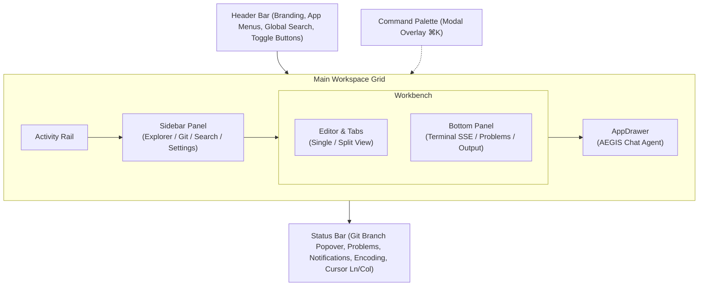

# AEGISCODE: Arsitektur & Blueprint Wireframe Frontend

> **Objective**: IDE Lightweight, Local Server  
> **Arsitektur**: Microservice (Local Runner / SSE / LSP)  
> **Prinsip Utama**: DONT Over Engineering  

---

## 1. Aturan & Batasan (Core Constraints)

### Constrain Frontend
1. **Reuse token color tailwind**: Semua styling warna wajib merujuk pada token tema yang telah didefinisikan di `@theme` Tailwind CSS v4 (`bg-canvas`, `bg-surface`, `text-ink`, `border-line`, dsb.). Tidak menggunakan arbitrary hardcoded hex color di elemen UI.
2. **Reuse Component design**: Komponen UI dasar (Icon, IconButton, Tab, Popover, Input, Toast) harus berada di `components/ui/` dan dipakai ulang di seluruh modul layout tanpa menduplikasi elemen primitif.
3. **Lightweight & Modular**: Pecah antarmuka menjadi komponen terisolasi per area layout tanpa dependensi state library yang berat (cukup React Context + Custom Hook).

### Constrain Backend
1. **DO NOT Try catch Silent**: Jika error terjadi, harus memutus fungsi (break the function) dan memicu penanganan yang jelas.
2. **DO NOT Add Spaghetti try catch**: 1 fungsi cukup memiliki 1 alur validasi yang benar tanpa tumpukan try-catch bersarang.
3. **DO NOT Add const jika tidak diperlukan**: Cek kemungkinan mutasi state dan minimalisasi konstanta redundan.

---

## 2. Struktur Arsitektur Frontend (`src/`)

Arsitektur direktori frontend direstrukturisasi dari komponen monolitik menjadi struktur modular berbasis area layout dan shared UI kit:

```text
src/
├── components/
│   ├── layout/            # 5 Area Kolom Layout Wireframe IDE
│   │   ├── Header.tsx         # Window controls, Branding, Menu bar, Global search trigger, Layout toggles
│   │   ├── ActivityRail.tsx   # Bar navigasi sisi kiri (Explorer, Search, Git, Settings)
│   │   ├── Sidebar.tsx        # Panel dinamis: Explorer tree, Regex Search, Git control, Settings
│   │   ├── Editor.tsx         # Tab bar, Breadcrumbs, Code pane, Multi-window/Split editor
│   │   ├── BottomPanel.tsx    # Terminal SSE mock, Problems/Linting diagnostics, Output logs
│   │   ├── ChatDrawer.tsx     # AppDrawer: AEGIS Workspace Agent chatbot & prompt composer
│   │   ├── StatusBar.tsx      # Info baris/kolom, Git branch, Problems badge, Notifications popover
│   │   └── CommandPalette.tsx # Modal launcher perintah cepat (⌘K)
│   └── ui/                # Reusable UI Primitives Kit
│       ├── Icon.tsx           # SVG icon registry terpusat (aegis, file, folder, git, dsb.)
│       ├── IconButton.tsx     # Tombol aksi berbasis icon dengan tooltip & active state
│       └── Toast.tsx          # Notifikasi aksi pengguna
├── context/
│   └── WorkbenchContext.tsx   # React Context & useWorkbench Hook (state wireframe interaktif)
├── data/
│   └── mockData.ts            # Data awal file tree, diagnostic lints, terminal logs, git changes
├── types/
│   └── workbench.ts           # Type definitions untuk file item, tab, terminal, lint diagnostic
├── index.css                  # Token @theme Tailwind v4 & utilitas layout grid
├── main.tsx                   # Root entry point
└── App.tsx                    # Komposisi Shell IDE & Provider Context
```

---

## 3. Hierarki & Kolom Layout Wireframe

Layout IDE AegisCode mengadopsi 5 zona kolom/baris modular:



### Rincian 5 Kolom / Area:
1. **Header Bar**:
   - macOS Traffic Lights (Window controls).
   - Branding AegisCode.
   - Menu bar interaktif (File, Edit, View, Run, Terminal) dengan keyboard shortcut.
   - Quick Command Launcher button (`⌘ K`).
   - Action toggle: Toggle Bottom Panel (`Ctrl+J`), Toggle Primary Sidebar (`Ctrl+B`), Toggle AEGIS Chat.
2. **Activity Rail & Sidebar (Left Columns)**:
   - **Activity Rail**: Ikon switcher untuk Explorer, Search, Source Control (Git), dan Settings.
   - **Explorer**: File tree hierarkis dengan status aktif/muted, icon folder/file, expandable section (Outline, Timeline).
   - **Search & Replace**: Regex-ready input filter untuk repositori aktif dengan file include pattern.
   - **Source Control**: Branch info, commit message composer, status perubahan staging (M/A/D), dan sync action.
   - **Settings**: Pengaturan konfigurasi editor (Auto Save, Minimap, Tab Size).
3. **Workbench (Center Column)**:
   - **Tabs Header**: Multi-tab switcher dengan tombol run file, split editor toggle, dan penutup tab.
   - **Breadcrumbs**: Path visual file aktif (`src > App.tsx > LocalServer`) dan profile bahasa pemrograman (TypeScript, Python, C++, dsb.).
   - **Editor Panes**: Editor single pane atau multi-pane/split horizontal, minimap code overview, serta diagnostic highlight dot (warning/error).
   - **Bottom Panel**: Panel drawer bawah dengan tab *Terminal* (simulasi native runner zsh/bash dengan shortcut terminate & clear), *Problems* (daftar error & warning syntax), dan *Output* (lint adapter log).
4. **AppDrawer (Right Column)**:
   - Panel chatbot AEGIS Agent yang terhubung dengan konteks workspace lokal.
   - History pesan AI & user, suggestion prompt ("Explain this file", "Fix 2 problems"), serta context badge.
5. **Status Bar (Bottom Row)**:
   - Info branch Git aktif (dengan popover switcher branch lokal).
   - Indikator masalah syntax (error/warning popover).
   - Indikator cursor posisi (Ln, Col), indentasi spasi, encoding file (UTF-8), bahasa aktif.
   - Notification center popover dengan unread counter badge.

---

## 4. Design System & Token Reusability (Tailwind CSS v4)

Semua komponen wajib mengonsumsi semantic token warna yang dideklarasikan di `src/index.css`:

| Token CSS | Variabel Tailwind Class | Deskripsi Penggunaan |
| :--- | :--- | :--- |
| `--color-canvas` | `bg-canvas`, `border-canvas` | Latar belakang kanvas terluar IDE (`#090d14`) |
| `--color-surface` | `bg-surface` | Background panel utama, header, dan bottom bar |
| `--color-surface-raised`| `bg-surface-raised` | Background kartu, input, tab aktif, dan dropdown |
| `--color-surface-hover` | `hover:bg-surface-hover` | Efek hover item list, file tree row, dan tombol |
| `--color-line` | `border-line` | Garis pemisah antar kolom dan border tipis |
| `--color-line-bright` | `border-line-bright` | Border aktif, divider popover, garis pemisah kontras |
| `--color-ink` | `text-ink` | Teks utama (`#e7edf7`) |
| `--color-ink-soft` | `text-ink-soft` | Teks sekunder, label, keterangan path |
| `--color-ink-muted` | `text-ink-muted` | Teks placeholder, shortcut kbd, file muted |
| `--color-accent` | `text-accent`, `bg-accent` | Aksen biru Aegis (`#79b8ff`), focus ring, tombol aksi |
| `--color-accent-soft` | `bg-accent-soft` | Background elemen aktif terpilih |
| `--color-green` | `text-green`, `bg-green` | Indikator sukses, status dot aktif, syntax string |
| `--color-orange` | `text-orange` | Peringatan diagnostic, badge angka |
| `--color-red` | `text-red` | Diagnostic error syntax, status terminate |
| `--color-blue` / `--color-pink` / `--color-cyan` | `syntax-*` | Syntax highlighting editor code |

---

## 5. State Management & Mock Interaction Layer

State dikelola secara terpusat melalui `WorkbenchContext` menggunakan standard React Context dan custom hook `useWorkbench()`:

- **Layout State**: `sidebarOpen`, `panelOpen`, `chatOpen`, `commandPaletteOpen`, `splitEditorOpen`.
- **Navigation State**: `activeActivity` ('Explorer' | 'Search' | 'Source Control' | 'Settings'), `activeTab`, `openTabs`.
- **Workspace Data**: `fileTree`, `activeFileContent`, `gitBranch`, `gitChanges`, `notifications`, `diagnostics`.
- **Terminal State**: `terminalLogs`, `terminalRunning`, `sendTerminalCommand(cmd)`, `clearTerminal()`.
- **Agent Chat State**: `chatMessages`, `sendChatMessage(text)`.
- **Toast Feedback**: `showToast(message)` untuk konfirmasi interaksi pengguna.

---

## 6. Roadmap Pengembangan Wireframe Frontend (5 Phase)

### Phase 1: Layout Kolom & Shell Componentization (Selesai pada restrukturisasi ini)
- Pemisahan `App.tsx` menjadi `components/layout/` (Header, ActivityRail, Sidebar, Editor, BottomPanel, ChatDrawer, StatusBar, CommandPalette).
- Reusable UI kit di `components/ui/` (Icon registry, IconButton, Toast).
- Konfigurasi `WorkbenchContext` untuk seluruh interaksi navigasi wireframe.
- Menjamin kepatuhan terhadap Tailwind theme tokens dan zero arbitrary colors.

### Phase 2: Workbench & Code Editor Interactivity
- Mock Monaco Editor / CodeMirror integration preview.
- Syntax highlighting per bahasa pemrograman (TypeScript, Python, C++, JSON, Markdown).
- Multi-window split editor horizontal/vertikal.
- Diagnostic lint markers (garis bawah merah/kuning) yang terhubung ke panel Problems.
- Panel terminal mock dengan penanganan runner shortcut (`Ctrl+C`, `Enter`, `clear`, `lint`).

### Phase 3: Explorer & Workspace Tools
- Mock CRUD file tree (buat file/folder, rename, hapus).
- Context menu klik kanan (Copy Path, Relative Path, Delete).
- Regex search and replace interaktif di file mock.
- Git control UI: staging area, commit input dengan validasi, branch visual graph.
- Settings modal overlay dengan filter pencarian instan.

### Phase 4: Status Bar & Diagnostics System
- Filter masalah (Problems) per severity (Error, Warning, Info).
- Git branch checkout popover switcher.
- Notification management center (mark all as read, dismissal).

### Phase 5: AppDrawer (Agentic Aegis Chat & Olympus)
- Streaming response mockup untuk agent chat.
- Mekanisme file-editing preview (diff view) yang disarankan oleh agent.
- Quick action pills untuk lint fix dan code explanation.

---

## 7. Standar Integrasi Menuju Local Server (Microservice Readiness)

Meskipun saat ini fokus pada wireframe frontend, antarmuka dirancang agar transisi ke microservice backend berjalan mulus tanpa merombak UI:

1. **Terminal SSE**: Hook `useWorkbench` dirancang menerima Stream Server-Sent Events (`EventSource('/api/terminal/stream')`) menggantikan mock terminal state.
2. **File System API**: `fileTree` siap dipetakan ke endpoint REST/gRPC lokal (`GET /api/workspace/tree`).
3. **LSP Diagnostics**: Model problem diagnostics mengikuti struktur Language Server Protocol (`range`, `message`, `severity`, `source`).
4. **Agent Bridge**: Format pesan `ChatMessage` kompatibel dengan payload prompt agent AI Aegis Code.
