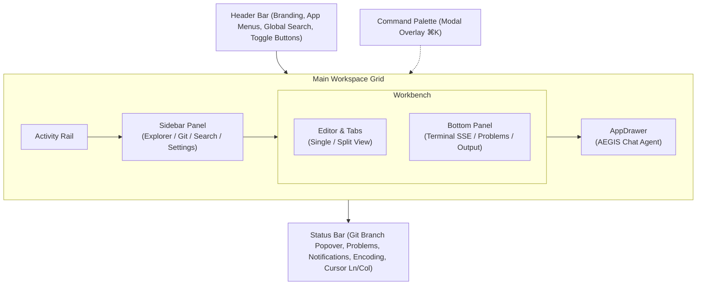
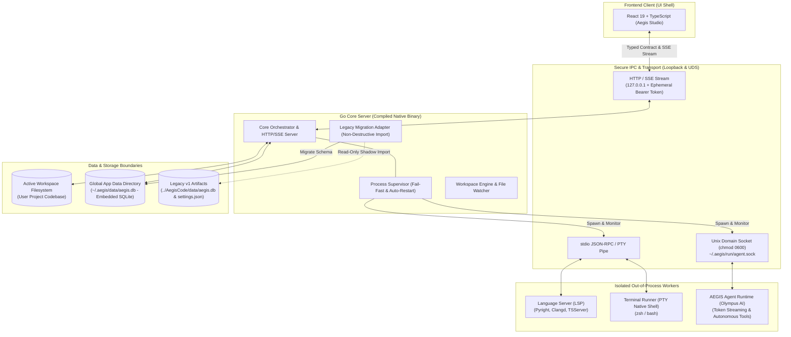
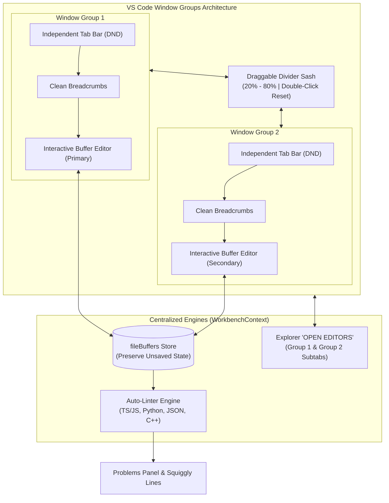
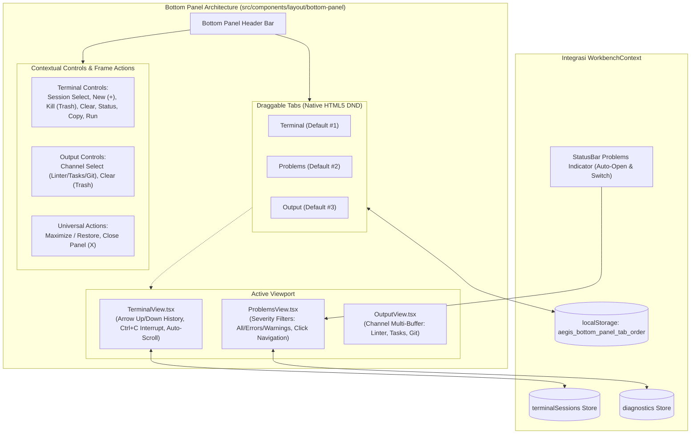
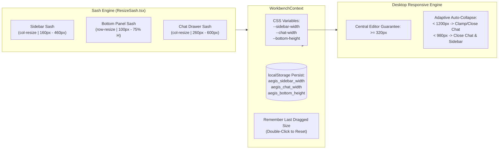
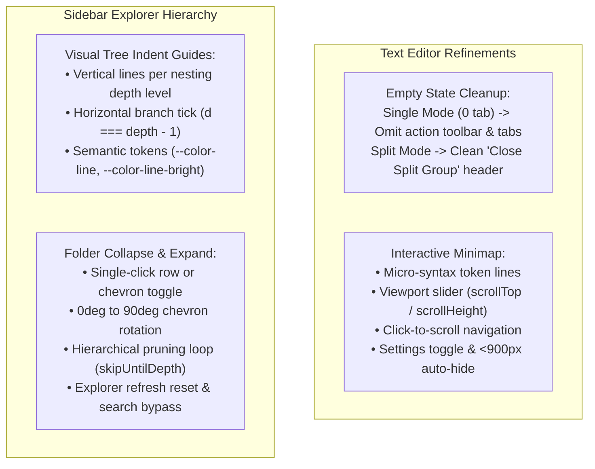

# AEGISCODE: Arsitektur & Blueprint Wireframe Frontend

> **Objective**: IDE Lightweight, Local Server  
> **Arsitektur**: Microservice (Local Runner / SSE / LSP)  
> **Prinsip Utama**: DONT Over Engineering  

---

## 1. Aturan & Batasan (Core Constraints)

### Constrain Frontend
1. **Reuse token color tailwind**: Semua styling warna wajib merujuk pada token tema yang telah didefinisikan di `@theme` Tailwind CSS v4 (`bg-canvas`, `bg-surface`, `text-ink`, `border-line`, dsb.). Tidak menggunakan arbitrary hardcoded hex color di elemen UI.
2. **Reuse Component design**: Komponen UI dasar (Icon, IconButton, Tab, Popover, Input, Toast) harus berada di `components/ui/` dan dipakai ulang di seluruh modul layout tanpa menduplikasi elemen primitif.
3. **Lightweight & Modular**: Pecah antarmuka menjadi komponen terisolasi per area layout tanpa dependensi state library yang berat (cukup React Context + Custom Hook).

### Constrain Backend
1. **DO NOT Try catch Silent**: Jika error terjadi, harus memutus fungsi (break the function) dan memicu penanganan yang jelas.
2. **DO NOT Add Spaghetti try catch**: 1 fungsi cukup memiliki 1 alur validasi yang benar tanpa tumpukan try-catch bersarang.
3. **DO NOT Add const jika tidak diperlukan**: Cek kemungkinan mutasi state dan minimalisasi konstanta redundan.

---

## 2. Struktur Arsitektur Frontend (`src/`)

Arsitektur direktori frontend direstrukturisasi dari komponen monolitik menjadi struktur modular berbasis area layout dan shared UI kit:

```text
src/
├── components/
│   ├── layout/            # Arsitektur Orkestrator & Mikro-komponen (Co-located CSS)
│   │   ├── header/            # Modul Header IDE
│   │   │   ├── Header.tsx             # Orkestrator Header
│   │   │   ├── WindowControls.tsx     # Traffic lights & branding
│   │   │   ├── AppMenu.tsx            # Menu dropdown (File, Edit, View, Run, Terminal)
│   │   │   ├── GlobalSearchButton.tsx # Quick command launcher trigger (⌘K)
│   │   │   ├── HeaderActions.tsx      # Toggle buttons panel, sidebar, & chat
│   │   │   └── header.css             # Styling header bar & window controls
│   │   ├── activity-rail/     # Navigasi Vertikal Sisi Kiri
│   │   │   ├── ActivityRail.tsx       # Switcher Explorer, Search, Git, & Settings
│   │   │   └── activity-rail.css      # Styling activity rail vertical bar
│   │   ├── sidebar/           # Modul Primary Sidebar
│   │   │   ├── Sidebar.tsx            # Orkestrator Sidebar
│   │   │   ├── ExplorerPanel.tsx      # Inline CRUD, Floating Context Menu, Hidden Files, Quick Filter, & Symbol Outline
│   │   │   ├── SearchPanel.tsx        # Regex Search & Granular Replace Engine (single, per-file, all)
│   │   │   ├── SourceControlPanel.tsx # Multi-repo controller, Git toolbar (pull/push/commit), Staged/Changes subtabs, & Branch Graph
│   │   │   └── sidebar.css            # Styling side panel, Explorer, Git Graph, & Search
│   │   ├── settings/          # Modul Settings Modal Overlay (Minimalist VS Code)
│   │   │   ├── SettingsModal.tsx      # Modal Overlay Preferences (Two-column categories & Regex Search Bar)
│   │   │   └── settings-modal.css     # Styling floating modal dialog & preferences cards
│   │   ├── editor/            # Modul Workbench Text Editor (VS Code Window Groups)
│   │   │   ├── Editor.tsx             # Orkestrator Window Groups (Group 1 & 2), Dual Pane, & Draggable Resizer Sash
│   │   │   ├── EditorTabs.tsx         # Group-aware multi-tab switcher dengan native HTML5 Drag-and-Drop (DND)
│   │   │   ├── EditorBreadcrumbs.tsx  # Path visual file bersih (tanpa dropdown manual / badge status)
│   │   │   ├── CodePane.tsx           # Lightweight interactive buffer editor (pengetikan nyata, gutter, auto-indent, diagnostics)
│   │   │   ├── Minimap.tsx            # Visual minimap code overview
│   │   │   ├── EditorFindWidget.tsx   # Floating in-editor find widget (Ctrl+F) dengan dynamic match counter
│   │   │   └── editor.css             # Styling window groups, draggable resizer sash, tabs, code buffer, gutter, & squiggly
│   │   ├── bottom-panel/      # Modul Bottom Panel & Drawer Multi-Fungsi
│   │   │   ├── BottomPanel.tsx        # Orkestrator Bottom Panel (Draggable Tab Bar, Maximize/Restore, Controls)
│   │   │   ├── TerminalView.tsx       # Multi-Session Terminal (Arrow Up/Down history, Ctrl+C interrupt, auto-scroll)
│   │   │   ├── ProblemsView.tsx       # Diagnostic syntax viewer dengan filter severity (All/Errors/Warnings) & navigasi baris
│   │   │   ├── OutputView.tsx         # Multi-channel log viewer (Linter, Tasks, Git) dengan action clear
│   │   │   └── bottom-panel.css       # Styling panel tabs, drag over indicators, dropdown selector, & filter chips
│   │   ├── chat/              # Modul AppDrawer AEGIS AI Agent
│   │   │   ├── ChatDrawer.tsx         # Orkestrator Chat Drawer (Master-Detail Host)
│   │   │   ├── ChatHeader.tsx         # Agent title, toggle sessions sidebar & actions
│   │   │   ├── ChatSessionSidebar.tsx # Sub-kolom panel master riwayat sesi
│   │   │   ├── ChatMessageList.tsx    # Render bubble pesan & token badge (/ & @)
│   │   │   ├── ChatSuggestions.tsx    # Quick prompt recommendation pills
│   │   │   ├── ChatComposer.tsx       # Textarea input & keyboard trigger autocomplete
│   │   │   ├── ChatCommandPopover.tsx # Floating popover autocomplete (/ skills & @ files)
│   │   │   ├── ChatProviderSelect.tsx # Cascading grouped model & provider dropdown
│   │   │   ├── index.ts               # Barrel export modul chat
│   │   │   └── chat.css               # Styling chat drawer, sessions, messages, & composer
│   │   ├── status-bar/        # Modul Status Bar & Popovers
│   │   │   ├── StatusBar.tsx          # Orkestrator Status Bar (kursor dinamis Ln/Col, bahasa aktif otomatis)
│   │   │   ├── BranchPopover.tsx      # Popover checkout branch git
│   │   │   ├── ProblemsPopover.tsx    # Popover ringkasan problem syntax (klik untuk lompat baris)
│   │   │   ├── NotificationsPopover.tsx # Popover notification center & unread badge
│   │   │   └── status-bar.css         # Styling status bar & popovers
│   │   ├── command-palette/   # Modul Command Palette Overlay
│   │   │   ├── CommandPalette.tsx     # Modal launcher perintah cepat (⌘K)
│   │   │   └── command-palette.css    # Styling modal palette & search results
│   │   └── index.ts           # Barrel Export Terpusat untuk App.tsx
│   └── ui/                # Reusable UI Primitives Kit
│       ├── Icon.tsx           # SVG icon registry terpusat (aegis, file, folder, git, dsb.)
│       ├── IconButton.tsx     # Tombol aksi berbasis icon dengan tooltip & active state
│       └── Toast.tsx          # Notifikasi aksi pengguna
├── styles/                # Shared Styling Foundations & Primitives
│   ├── tokens.css             # Definisi @theme Tailwind v4 & palet semantic tokens
│   ├── base.css               # Reset global (#root, body, buttons, focus-visible)
│   ├── ui.css                 # Styling elemen UI bersama (icon-button, toast, scrollbar)
│   └── shell.css              # Master frame layout (.app-shell, .workspace, .workbench)
├── utils/                 # Utility Engines Ringan (0 Bloat)
│   ├── linter.ts              # Mesin validasi sintaksis multi-bahasa (TS/JS, Python, JSON, C++) & auto-detect bahasa
│   └── syntax.tsx             # Tokenizer pewarnaan sintaksis reaktif berbasis semantic CSS tokens
├── context/
│   └── WorkbenchContext.tsx   # React Context & useWorkbench Hook (Editor Groups, Buffers, Linter, Chat)
├── data/
│   ├── chatConstants.ts       # Preset skill autocomplete & model providers
│   └── mockData.ts            # Buffer awal file teks, tree workspace, diagnostic lints, terminal logs
├── types/
│   └── workbench.ts           # Type definitions (EditorGroupState, FileBuffer, CursorPosition, LinterSettings, dsb.)
├── index.css                  # Slim Aggregator (@import tailwindcss & modul CSS)
├── main.tsx                   # Root entry point
└── App.tsx                    # Komposisi Shell IDE (< 50 baris)
```

---

## 3. Hierarki & Kolom Layout Wireframe

Layout IDE AegisCode mengadopsi 5 zona kolom/baris modular:



### Rincian 5 Kolom / Area:
1. **Header Bar**:
   - macOS Traffic Lights (Window controls).
   - Branding AegisCode.
   - Menu bar interaktif (File, Edit, View, Run, Terminal) dengan keyboard shortcut.
   - Quick Command Launcher button (`⌘ K`).
   - Action toggle: Toggle Bottom Panel (`Ctrl+J`), Toggle Primary Sidebar (`Ctrl+B`), Toggle AEGIS Chat.
2. **Activity Rail & Sidebar (Left Columns)**:
   - **Activity Rail**: Ikon switcher untuk Explorer, Search, Source Control (Git), dan trigger modal dialog Settings (`Cmd+,`).
   - **Explorer**: 
     - **OPEN EDITORS**: Seksi collapsible di paling atas yang memvisualisasikan subtab per Window Group (`GROUP 1` dan `GROUP 2`), status file aktif, indikator modifikasi belum disimpan (*dirty bullet*), dan tombol penutup file (`✕`).
     - **Workspace File Tree & Inline CRUD**: Tree direktori hierarkis (`AEGISCODE`) dengan aksi header & inline New File, New Folder, Rename, Delete.
     - **Floating Context Menu (Klik Kanan)**: Menu popover floating native-feel dengan Copy Name, Copy Relative Path, Copy Full Path, Rename, dan Delete.
     - **Hidden File Detection**: Otomatis membaca dan menampilkan file/folder tersembunyi (`.agents/`, `.env`, `.gitignore`) secara default dengan muted visual styling (`.file-muted`).
     - **Quick Filter Bar**: Filter instan pohon file berdasarkan nama secara real-time.
     - **Interactive Outline (Symbol Tree)**: Parser regex simbol file aktif (functions, classes, interfaces, types) dengan navigasi klik-lompat-baris (`setCursorPosition`).
   - **Search & Replace**:
     - Mesin pencarian regex real-time (`.*`, `Aa` match case, `\b` whole word) melintasi seluruh buffer aktif workspace (`fileBuffers`).
     - Kontrol replace granular: replace per baris/match, replace semua dalam 1 file spesifik, dan replace all lintas workspace.
   - **Source Control (Git)**:
     - **Active Repository Controller**: Multi-repo switcher dropdown (`aegis-code-v2`, `aegis-agent-runtime`, `aegis-docs`).
     - **Full Git Controls**: Toolbar commit message textarea, shortcut Ctrl+Enter, tombol Pull (`gitPull`), Push (`gitPush`), dan Sync.
     - **Subtabs Staged & Changes**: Subseksi `STAGED CHANGES` (dengan tombol unstage per-file `-` dan unstage all) dan `CHANGES` (dengan tombol stage per-file `+` dan stage all).
     - **Branch Graph**: Visual timeline commit berbasis SVG yang memetakan rantai hash, badge cabang (`main`), author, dan timestamp.
   - **Settings Modal Overlay (Bukan Tab & Bukan Sidebar)**:
     - Floating dialog modal minimalis bergaya VS Code dengan backdrop blur (`Cmd+,`).
     - Navigasi dua kolom: Kolom kiri (Commonly Used, Text Editor, Workbench, Linter, Git, AI), kolom kanan (kartu pengaturan interaktif toggle/select/input).
     - Header search bar dengan dukungan regex (`.*`) untuk pencarian instan nama atau deskripsi opsi setting.
3. **Workbench (Center Column)**:
   - **Window Groups (VS Code Architecture)**: Mendukung dual independent editor groups (`Group 1` & `Group 2`), masing-masing memiliki bilah multi-tab mandiri.
   - **Draggable Window Resizer (Sash)**: Pembatas interaktif vertikal di antara kedua group dengan cursor `col-resize` (rentang 20%–80%) dan fitur double-click untuk auto-reset 50:50.
   - **Draggable Tabs (DND Engine)**: Mendukung drag-and-drop native HTML5 untuk memindahkan file antar window group atau mengubah urutan tab.
   - **Clean Breadcrumbs**: Path visual file aktif (`src > App.tsx > LocalServer`) yang bersih tanpa dropdown manual atau badge status statis.
   - **Interactive Code Buffer**: Pengetikan interaktif nyata dengan `fileBuffers` tersinkronisasi, nomor baris dinamis, auto-indent (2 spasi pada Tab, preserve indent pada Enter), dirty bullet pada tab, dan shortcut simpan (`Ctrl+S`).
   - **Auto-Linting & Gutter Diagnostics**: Validasi sintaksis real-time untuk TS/JS, Python, JSON, dan C++ dengan dot error/warning di gutter dan garis bawah bergelombang (*squiggly underline*) yang terhubung ke panel Problems.
   - **Editor Empty State**: Tampilan watermark logo Aegis dengan kartu pintasan interaktif (`⌘N` New File, `⌘K` Command Palette, `⌘B` Toggle Sidebar, `⌘,` Settings) saat seluruh tab ditutup.
   - **Lint Diagnostic Hover Tooltip**: Popover floating (`DiagnosticHoverCard`) saat hover/klik pada error squiggly text atau gutter dot, dilengkapi tombol *"View in Problems"* dan *"Ask Aegis AI"*.
   - **3-Layer Browser AI Sync**: Sinkronisasi aktif metadata dokumen & buffer (`document.title`, `<meta name="aegis:*">`, DOM `data-aegis-*`, dan `window.__AEGIS_ACTIVE_CONTEXT__`) untuk interoperabilitas dengan AI bawaan browser.
   - **Bottom Panel**: Panel drawer bawah modular dengan urutan default **Terminal - Problems - Output**, tab draggable horizontal yang persisten di `localStorage`, kontrol toolbar interaktif (Maximize/Restore `.workbench-panel-maximized`, Close `✕`), Multi-Session Terminal (dropdown switcher, Arrow Up/Down history, Ctrl+C interrupt), Problems filter (All/Errors/Warnings), dan Output channel selector (Linter, Tasks, Git).
4. **AppDrawer (Right Column)**:
   - Panel chatbot AEGIS Agent yang terhubung dengan konteks workspace lokal.
   - History pesan AI & user, suggestion prompt ("Explain this file", "Fix 2 problems"), serta context badge.
5. **Status Bar (Bottom Row)**:
   - Info branch Git aktif (dengan popover switcher branch lokal).
   - Indikator masalah syntax (error/warning counter terintegrasi; klik otomatis membuka Bottom Panel dan mengaktifkan tab *Problems*).
   - Indikator cursor posisi dinamis (`Ln X, Col Y`), indentasi spasi (Spaces: 2), encoding file (UTF-8), dan bahasa aktif yang dideteksi 100% otomatis dari ekstensi file.
   - Notification center popover dengan unread counter badge.

---

## 4. Design System & Token Reusability (Tailwind CSS v4)

Semua komponen wajib mengonsumsi semantic token warna yang dideklarasikan di `src/styles/tokens.css` (di-load via `src/index.css`):

| Token CSS | Variabel Tailwind Class | Deskripsi Penggunaan |
| :--- | :--- | :--- |
| `--color-canvas` | `bg-canvas`, `border-canvas` | Latar belakang kanvas terluar IDE (`#090d14`) |
| `--color-surface` | `bg-surface` | Background panel utama, header, dan bottom bar |
| `--color-surface-raised`| `bg-surface-raised` | Background kartu, input, tab aktif, dan dropdown |
| `--color-surface-hover` | `hover:bg-surface-hover` | Efek hover item list, file tree row, dan tombol |
| `--color-line` | `border-line` | Garis pemisah antar kolom dan border tipis |
| `--color-line-bright` | `border-line-bright` | Border aktif, divider popover, garis pemisah kontras |
| `--color-ink` | `text-ink` | Teks utama (`#e7edf7`) |
| `--color-ink-soft` | `text-ink-soft` | Teks sekunder, label, keterangan path |
| `--color-ink-muted` | `text-ink-muted` | Teks placeholder, shortcut kbd, file muted |
| `--color-accent` | `text-accent`, `bg-accent` | Aksen biru Aegis (`#79b8ff`), focus ring, tombol aksi |
| `--color-accent-soft` | `bg-accent-soft` | Background elemen aktif terpilih |
| `--color-green` | `text-green`, `bg-green` | Indikator sukses, status dot aktif, syntax string |
| `--color-orange` | `text-orange` | Peringatan diagnostic, badge angka |
| `--color-red` | `text-red` | Diagnostic error syntax, status terminate |
| `--color-blue` / `--color-pink` / `--color-cyan` | `syntax-*` | Syntax highlighting editor code |

---

## 5. State Management & Mock Interaction Layer

State dikelola secara terpusat melalui `WorkbenchContext` menggunakan standard React Context dan custom hook `useWorkbench()`:

- **Layout State**: `sidebarOpen`, `panelOpen`, `panelMaximized`, `togglePanelMaximized()`, `chatOpen`, `commandPaletteOpen`, `splitEditor`, `activeBottomTab` ('Terminal' | 'Problems' | 'Output'), `setActiveBottomTab(tab)`, `bottomTabOrder` (urutan tab persisten di `localStorage`), `reorderBottomTabs(srcIndex, targetIndex)`.
- **Window Groups & Split State**:
  - `group1`: State Window Group 1 (`{ id: 'group1', name: 'Group 1', tabs: string[], activeTab: string }`).
  - `group2`: State Window Group 2 (`{ id: 'group2', name: 'Group 2', tabs: string[], activeTab: string }`).
  - `focusedGroup`: Identifier group aktif (`'group1' | 'group2'`).
  - `splitRatio`: Rasio persentase lebar window kiri dan kanan (20% – 80%, default 50%).
  - `openFileInGroup(file, group?)`, `closeTabInGroup(group, file)`, `setActiveTabInGroup(group, file)`.
  - `moveTabBetweenGroups(src, target, file, index?)`, `reorderTabsInGroup(group, srcIndex, targetIndex)`.
  - `toggleSplitEditor()`, `closeSplitEditor()`.
- **File Buffers & Editor Engine**:
  - `fileBuffers`: Map terpusat teks file (`Record<string, { content, isDirty, language }>`).
  - `updateFileContent(filename, content)`, `saveFile(filename?)`.
  - `cursorPosition`: Tracking kursor baris dan kolom (`{ line, col }`) yang tersambung ke Status Bar.
  - `linterSettings`: Pengaturan diagnostik (`{ enabled: boolean, trigger: 'onType' | 'onSave', showWarnings: boolean }`).
  - `navigateToDiagnostic(diag)`: Navigasi instan dari Problems panel ke file dan baris spesifik.
- **Navigation State**: `activeActivity` ('Explorer' | 'Search' | 'Source Control' | 'Settings'), `activeLanguage` (auto-detect pasif).
- **Workspace Data**: `files`, `gitChanges`, `notifications`, `diagnostics`.
- **Terminal & Bottom Panel State**:
  - `terminalSessions`: Daftar sesi terminal aktif (`TerminalSession[]` dengan properti `id`, `name`, `shell`, `lines`, `running`, `commandHistory`).
  - `activeTerminalSessionId`, `activeTerminalSession`: Sesi terminal aktif saat ini.
  - `createTerminalSession(shell?)`, `closeTerminalSession(id)`.
  - `terminalLines`, `terminalRunning`, `setTerminalRunning()`.
  - `sendTerminalCommand(cmd, sessionId?)`, `clearTerminal(sessionId?)`.
- **Agent Chat State**:
  - `sessions`: Daftar sesi percakapan aktif & historis (`ChatSession[]`).
  - `activeSessionId`, `activeSession`: Sesi percakapan yang sedang aktif.
  - `activeProvider` ('antigravity' | 'opencode' | 'openrouter'), `activeModel`: Konfigurasi LLM aktif.
  - `createSession(provider?, model?)`, `switchSession(id)`, `deleteSession(id)`, `setSessionModel(provider, model)`.
  - `chatMessages`: Riwayat pesan pada sesi aktif (`activeSession.messages`).
  - `sendChatMessage(text)`: Mengirim pesan pengguna, trigger auto-naming sesi, dan simulasi respon agent kontekstual.
- **Toast Feedback**: `showToast(message)` untuk konfirmasi interaksi pengguna.

---

## 6. Roadmap Pengembangan Wireframe Frontend (5 Phase)

### Phase 1: Layout Kolom & Shell Componentization (Selesai)
- Pemisahan `App.tsx` menjadi `components/layout/` (Header, ActivityRail, Sidebar, Editor, BottomPanel, ChatDrawer, StatusBar, CommandPalette).
- Reusable UI kit di `components/ui/` (Icon registry, IconButton, Toast).
- Konfigurasi `WorkbenchContext` untuk seluruh interaksi navigasi wireframe.
- Menjamin kepatuhan terhadap Tailwind theme tokens dan zero arbitrary colors.

### Phase 2: Workbench & Code Editor Interactivity
- Mock Monaco Editor / CodeMirror integration preview.
- Syntax highlighting per bahasa pemrograman (TypeScript, Python, C++, JSON, Markdown).
- Multi-window split editor horizontal/vertikal.
- Diagnostic lint markers (garis bawah merah/kuning) yang terhubung ke panel Problems.
- Panel terminal mock dengan penanganan runner shortcut (`Ctrl+C`, `Enter`, `clear`, `lint`).

### Phase 3: Explorer & Workspace Tools
- Mock CRUD file tree (buat file/folder, rename, hapus).
- Context menu klik kanan (Copy Path, Relative Path, Delete).
- Regex search and replace interaktif di file mock.
- Git control UI: staging area, commit input dengan validasi, branch visual graph.
- Settings modal overlay dengan filter pencarian instan.

### Phase 4: Status Bar & Diagnostics System
- Filter masalah (Problems) per severity (Error, Warning, Info).
- Git branch checkout popover switcher.
- Notification management center (mark all as read, dismissal).

### Phase 5: AppDrawer (Agentic Aegis Chat, Multi-Provider & Sessions)
- **Multi-Session Management**: Pembuatan sesi instan, menu riwayat sesi di header, auto-naming sesi dari prompt pertama, dan pemulihan otomatis jika sesi kosong.
- **Cascading Model Provider**: Grouped popover di footer composer untuk memilih provider (Antigravity, OpenCode, OpenRouter) beserta model unggulan.
- **Command & Context Autocomplete**:
  - `/` untuk trigger 5 preset skill agent (`/spec`, `/plan`, `/review`, `/debug`, `/simplify`).
  - `@` untuk mention file/folder langsung dari context workspace.
  - Visual token badges berikon di bubble riwayat pesan.
- Streaming response mockup untuk agent chat.
- Mekanisme file-editing preview (diff view) yang disarankan oleh agent.

---

## 7. Standar Integrasi Menuju Local Server (Microservice Readiness)

Meskipun saat ini fokus pada wireframe frontend, antarmuka dirancang agar transisi ke microservice backend berjalan mulus tanpa merombak UI:

1. **Terminal SSE**: Hook `useWorkbench` dirancang menerima Stream Server-Sent Events (`EventSource('/api/terminal/stream')`) menggantikan mock terminal state.
2. **File System API**: `fileTree` siap dipetakan ke endpoint REST/gRPC lokal (`GET /api/workspace/tree`).
3. **LSP Diagnostics**: Model problem diagnostics mengikuti struktur Language Server Protocol (`range`, `message`, `severity`, `source`).
4. **Agent Bridge**: Format pesan `ChatMessage` kompatibel dengan payload prompt agent AI Aegis Code.

---

## 8. Arsitektur Relayouting Chat & Agent System (Sesi, Multi-Provider, & Autocomplete)

Sistem Chat Agent pada `src/components/layout/chat` direlayout secara modular dengan arsitektur berikut:

### A. Manajemen Sesi Percakapan (Master-Detail Split Layout)
- **Komponen**: 
  - `ChatSessionSidebar.tsx`: Sub-kolom panel master riwayat sesi (lebar 190px) di sebelah kiri chat aktif saat expanded.
  - `ChatDrawer.tsx`: Host orkestrator yang melebarkan grid drawer dari 300px ke 500px (`.workspace-chat-expanded`) saat sesi dibuka.
  - `ChatHeader.tsx`: Tombol toggle icon `history` (🕒) di samping tombol `+` (*New Chat*) dan `✕` (*Close*).
- **Interaksi & UX Menyatu (Master-Detail)**:
  - Sesi dan alur chat terlihat berdampingan secara bersamaan (*master-detail layout*).
  - Mengklik sesi di sidebar langsung memuat pesan pada pane chat sebelah kanan secara instan (*live switch*) tanpa menutup tampilan atau menutupi composer.
  - Tombol `+ New Session` di header sidebar untuk membuat percakapan baru instan.
  - Tombol toggle `[🕒]` di header mengecilkan chat drawer kembali ke ukuran normal 300px.
- **Lifecycle & Storage**:
  - Setiap sesi memiliki tipe `ChatSession`: `{ id, title, provider, model, messages, createdAt }`.
  - Judul sesi otomatis diperbarui (*auto-named*) dari cuplikan 26 karakter pertama dari prompt user pertama.
  - Sesi disimpan secara persisten di browser (`localStorage` dengan key `aegis_chat_sessions_v2` dan `aegis_active_session_id_v2`).
  - Jika pengguna menghapus seluruh sesi, sistem secara otomatis menginisiasi satu sesi baru kosong (*safety reset*).

### B. Mode Dropdown & Provider Bertingkat (Cascading Model Select)
- **Komponen**: `ChatProviderSelect.tsx` di footer `ChatComposer`.
- **Struktur Menu**: Tombol single-badge compact (`[Provider] model ▾`) yang membuka popover terkelompok (*grouped list*):
  - **Antigravity**: `gemini-2.5-flash` (default), `gemini-2.5-pro`
  - **OpenCode**: `claude-3.7-sonnet` (default), `claude-3.5-haiku`
  - **OpenRouter**: `deepseek-r1` (default), `claude-3.7-sonnet`, `gpt-4o`
- **Scoping**: Model dan provider terikat secara individual per sesi chat aktif.

### C. Autocomplete Command (`/`) & Context Path (`@`)
- **Komponen**: `ChatCommandPopover.tsx` & parser di `ChatComposer.tsx`.
- **Deteksi Input**: Regex real-time mendeteksi token sebelum kursor yang berawalan `/` atau `@`.
- **Daftar Opsi**:
  - `/` (Skills): Menampilkan preset skill agent: `/spec` (Specification), `/plan` (Implementation Plan), `/review` (Code Review), `/debug` (Debugging), `/simplify` (Simplification).
  - `@` (Files/Folders): Menampilkan tree file dari `useWorkbench().files`. Folder otomatis diakhiri trailing slash `/` (contoh `@components/`).
- **Navigasi Keyboard**: `ArrowUp` / `ArrowDown` untuk memilih, `Enter` / `Tab` untuk menyisipkan token, `Escape` untuk menutup popover.
- **Visual Token Rendering**: Di bubble pesan `ChatMessageList.tsx`, token `@` dirender sebagai badge file/folder berikon biru/oranye, dan token `/` dirender sebagai badge command berikon ungu/aksen.

### D. Redesain Balon Chat & Input Context Toolbar
- **Relokasi In-Context File**: Sub-bar context lama di header ditiadakan. Indikator konteks file aktif dipindahkan langsung ke footer `ChatComposer.tsx` berupa badge pill `[● activeTab]` di samping selector provider.
- **Pembersihan Area Percakapan**: Banner intro lama (*"Build with your codebase, not around it."*) dan suggestion pills dihapus total, memaksimalkan area baca percakapan.
- **Balon Chat Modern**:
  - **Header Balon**: Ikon avatar (`msg-avatar-agent` / `msg-avatar-user`), label pengirim (*AEGIS* / *You*), serta model badge monospaced pada respon agen.
  - **Balon User**: Rata kanan dengan card `var(--color-accent-soft)` dan border aksen.
  - **Balon Agent**: Rata kiri dengan card `var(--color-surface-raised)`, tipografi terstruktur, dan tombol interaktif **Copy Message** (ikon copy) yang muncul saat bubble di-hover.
  - **Empty State**: Placeholder minimalis dan bersih jika sesi chat baru belum memiliki pesan.

---

## 9. Blueprint Arsitektur Backend & Local Process (Go Core Server, Security, & Worker Daemons)

Arsitektur backend dirancang berdasarkan hasil keputusan arsitektur resmi ([ADR 0001 - 0008](file:///Users/aditwicaksono/Documents/Project-AI/AegisCodev2/docs/adr/)) dengan pola **Hybrid Layered Core + Out-of-Process Workers**:



### A. Prinsip & Pola Arsitektur Inti
1. **Hybrid Layered + Out-of-Process Workers ([ADR 0001](file:///Users/aditwicaksono/Documents/Project-AI/AegisCodev2/docs/adr/0001-hybrid-process-architecture.md))**:
   - Menolak enterprise network microservices (multi-container, separate DB per service, network serialization).
   - Mengadopsi server lokal berbasis Go sebagai orkestrator sentral dengan subprocess worker terisolasi untuk proses intensif atau tidak stabil (LSP, terminal runner, AI agent).
2. **Core Server Runtime ([ADR 0003](file:///Users/aditwicaksono/Documents/Project-AI/AegisCodev2/docs/adr/0003-core-server-runtime-golang.md))**:
   - Dibangun menggunakan **Go (Golang)** sebagai single compiled native binary.
   - Footprint memori ultra-rendah (<30MB RAM), waktu startup instan (<20ms), dan konkurensi native via goroutine untuk streaming SSE dan terminal PTY.
3. **Pragmatic Package Layout ([ADR 0006](file:///Users/aditwicaksono/Documents/Project-AI/AegisCodev2/docs/adr/0006-pragmatic-go-package-layout.md))**:
   - Struktur paket Go flat & modular (`cmd/server/main.go`, `internal/config`, `internal/store`, `internal/supervisor`, `internal/workspace`, `internal/api`).
   - Menghindari boilerplate berlebih (anti over-engineering) dan mematuhi aturan error handling eksplisit (*"DO NOT Try catch Silent"*).

### B. Keamanan & Protokol Komunikasi Inter-Service
1. **Ephemeral Token Handshake**:
   - Saat Core Server boot, token acak di-generate di memori dan di-pass ke UI Shell.
   - Server di-bind khusus ke `127.0.0.1` (loopback only). Seluruh request HTTP/SSE wajib menyertakan header `Authorization: Bearer <token>`, memblokir serangan DNS rebinding dan CSRF dari browser web.
2. **Unix Domain Sockets (UDS) untuk Agent IPC ([ADR 0005](file:///Users/aditwicaksono/Documents/Project-AI/AegisCodev2/docs/adr/0005-unix-domain-sockets-for-agent-ipc.md))**:
   - Core Server dan Agent Runtime bertukar data melalui socket file `~/.aegis/run/agent.sock` dengan perizinan file `0600` (hanya dapat diakses user pemilik proses).
   - Bebas tabrakan nomor port TCP dan kebal dari scanning jaringan lokal.
3. **Typed Contract Generation ([ADR 0008](file:///Users/aditwicaksono/Documents/Project-AI/AegisCodev2/docs/adr/0008-typed-contract-generation.md))**:
   - Struct Go diekspor otomatis menjadi TypeScript definitions menggunakan generator tipe (`tygo`).
   - Menjamin tipe data antara backend Go dan frontend React 19 selalu 100% selaras tanpa human error.

### C. Batas Data & Strategi Migrasi Legacy
1. **Pemisahan Penyimpanan Data ([ADR 0002](file:///Users/aditwicaksono/Documents/Project-AI/AegisCodev2/docs/adr/0002-app-data-directory-and-legacy-migration.md))**:
   - **Workspace**: Hanya memuat file source code proyek pengguna.
   - **Global App Data**: Seluruh database SQLite (`aegis.db`), riwayat sesi agent, dan cache berada di `~/.aegis/data/`, tidak pernah mengotori folder repositori aktif.
2. **Non-Destructive Shadow Migration ([ADR 0007](file:///Users/aditwicaksono/Documents/Project-AI/AegisCodev2/docs/adr/0007-non-destructive-shadow-migration.md))**:
   - Startup routine mendeteksi konfigurasi lama dari v1 (`../AegisCode/data/settings.json`, `.aegis/auth.json`, dan `aegis.db`).
   - Melakukan pembacaan read-only dan mengimpor preferensi serta model LLM ke skema v2 tanpa memodifikasi atau menghapus file v1 asli.

### D. Supervisi & Ketahanan Proses ([ADR 0004](file:///Users/aditwicaksono/Documents/Project-AI/AegisCodev2/docs/adr/0004-worker-supervision-and-agent-isolation.md))
1. **Process Supervisor**:
   - Core Server memonitor status exit code setiap child-process (LSP, PTY, Agent).
   - Kebijakan *Fail-Fast & Explicit Incident Reporting*: jika worker crash, Core Server tidak membungkam error, melainkan memutus fungsi secara eksplisit, mengirim notifikasi diagnostic ke UI, dan menjalankan clean restart terisolasi.
2. **Isolasi Latensi Editor**:
   - Beban kerja komputasi berat dari AI Agent tidak membebani loop pengetikan teks pada workbench editor.

---

## 10. Arsitektur Workbench Text Editor & Window Groups (VS Code Model, Linter, & DND)

Modul Text Editor pada `src/components/layout/editor` dirancang ulang mengikuti paradigma **VS Code Window Groups** untuk menghadirkan pengalaman IDE native yang fleksibel, cepat, dan ringan (*0 bloat*):



### A. Dual Independent Window Groups
- **State Terisolasi**: Setiap group memiliki struktur `EditorGroupState`:
  - `group1`: `{ id: 'group1', name: 'Group 1', tabs: string[], activeTab: string }`
  - `group2`: `{ id: 'group2', name: 'Group 2', tabs: string[], activeTab: string }`
- **Bilah Multi-Tab Mandiri**: Setiap group memiliki komponen `EditorTabs.tsx` sendiri di atas pane kodenya. User dapat membuka, mengaktifkan, dan menutup tab secara independen di Group 1 maupun Group 2.
- **Routing File Berbasis Fokus**: Membuka file dari Explorer, Git Source Control, atau Command Palette akan otomatis mengisi group yang sedang memiliki fokus aktif (`focusedGroup: 'group1' | 'group2'`).
- **Auto-Close Split Lifecycle**: Jika seluruh tab pada Group 2 ditutup hingga habis (0 tabs tersisa), mode split otomatis dinonaktifkan (`splitEditor = false`) dan Group 1 kembali memenuhi 100% layar.

### B. Draggable Window Resizer (Sash)
- **Pembatas Interaktif Vertikal**: Komponen divider 4px (`.split-resizer-sash`) disematkan di antara kedua group pane.
- **Fluid Resizing**: User dapat menyeret mouse secara horizontal dengan kursor `col-resize` untuk mengubah rasio lebar window antara 20% hingga 80% (disimpan di state `splitRatio`).
- **Proteksi Drag**: Layar dilindungi overlay transparan (`.split-resize-overlay`) selama penyeretan agar kursor tidak lepas dan teks di dalam editor tidak sengaja terseleksi.
- **Double-Click Reset**: Mengetuk ganda divider langsung mengembalikan proporsi kedua window ke **50:50**.

### C. Drag-and-Drop Tabs Engine (DND)
- **Native HTML5 Drag & Drop**: Setiap tab pada `EditorTabs.tsx` memiliki atribut `draggable`.
- **Perpindahan Antar Group**: Menarik tab dari Group 1 dan melepasnya di tab bar Group 2 (atau sebaliknya) mengeksekusi `moveTabBetweenGroups`, memindahkan file ke group tujuan dan mengaktifkannya.
- **Pengurutan Tab (Reordering)**: Menarik tab di dalam bar yang sama mengeksekusi `reorderTabsInGroup`, memperbarui urutan file secara dinamis.
- **Visual Feedback**: Menampilkan drop indicator vertikal (`.tab-drag-over`) pada tab target dan highlight drop zone (`.editor-tabs-droptarget`).

### D. Hierarki "OPEN EDITORS" di Explorer Sidebar
- Di `ExplorerPanel.tsx`, disediakan seksi collapsible `"OPEN EDITORS"` tepat di atas project file tree:
  - Saat split aktif, daftar file dikelompokkan dalam sub-header `GROUP 1` dan `GROUP 2`.
  - Menampilkan ikon file, nama file, penanda file aktif, *dirty bullet* jika ada perubahan belum disimpan, dan tombol close `✕`.
  - Mengklik file langsung memfokuskan window group terkait dan mengaktifkan file tersebut.

### E. Interactive Buffer Engine & 6 Fitur Wajib Text Editor
Menggantikan preview statis dengan code buffer yang dapat diketik secara nyata:
1. **Interactive Typing & Buffer Centralization**: Teks seluruh file dikelola dalam `fileBuffers` terpusat (`WorkbenchContext.tsx`), memastikan perubahan tidak hilang saat user berpindah tab atau membagi window.
2. **Dynamic Line Numbers & Gutter**: Nomor baris dinamis mengikuti panjang teks, dilengkapi titik diagnostik merah (*error*) dan oranye (*warning*).
3. **Tracking Kursor Real-Time**: Posisi kursor (`Ln X, Col Y`) dihitung dari kursor aktif dan disinkronkan secara real-time ke Status Bar.
4. **Dirty State & Save Handling**: Dot bullet pada tab menandakan modifikasi belum disimpan; didukung shortcut `Ctrl+S` / `Cmd+S` untuk menyimpan buffer.
5. **Indentation Handling**: Menekan tombol `Tab` menyisipkan 2 spasi (tanpa memindahkan fokus HTML), dan tombol `Enter` mempertahankan indentasi baris sebelumnya secara otomatis.
6. **Syntax Highlighting & Squiggly Lines**: Tokenizer ringan (`src/utils/syntax.tsx`) mewarnai token sintaksis menggunakan semantic Tailwind CSS tokens repo, disertai garis bawah bergelombang merah/oranye untuk baris bermasalah.
7. **Find Widget Integration**: `EditorFindWidget.tsx` (`Ctrl+F`) mendeteksi dan menghitung jumlah match secara nyata dari buffer yang aktif.
8. **Navigasi Klik Diagnostik**: Mengklik item error/warning pada panel Problems langsung melompat ke file dan nomor baris terkait.

### F. Auto-Linter Engine & Pengaturan di Settings
- **Pembersihan Breadcrumb**: Badge `"Lint ready"` dan dropdown bahasa manual dihapus dari `EditorBreadcrumbs.tsx`. Jalur navigasi tampil rapi dan bahasa pemrograman dideteksi 100% otomatis dari ekstensi file.
- **Mesin Validasi Sintaksis (`src/utils/linter.ts`)**:
  - **JSON**: Parser validasi JSON bawaan (deteksi trailing comma, unquoted key, kurung kurawal hilang).
  - **TypeScript & JavaScript**: Deteksi ketidakseimbangan delimiter `{ }`, `( )`, `[ ]`, unclosed quotes, dan console statements.
  - **Python**: Deteksi syntax error blok tanpa titik dua `:`, trailing semicolons, dan unclosed quotes.
  - **C++**: Deteksi statement tanpa titik koma `;` dan bracket matching.
- **Konfigurasi di Settings (`SettingsPanel.tsx`)**:
  - Grup **LINTER & DIAGNOSTICS**:
    - `Enable Linter`: Toggle on/off untuk mengaktifkan/menonaktifkan seluruh diagnostik secara instan.
    - `Lint Trigger`: Pilihan mode eksekusi (`onType` reaktif dengan debounce ~300ms vs `onSave` saat menyimpan file).
    - `Show Warnings`: Toggle untuk menyaring apakah hanya error fatal atau warning juga yang dimunculkan di editor & Problems panel.

### G. Editor Empty State (`EditorEmptyState.tsx`)
- **Visual Branding & Watermark**: Saat semua tab dalam sebuah Window Group atau seluruh editor ditutup, ruang editor menampilkan visual watermark logo Aegis (`Icon name="aegis"` dengan opasitas lembut), heading *"AegisCode Editor"*, serta subjudul deskriptif.
- **Kartu Aksi Pintasan (Action Cards)**: Disediakan 4 kartu pintasan keyboard interaktif:
  1. `⌘ N` / `Ctrl+N` (*New File*): Menampilkan prompt instan untuk membuat file baru di dalam buffer dan langsung membukanya di editor.
  2. `⌘ K` / `Ctrl+K` (*Command Palette*): Membuka overlay command palette untuk pencarian file dan perintah IDE.
  3. `⌘ B` / `Ctrl+B` (*Toggle Sidebar*): Menampilkan / menyembunyikan primary sidebar panel.
  4. `⌘ ,` / `Ctrl+,` (*Open Settings*): Membuka modal pengaturan konfigurasi IDE.
- **Dukungan Dual-Group**: Bekerja baik pada mode single view maupun saat split editor aktif (misalnya Group 1 memiliki file terbuka sedangkan Group 2 kosong).

### H. Floating Lint Diagnostics & Hover Card (`DiagnosticHoverCard.tsx`)
- **Pemicu Interaktif Ganda**:
  - *Gutter Diagnostic Dots*: Mengklik dot merah (*error*) atau oranye (*warning*) di gutter baris kode.
  - *Squiggly Text Cursor / Mouse Hover*: Arahkan kursor atau mouse pada segmen teks bergaris bawah bergelombang merah/kuning untuk memicu kartu popover.
- **Anatomi Popover Floating**:
  - Header: Badge severity (`ERROR` / `WARNING`) berlatar warna semantik token, indikator lokasi baris & kolom (`Ln X, Col Y`), dan tombol tutup (`✕`).
  - Pesan Diagnostik: Teks deskripsi masalah sintaksis yang jelas.
  - Quick Actions Footer:
    1. **"View in Problems"**: Membuka Bottom Panel, mengaktifkan tab Problems, dan menyorot daftar isu.
    2. **"Ask Aegis AI"**: Mengirimkan prompt diagnosa langsung ke AEGIS Chat Drawer (`"Help me fix this diagnostic in <filename>: <error>"`) dan otomatis membuka drawer jika sedang tertutup.
- **Dismissal Luwes**: Dapat ditutup dengan menekan tombol Escape (`Esc`), mengklik tombol `✕`, atau mengklik di luar area kartu.

### I. 3-Layer Browser Native AI Synchronization (`src/utils/browserAiSync.ts`)
Untuk mendukung integrasi langsung dengan AI bawaan browser (seperti Chrome Built-in AI / Gemini Nano, Web AI Extensions, atau screen/DOM parser agent):
- **Lapis 1 — Head & Document Title Layer**:
  - `document.title`: Mengadopsi format `<ActiveFile> — AegisCode` (atau `AegisCode — Lightweight IDE` saat kosong).
  - `<head>` Meta Tags: Otomatis membuat dan memperbarui elemen meta secara reaktif:
    - `<meta name="aegis:active-file" content="...">`
    - `<meta name="aegis:language" content="...">`
    - `<meta name="aegis:workspace" content="...">`
    - `<meta name="aegis:cursor" content="Ln X, Col Y">`
    - `<meta name="aegis:is-dirty" content="true|false">`
    - `<meta name="aegis:diagnostics-count" content="...">`
- **Lapis 2 — Semantic DOM Attributes Layer**:
  - Elemen container `.workspace` disuntikkan atribut data semantik standar:
    `data-aegis-active-file`, `data-aegis-language`, `data-aegis-workspace`, `data-aegis-cursor-line`, `data-aegis-cursor-col`, `data-aegis-dirty`, `data-aegis-diagnostics`.
  - Hal ini memudahkan script web AI ekstensi melakukan pembacaan konteks instan tanpa perlu membedah DOM internal editor.
- **Lapis 3 — Runtime Global JS Context & CustomEvent**:
  - Objek global `window.__AEGIS_ACTIVE_CONTEXT__` selalu memuat snapshot metadata terkini beserta timestamp UNIX.
  - Setiap perubahan file, cursor move, atau buffer editing memancarkan custom event `window.dispatchEvent(new CustomEvent('aegis:file-change', { detail: payload }))` sehingga ekstensi AI atau modul eksternal dapat berlangganan secara asinkronus (*event-driven*).

---

## 11. Arsitektur Bottom Panel (Draggable Tabs, Multi-Session Terminal, Problems Filter, & Output Channels)

Modul Bottom Panel pada `src/components/layout/bottom-panel` mengadopsi arsitektur multi-fungsi yang responsif, terintegrasi penuh ke `WorkbenchContext`, dan mendukung personalisasi layout pengguna:



### A. Draggable Tabs Engine & Urutan Bawaan
- **Urutan Default**: Urutan inisial tab terstruktur sebagai **Terminal** (1), **Problems** (2), dan **Output** (3).
- **Native HTML5 Drag & Drop**: Setiap tombol tab (`.bottom-tab-button`) mengaktifkan atribut `draggable` dengan handler `onDragStart`, `onDragOver`, `onDragLeave`, dan `onDrop`.
- **Indikator Visual**: Menampilkan garis batas aksen biru (`.tab-drag-over` dengan border-left 2px) saat tab lain diseret melintas di atasnya.
- **Persistensi Preferensi**: Urutan tab disimpan otomatis ke browser (`localStorage` key `aegis_bottom_panel_tab_order`). Jika urutan diubah oleh pengguna, susunan tersebut tetap terjaga saat refresh atau sesi IDE dibuka kembali.

### B. Fitur Core Multi-Session Terminal (`TerminalView.tsx`)
- **Multi-Session Management**:
  - Selector sesi dropdown (`.panel-select`) di header toolbar yang memungkinkan navigasi cepat antar-sesi aktif (`1: zsh`, `2: zsh`).
  - Tombol **`+` (New Terminal Session)**: Membuka instance terminal mandiri dengan shell profil terpilih.
  - Tombol **`Trash` (Kill Session)**: Menghentikan dan menutup sesi terminal aktif dengan pemulihan sesi otomatis (*safety fallback* jika sesi terakhir ditutup).
- **Command History Navigation**:
  - Tombol **Arrow Up (↑)**: Menavigasi ke perintah sebelumnya dari riwayat `commandHistory`.
  - Tombol **Arrow Down (↓)**: Menavigasi maju ke perintah berikutnya atau mengosongkan input.
- **Auto-Scroll Real-Time**: Viewport otomatis bergulir (*smooth/auto scroll*) ke baris paling bawah saat output baru tiba.
- **Interrupt & Clear Controls**:
  - Shortcut `Ctrl+C`: Menghentikan proses yang sedang berjalan dan menampilkan simbol `^C` secara instan.
  - Tombol **Clear Output** (ikon silang / trash) serta command `clear` bawaan untuk membersihkan buffer layar.

### C. Fitur Core Problems Tab (`ProblemsView.tsx`)
- **Filter Severity Chips**:
  - Tombol filter cepat di bagian atas: **All (N)**, **Errors (N)**, dan **Warnings (N)** dengan indikator aktif (`.filter-chip-active`).
  - Mengisolasi pesan diagnostik sehingga developer dapat berfokus membenahi error kritis atau sekadar meninjau peringatan kode.
- **Navigasi Klik Langsung**: Mengklik salah satu entri problem langsung melompat (*jump*) ke file dan nomor baris bersangkutan di Code Editor, memfokuskan kursor, dan menampilkan notifikasi toast.
- **Integrasi Status Bar**: Mengklik counter error/warning di `StatusBar.tsx` otomatis membuka Bottom Panel (jika tertutup) dan langsung memfokuskan tab aktif ke **Problems**.

### D. Fitur Core Output Tab (`OutputView.tsx`)
- **Channel Selector Dropdown**: Switcher saluran log di toolbar kanan dengan 3 kanal default:
  1. `Linter / Syntax`: Log adapter linting lintas bahasa dan status inisialisasi parser.
  2. `Tasks & Build`: Log dev server lokal (Vite, SSE runner, task watchers).
  3. `Git / Source Control`: Log eksekusi Git CLI lokal dan ringkasan branch.
- **Channel Buffer & Clear**: Tombol pembersih log (*Clear Output*) di samping dropdown yang membersihkan output khusus untuk saluran yang sedang aktif.
- **Timestamping & Monospace Formatting**: Tiap baris log dilengkapi penanda waktu (*timestamp*) dan styling monospaced rapi.

### E. Kontrol Frame & Mekanisme Fullscreen (Flexbox Layout Engine & Grid Fix)
- **Koreksi Bug Grid Fullscreen**: Memperbaiki deklarasi `.workbench-panel-maximized` menjadi `grid-template-rows: 1fr !important;`. Sebelumnya, `grid-template-rows: 0 1fr;` menyebabkan `<BottomPanel />` terdorong ke row 1 (`0px`) karena `.editor` (`display: none`) tidak berpartisipasi dalam formatting grid, mengakibatkan konten tab collapse/rusak. Dengan `1fr !important;`, Bottom Panel mengambil 100% penuh tinggi workbench tanpa celah.
- **Data Grid Inspeksi Masalah pada Mode Fullscreen (`ProblemsView.tsx`)**:
  - Pada mode normal: Tampilan kartu daftar 1-kolom yang ringkas.
  - Pada mode fullscreen / maximized: Bertransformasi otomatis menjadi **Data Grid Multi-Kolom Profesional** dengan kolom:
    1. *Severity*: Ikon dan badge warna semantik (`Error` / `Warning`).
    2. *Message*: Judul / deskripsi masalah sintaksis.
    3. *File*: Nama file yang bermasalah.
    4. *Location*: Nomor baris dan kolom (`Ln X, Col Y`).
    5. *Source*: Sumber linter (`TypeScript`, `ESLint`, `JSON Parser`, dll.).
    6. *Actions*: Tombol aksi cepat *"Ask AI"* di ujung baris yang langsung mengirim diagnosa ke AEGIS Chat Drawer.
- **Container Flexbox Murni (`height: 100%`)**: `.bottom-panel` dikonfigurasi sebagai container flex vertikal (`height: 100%; min-height: 0; overflow: hidden;`), dengan `.bottom-panel-header` (`flex-shrink: 0; height: 35px;`) dan `.bottom-panel-content` (`flex: 1; min-height: 0; overflow: hidden;`). Ini menjamin isi tab selalu berekspansi penuh 100% tanpa menyisakan ruang kosong atau collapse.
- **Pemisahan Font & Scroll Terisolasi**:
  - TerminalView & OutputView memakai monospace `SFMono-Regular` dengan scroll viewport mandiri (`overflow-y: auto`).
  - ProblemsView memakai sans-serif UI, filter bar sticky, dan list/table yang scrollable mandiri.
  - Input command bar Terminal terkunci di bagian bawah (`flex-shrink: 0; border-top: 1px solid var(--color-line);`).
- **Maximize / Restore**: Tombol maximize di header kanan yang menyinkronkan status visual (`chevron-down` saat maximized vs `maximize` saat normal), menonaktifkan border atas `.bottom-panel` dan memperluas area panel hingga memenuhi workbench untuk kemudahan peninjauan log panjang.
- **Close Button (`✕`)**: Tombol penutup instan yang menyinkronkan state `panelOpen = false` tanpa perlu menggunakan keyboard shortcut `Ctrl+J`.

---

## 12. Arsitektur Drag-Resize Sash & Responsive Desktop Constraints

Untuk menghadirkan pengalaman manipulasi layout desktop yang setara dengan IDE native (VS Code) dengan prinsip *lightweight, 0 bloat, no external library*, sistem menerapkan arsitektur drag resize berbasis CSS custom properties:



### A. Komponen Reusable `ResizeSash.tsx`
- **Dukungan Dua Arah**:
  - `direction: "vertical"` (`col-resize`): Ditempatkan di batas kanan Sidebar (`.sash-sidebar`) dan batas kiri Chat Drawer (`.sash-chat`).
  - `direction: "horizontal"` (`row-resize`): Ditempatkan di batas atas Bottom Panel (`.sash-bottom`, hanya aktif jika panel terbuka dan tidak sedang fullscreen).
- **Proteksi Drag Layar Penuh (`.resize-overlay-active`)**:
  - Saat penyeretan mouse aktif, overlay transparan fullscreen dipasang di atas viewport dengan cursor yang sesuai (`col-resize` / `row-resize`). Ini mencegah kursor lepas, teks terseleksi, atau event pointer terserap oleh `textarea` editor atau `iframe`.
- **Indikator Visual Presisi**: Garis pembatas aksen biru setebal 2px (`var(--color-accent)`) yang bertransisi halus saat disentuh atau diseret.

### B. Batasan Dimensi (Clamping) & Snap-to-Close
- **Sidebar**:
  - Rentang aman: Min `160px` – Max `460px` (Default `220px`).
  - *Snap-to-Close*: Jika diseret di bawah ambang batas kritis `< 90px`, sidebar otomatis menutup (`sidebarOpen = false`).
- **Chat Drawer**:
  - Rentang aman: Min `260px` – Max `600px` (Default `300px` atau `500px` saat expanded session).
  - *Snap-to-Close*: Jika diseret di bawah `< 90px`, chat drawer otomatis menutup (`chatOpen = false`).
- **Bottom Panel**:
  - Rentang aman: Min `100px` – Max `75%` dari tinggi jendela/workbench (Default `180px`).
  - *Snap-to-Close*: Jika diseret di bawah `< 80px`, panel bawah otomatis menutup (`panelOpen = false`).
- **Jaminan Text Editor di Tengah**: Lebar area Text Editor diproteksi minimal `320px` di setiap kalkulasi drag. Sash tidak dapat ditarik lebih jauh jika editor terancam kurang dari 320px.

### C. Pemulihan Dimensi (Remember Last Size) & Double-Click Reset
- **Remember Last Size**: Ketika panel ditutup (baik via snap-to-close, shortcut keyboard, atau tombol close), ukuran terakhir yang diseret disimpan dalam state `lastActiveWidth` / `lastActiveHeight`. Saat panel dibuka kembali, ukuran personal pengguna langsung dipulihkan.
- **Double-Click Reset**: Mengetuk dua kali sash mana pun langsung mengembalikan panel ke ukuran bawaan (*Sidebar: 220px, Bottom: 180px, Chat: 300px*).
- **Persistensi `localStorage`**: Nilai kustom disimpan di `localStorage` (`aegis_sidebar_width`, `aegis_chat_width`, `aegis_bottom_height`) sehingga layout tetap konsisten melintasi refresh browser.

### D. Penanganan Responsif Viewport Desktop (Editor-First Priority)
- **Prioritas Utama**: Editor kode adalah area kerja terpenting dan selalu dilindungi dari himpitan panel samping.
- **Adaptive Breakpoints**:
  1. Resolusi `>= 1280px`: Semua panel dapat terbuka penuh berdampingan.
  2. Resolusi `< 1200px`: Jika lebar layar menyempit dan total panel kustom menekan editor < 320px, Chat Drawer otomatis dikurangi lebarnya atau di-collapse (`chatOpen = false`).
  3. Resolusi `< 980px`: Chat Drawer ditutup, Sidebar di-collapse menjadi ikon rail (`sidebarOpen = false`), memberikan 100% ruang tersisa untuk editor.
- **User-Intent Preservation**: Ketika jendela browser kembali diperlebar ke layar besar (> 1440px), sistem tidak memaksa membuka panel secara agresif, menghormati fokus kerja pengguna.

---

## 13. Arsitektur Text Editor Refinements & Sidebar Tree Percabangan

Untuk meningkatkan kenyamanan navigasi dan keterbacaan kode berstandar IDE modern, sistem mengimplementasikan pembaruan pada Text Editor dan Sidebar Explorer:



### A. Text Editor Empty State Cleanup
- **Eliminasi Action Toolbar Saat 0 Tab**: Saat semua tab file ditutup pada mode editor tunggal, baris `<EditorTabs />` yang memuat aksi `Save`, `Run`, `Find`, dan `Split` tidak lagi dimunculkan. Pengguna disajikan langsung dengan `<EditorEmptyState />` yang memuat watermark logo Aegis, shortcut keyboard (`⌘P` Quick Open, `⌘K` Command Palette, `Ctrl+` Toggle Terminal), dan tombol pembuat tab/file cepat.
- **Header Bersih pada Split View Kosong**: Pada mode editor terpisah (*Split Editor*), jika salah satu grup jendela tidak memiliki tab aktif, grup tersebut menampilkan header bersih dengan tombol aksi *"Close Split Group (✕)"* alih-alih action toolbar, menjaga fokus visual pengguna.

### B. Interactive Minimap Engine (`Minimap.tsx`)
- **Micro-Syntax Rendering**: Tokenisasi baris kode per baris menjadi representasi garis mini berwarna (`syntax-pink` untuk kata kunci bahasa, `syntax-green` untuk string/literal, `syntax-blue` untuk pengenal/fungsi) dengan batas lebar maksimal 56px.
- **Dynamic Viewport Slider**: Indikator slider transparan (`.minimap-slider`) yang merefleksikan posisi gulir saat ini (`scrollTop / scrollHeight`) dan proporsi tinggi layar (`clientHeight / scrollHeight`).
- **Click-to-Scroll & Drag Navigation**: Mengklik area minimap menghitung rasio vertikal terhadap tinggi kontainer dan memicu `onScrollToLine`, menggulir buffer teks di `textarea` editor secara sinkron ke baris yang dituju.
- **Toggle Preferences & Adaptasi Responsif**: Minimap dapat diaktifkan/dinonaktifkan melalui `SettingsModal` ("Editor: Minimap", tersimpan di `localStorage` `aegis_minimap_enabled`), dan otomatis disembunyikan pada split screen sempit atau lebar viewport `< 900px`.

### C. Sidebar Tree Percabangan & Indent Guidelines (`ExplorerPanel.tsx` & `sidebar.css`)
- **Visual Tree Branching Guidelines**:
  - Untuk setiap baris dengan kedalaman `depth > 0`, sistem merender garis panduan vertikal absolut (`.tree-indent-guide`) di posisi `16 + d * 14 px` untuk tiap level kedalaman leluhur.
  - Pada kedalaman langsung (`d === depth - 1`), sistem menambahkan garis percabangan horizontal (`.tree-branch-tick`, lebar 8px) yang menghubungkan garis vertikal langsung ke sisi kiri ikon atau teks berkas.
  - **Hover & Active Feedback**: Garis panduan menggunakan token warna semantik Tailwind `var(--color-line)`, dan bertransisi menjadi `var(--color-line-bright)` saat baris di-hover atau `var(--color-accent-soft)` saat berkas sedang aktif.
- **Mekanisme Folder Collapse / Expand**:
  - **State Terkelola**: State `collapsedFolders` (`Record<string, boolean>`) mengidentifikasi status buka/tutup tiap folder, diinisialisasi dari berkas bawaan (misal folder `.agents` tertutup secara default).
  - **Single-Click Toggle**: Mengetuk seluruh baris folder atau tombol chevron spesifik langsung memicu `toggleFolder(file.label)`.
  - **Animasi Rotasi Chevron**: Ikon chevron dibungkus dalam `.folder-chevron` dengan transisi rotasi halus: `chevron-open` (rotasi 90°) saat terbuka dan `chevron-closed` (rotasi 0°) saat terlipat.
  - **Algoritma Hierarchical Pruning (`visibleFiles`)**: Saat folder terlipat, sistem mencatat `skipUntilDepth = folder.depth` dan mengabaikan seluruh baris turunan yang memiliki `depth > skipUntilDepth` hingga menemukan entri baru dengan kedalaman setara atau lebih dangkal.
  - **Search Bypass & Refresh Reset**: Saat filter cepat aktif (`filterQuery`), pruning folder dinonaktifkan sementara agar semua berkas yang cocok dapat langsung diakses; tombol *Refresh Explorer* mengembalikan status lipatan folder ke konfigurasi awal.


