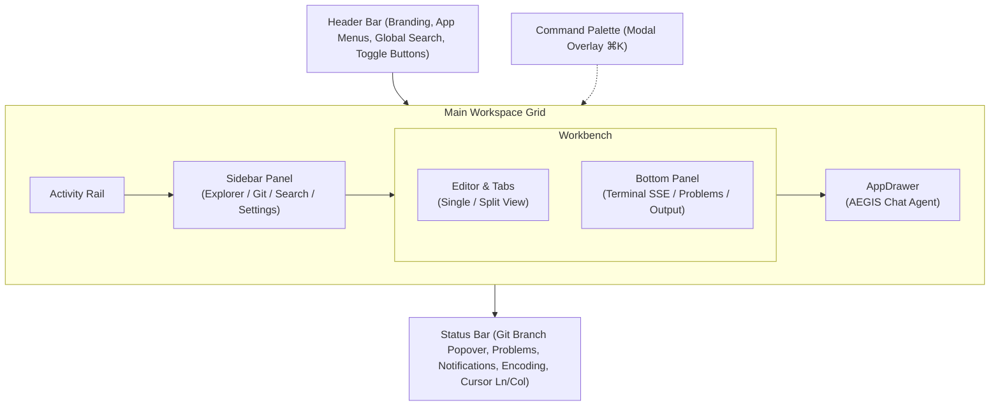

# AEGISCODE: Arsitektur & Blueprint Wireframe Frontend

> **Objective**: IDE Lightweight, Local Server  
> **Arsitektur**: Microservice (Local Runner / SSE / LSP)  
> **Prinsip Utama**: DONT Over Engineering  

---

## 1. Aturan & Batasan (Core Constraints)

### Constrain Frontend
1. **Reuse token color tailwind**: Semua styling warna wajib merujuk pada token tema yang telah didefinisikan di `@theme` Tailwind CSS v4 (`bg-canvas`, `bg-surface`, `text-ink`, `border-line`, dsb.). Tidak menggunakan arbitrary hardcoded hex color di elemen UI.
2. **Reuse Component design**: Komponen UI dasar (Icon, IconButton, Tab, Popover, Input, Toast) harus berada di `components/ui/` dan dipakai ulang di seluruh modul layout tanpa menduplikasi elemen primitif.
3. **Lightweight & Modular**: Pecah antarmuka menjadi komponen terisolasi per area layout tanpa dependensi state library yang berat (cukup React Context + Custom Hook).

### Constrain Backend
1. **DO NOT Try catch Silent**: Jika error terjadi, harus memutus fungsi (break the function) dan memicu penanganan yang jelas.
2. **DO NOT Add Spaghetti try catch**: 1 fungsi cukup memiliki 1 alur validasi yang benar tanpa tumpukan try-catch bersarang.
3. **DO NOT Add const jika tidak diperlukan**: Cek kemungkinan mutasi state dan minimalisasi konstanta redundan.

---

## 2. Struktur Arsitektur Frontend (`src/`)

Arsitektur direktori frontend direstrukturisasi dari komponen monolitik menjadi struktur modular berbasis area layout dan shared UI kit:

```text
src/
├── components/
│   ├── layout/            # Arsitektur Orkestrator & Mikro-komponen (Co-located CSS)
│   │   ├── header/            # Modul Header IDE
│   │   │   ├── Header.tsx             # Orkestrator Header
│   │   │   ├── WindowControls.tsx     # Traffic lights & branding
│   │   │   ├── AppMenu.tsx            # Menu dropdown (File, Edit, View, Run, Terminal)
│   │   │   ├── GlobalSearchButton.tsx # Quick command launcher trigger (⌘K)
│   │   │   ├── HeaderActions.tsx      # Toggle buttons panel, sidebar, & chat
│   │   │   └── header.css             # Styling header bar & window controls
│   │   ├── activity-rail/     # Navigasi Vertikal Sisi Kiri
│   │   │   ├── ActivityRail.tsx       # Switcher Explorer, Search, Git, & Settings
│   │   │   └── activity-rail.css      # Styling activity rail vertical bar
│   │   ├── sidebar/           # Modul Primary Sidebar
│   │   │   ├── Sidebar.tsx            # Orkestrator Sidebar
│   │   │   ├── ExplorerPanel.tsx      # File tree, Outline, & Timeline
│   │   │   ├── SearchPanel.tsx        # Regex search & replace repositori
│   │   │   ├── SourceControlPanel.tsx # Git changes staging, commit, & sync
│   │   │   ├── SettingsPanel.tsx      # Preferences editor (auto save, minimap, tab size)
│   │   │   └── sidebar.css            # Styling side panel & sub-panels
│   │   ├── editor/            # Modul Workbench Text Editor
│   │   │   ├── Editor.tsx             # Orkestrator Editor & Split View
│   │   │   ├── EditorTabs.tsx         # Multi-tab switcher & tab action bar
│   │   │   ├── EditorBreadcrumbs.tsx  # Path visual file & selector bahasa
│   │   │   ├── CodePane.tsx           # Render baris kode, penomoran baris, & diagnostic dots
│   │   │   ├── Minimap.tsx            # Visual minimap code overview
│   │   │   ├── EditorFindWidget.tsx   # Floating in-editor find widget (Ctrl+F)
│   │   │   └── editor.css             # Styling tabs, breadcrumbs, code panes, & minimap
│   │   ├── bottom-panel/      # Modul Bottom Drawer
│   │   │   ├── BottomPanel.tsx        # Orkestrator Bottom Panel
│   │   │   ├── TerminalView.tsx       # Simulasi terminal native runner SSE (zsh/bash)
│   │   │   ├── ProblemsView.tsx       # Daftar diagnostic error & warning syntax
│   │   │   ├── OutputView.tsx         # Logs adapter linting incremental
│   │   │   └── bottom-panel.css       # Styling bottom drawer, terminal, & problems
│   │   ├── chat/              # Modul AppDrawer AEGIS AI Agent
│   │   │   ├── ChatDrawer.tsx         # Orkestrator Chat Drawer (Master-Detail Host)
│   │   │   ├── ChatHeader.tsx         # Agent title, toggle sessions sidebar & actions
│   │   │   ├── ChatSessionSidebar.tsx # Sub-kolom panel master riwayat sesi
│   │   │   ├── ChatMessageList.tsx    # Render bubble pesan & token badge (/ & @)
│   │   │   ├── ChatSuggestions.tsx    # Quick prompt recommendation pills
│   │   │   ├── ChatComposer.tsx       # Textarea input & keyboard trigger autocomplete
│   │   │   ├── ChatCommandPopover.tsx # Floating popover autocomplete (/ skills & @ files)
│   │   │   ├── ChatProviderSelect.tsx # Cascading grouped model & provider dropdown
│   │   │   ├── index.ts               # Barrel export modul chat
│   │   │   └── chat.css               # Styling chat drawer, sessions, messages, & composer
│   │   ├── status-bar/        # Modul Status Bar & Popovers
│   │   │   ├── StatusBar.tsx          # Orkestrator Status Bar
│   │   │   ├── BranchPopover.tsx      # Popover checkout branch git
│   │   │   ├── ProblemsPopover.tsx    # Popover ringkasan problem syntax
│   │   │   ├── NotificationsPopover.tsx # Popover notification center & unread badge
│   │   │   └── status-bar.css         # Styling status bar & popovers
│   │   ├── command-palette/   # Modul Command Palette Overlay
│   │   │   ├── CommandPalette.tsx     # Modal launcher perintah cepat (⌘K)
│   │   │   └── command-palette.css    # Styling modal palette & search results
│   │   └── index.ts           # Barrel Export Terpusat untuk App.tsx
│   └── ui/                # Reusable UI Primitives Kit
│       ├── Icon.tsx           # SVG icon registry terpusat (aegis, file, folder, git, dsb.)
│       ├── IconButton.tsx     # Tombol aksi berbasis icon dengan tooltip & active state
│       └── Toast.tsx          # Notifikasi aksi pengguna
├── styles/                # Shared Styling Foundations & Primitives
│   ├── tokens.css             # Definisi @theme Tailwind v4 & palet semantic tokens
│   ├── base.css               # Reset global (#root, body, buttons, focus-visible)
│   ├── ui.css                 # Styling elemen UI bersama (icon-button, toast, scrollbar)
│   └── shell.css              # Master frame layout (.app-shell, .workspace, .workbench)
├── context/
│   └── WorkbenchContext.tsx   # React Context & useWorkbench Hook (state wireframe interaktif)
├── data/
│   ├── chatConstants.ts       # Preset skill autocomplete & model providers
│   └── mockData.ts            # Data awal file tree, diagnostic lints, terminal logs, git changes
├── types/
│   └── workbench.ts           # Type definitions untuk file item, tab, terminal, lint diagnostic
├── index.css                  # Slim Aggregator (@import tailwindcss & modul CSS)
├── main.tsx                   # Root entry point
└── App.tsx                    # Komposisi Shell IDE (< 50 baris)
```

---

## 3. Hierarki & Kolom Layout Wireframe

Layout IDE AegisCode mengadopsi 5 zona kolom/baris modular:



### Rincian 5 Kolom / Area:
1. **Header Bar**:
   - macOS Traffic Lights (Window controls).
   - Branding AegisCode.
   - Menu bar interaktif (File, Edit, View, Run, Terminal) dengan keyboard shortcut.
   - Quick Command Launcher button (`⌘ K`).
   - Action toggle: Toggle Bottom Panel (`Ctrl+J`), Toggle Primary Sidebar (`Ctrl+B`), Toggle AEGIS Chat.
2. **Activity Rail & Sidebar (Left Columns)**:
   - **Activity Rail**: Ikon switcher untuk Explorer, Search, Source Control (Git), dan Settings.
   - **Explorer**: File tree hierarkis dengan status aktif/muted, icon folder/file, expandable section (Outline, Timeline).
   - **Search & Replace**: Regex-ready input filter untuk repositori aktif dengan file include pattern.
   - **Source Control**: Branch info, commit message composer, status perubahan staging (M/A/D), dan sync action.
   - **Settings**: Pengaturan konfigurasi editor (Auto Save, Minimap, Tab Size).
3. **Workbench (Center Column)**:
   - **Tabs Header**: Multi-tab switcher dengan tombol run file, split editor toggle, dan penutup tab.
   - **Breadcrumbs**: Path visual file aktif (`src > App.tsx > LocalServer`) dan profile bahasa pemrograman (TypeScript, Python, C++, dsb.).
   - **Editor Panes**: Editor single pane atau multi-pane/split horizontal, minimap code overview, serta diagnostic highlight dot (warning/error).
   - **Bottom Panel**: Panel drawer bawah dengan tab *Terminal* (simulasi native runner zsh/bash dengan shortcut terminate & clear), *Problems* (daftar error & warning syntax), dan *Output* (lint adapter log).
4. **AppDrawer (Right Column)**:
   - Panel chatbot AEGIS Agent yang terhubung dengan konteks workspace lokal.
   - History pesan AI & user, suggestion prompt ("Explain this file", "Fix 2 problems"), serta context badge.
5. **Status Bar (Bottom Row)**:
   - Info branch Git aktif (dengan popover switcher branch lokal).
   - Indikator masalah syntax (error/warning popover).
   - Indikator cursor posisi (Ln, Col), indentasi spasi, encoding file (UTF-8), bahasa aktif.
   - Notification center popover dengan unread counter badge.

---

## 4. Design System & Token Reusability (Tailwind CSS v4)

Semua komponen wajib mengonsumsi semantic token warna yang dideklarasikan di `src/styles/tokens.css` (di-load via `src/index.css`):

| Token CSS | Variabel Tailwind Class | Deskripsi Penggunaan |
| :--- | :--- | :--- |
| `--color-canvas` | `bg-canvas`, `border-canvas` | Latar belakang kanvas terluar IDE (`#090d14`) |
| `--color-surface` | `bg-surface` | Background panel utama, header, dan bottom bar |
| `--color-surface-raised`| `bg-surface-raised` | Background kartu, input, tab aktif, dan dropdown |
| `--color-surface-hover` | `hover:bg-surface-hover` | Efek hover item list, file tree row, dan tombol |
| `--color-line` | `border-line` | Garis pemisah antar kolom dan border tipis |
| `--color-line-bright` | `border-line-bright` | Border aktif, divider popover, garis pemisah kontras |
| `--color-ink` | `text-ink` | Teks utama (`#e7edf7`) |
| `--color-ink-soft` | `text-ink-soft` | Teks sekunder, label, keterangan path |
| `--color-ink-muted` | `text-ink-muted` | Teks placeholder, shortcut kbd, file muted |
| `--color-accent` | `text-accent`, `bg-accent` | Aksen biru Aegis (`#79b8ff`), focus ring, tombol aksi |
| `--color-accent-soft` | `bg-accent-soft` | Background elemen aktif terpilih |
| `--color-green` | `text-green`, `bg-green` | Indikator sukses, status dot aktif, syntax string |
| `--color-orange` | `text-orange` | Peringatan diagnostic, badge angka |
| `--color-red` | `text-red` | Diagnostic error syntax, status terminate |
| `--color-blue` / `--color-pink` / `--color-cyan` | `syntax-*` | Syntax highlighting editor code |

---

## 5. State Management & Mock Interaction Layer

State dikelola secara terpusat melalui `WorkbenchContext` menggunakan standard React Context dan custom hook `useWorkbench()`:

- **Layout State**: `sidebarOpen`, `panelOpen`, `chatOpen`, `commandPaletteOpen`, `splitEditorOpen`.
- **Navigation State**: `activeActivity` ('Explorer' | 'Search' | 'Source Control' | 'Settings'), `activeTab`, `openTabs`.
- **Workspace Data**: `fileTree`, `activeFileContent`, `gitBranch`, `gitChanges`, `notifications`, `diagnostics`.
- **Terminal State**: `terminalLogs`, `terminalRunning`, `sendTerminalCommand(cmd)`, `clearTerminal()`.
- **Agent Chat State**:
  - `sessions`: Daftar sesi percakapan aktif & historis (`ChatSession[]`).
  - `activeSessionId`, `activeSession`: Sesi percakapan yang sedang aktif.
  - `activeProvider` ('antigravity' | 'opencode' | 'openrouter'), `activeModel`: Konfigurasi LLM aktif.
  - `createSession(provider?, model?)`, `switchSession(id)`, `deleteSession(id)`, `setSessionModel(provider, model)`.
  - `chatMessages`: Riwayat pesan pada sesi aktif (`activeSession.messages`).
  - `sendChatMessage(text)`: Mengirim pesan pengguna, trigger auto-naming sesi, dan simulasi respon agent kontekstual.
- **Toast Feedback**: `showToast(message)` untuk konfirmasi interaksi pengguna.

---

## 6. Roadmap Pengembangan Wireframe Frontend (5 Phase)

### Phase 1: Layout Kolom & Shell Componentization (Selesai)
- Pemisahan `App.tsx` menjadi `components/layout/` (Header, ActivityRail, Sidebar, Editor, BottomPanel, ChatDrawer, StatusBar, CommandPalette).
- Reusable UI kit di `components/ui/` (Icon registry, IconButton, Toast).
- Konfigurasi `WorkbenchContext` untuk seluruh interaksi navigasi wireframe.
- Menjamin kepatuhan terhadap Tailwind theme tokens dan zero arbitrary colors.

### Phase 2: Workbench & Code Editor Interactivity
- Mock Monaco Editor / CodeMirror integration preview.
- Syntax highlighting per bahasa pemrograman (TypeScript, Python, C++, JSON, Markdown).
- Multi-window split editor horizontal/vertikal.
- Diagnostic lint markers (garis bawah merah/kuning) yang terhubung ke panel Problems.
- Panel terminal mock dengan penanganan runner shortcut (`Ctrl+C`, `Enter`, `clear`, `lint`).

### Phase 3: Explorer & Workspace Tools
- Mock CRUD file tree (buat file/folder, rename, hapus).
- Context menu klik kanan (Copy Path, Relative Path, Delete).
- Regex search and replace interaktif di file mock.
- Git control UI: staging area, commit input dengan validasi, branch visual graph.
- Settings modal overlay dengan filter pencarian instan.

### Phase 4: Status Bar & Diagnostics System
- Filter masalah (Problems) per severity (Error, Warning, Info).
- Git branch checkout popover switcher.
- Notification management center (mark all as read, dismissal).

### Phase 5: AppDrawer (Agentic Aegis Chat, Multi-Provider & Sessions)
- **Multi-Session Management**: Pembuatan sesi instan, menu riwayat sesi di header, auto-naming sesi dari prompt pertama, dan pemulihan otomatis jika sesi kosong.
- **Cascading Model Provider**: Grouped popover di footer composer untuk memilih provider (Antigravity, OpenCode, OpenRouter) beserta model unggulan.
- **Command & Context Autocomplete**:
  - `/` untuk trigger 5 preset skill agent (`/spec`, `/plan`, `/review`, `/debug`, `/simplify`).
  - `@` untuk mention file/folder langsung dari context workspace.
  - Visual token badges berikon di bubble riwayat pesan.
- Streaming response mockup untuk agent chat.
- Mekanisme file-editing preview (diff view) yang disarankan oleh agent.

---

## 7. Standar Integrasi Menuju Local Server (Microservice Readiness)

Meskipun saat ini fokus pada wireframe frontend, antarmuka dirancang agar transisi ke microservice backend berjalan mulus tanpa merombak UI:

1. **Terminal SSE**: Hook `useWorkbench` dirancang menerima Stream Server-Sent Events (`EventSource('/api/terminal/stream')`) menggantikan mock terminal state.
2. **File System API**: `fileTree` siap dipetakan ke endpoint REST/gRPC lokal (`GET /api/workspace/tree`).
3. **LSP Diagnostics**: Model problem diagnostics mengikuti struktur Language Server Protocol (`range`, `message`, `severity`, `source`).
4. **Agent Bridge**: Format pesan `ChatMessage` kompatibel dengan payload prompt agent AI Aegis Code.

---

## 8. Arsitektur Relayouting Chat & Agent System (Sesi, Multi-Provider, & Autocomplete)

Sistem Chat Agent pada `src/components/layout/chat` direlayout secara modular dengan arsitektur berikut:

### A. Manajemen Sesi Percakapan (Master-Detail Split Layout)
- **Komponen**: 
  - `ChatSessionSidebar.tsx`: Sub-kolom panel master riwayat sesi (lebar 190px) di sebelah kiri chat aktif saat expanded.
  - `ChatDrawer.tsx`: Host orkestrator yang melebarkan grid drawer dari 300px ke 500px (`.workspace-chat-expanded`) saat sesi dibuka.
  - `ChatHeader.tsx`: Tombol toggle icon `history` (🕒) di samping tombol `+` (*New Chat*) dan `✕` (*Close*).
- **Interaksi & UX Menyatu (Master-Detail)**:
  - Sesi dan alur chat terlihat berdampingan secara bersamaan (*master-detail layout*).
  - Mengklik sesi di sidebar langsung memuat pesan pada pane chat sebelah kanan secara instan (*live switch*) tanpa menutup tampilan atau menutupi composer.
  - Tombol `+ New Session` di header sidebar untuk membuat percakapan baru instan.
  - Tombol toggle `[🕒]` di header mengecilkan chat drawer kembali ke ukuran normal 300px.
- **Lifecycle & Storage**:
  - Setiap sesi memiliki tipe `ChatSession`: `{ id, title, provider, model, messages, createdAt }`.
  - Judul sesi otomatis diperbarui (*auto-named*) dari cuplikan 26 karakter pertama dari prompt user pertama.
  - Sesi disimpan secara persisten di browser (`localStorage` dengan key `aegis_chat_sessions_v2` dan `aegis_active_session_id_v2`).
  - Jika pengguna menghapus seluruh sesi, sistem secara otomatis menginisiasi satu sesi baru kosong (*safety reset*).

### B. Mode Dropdown & Provider Bertingkat (Cascading Model Select)
- **Komponen**: `ChatProviderSelect.tsx` di footer `ChatComposer`.
- **Struktur Menu**: Tombol single-badge compact (`[Provider] model ▾`) yang membuka popover terkelompok (*grouped list*):
  - **Antigravity**: `gemini-2.5-flash` (default), `gemini-2.5-pro`
  - **OpenCode**: `claude-3.7-sonnet` (default), `claude-3.5-haiku`
  - **OpenRouter**: `deepseek-r1` (default), `claude-3.7-sonnet`, `gpt-4o`
- **Scoping**: Model dan provider terikat secara individual per sesi chat aktif.

### C. Autocomplete Command (`/`) & Context Path (`@`)
- **Komponen**: `ChatCommandPopover.tsx` & parser di `ChatComposer.tsx`.
- **Deteksi Input**: Regex real-time mendeteksi token sebelum kursor yang berawalan `/` atau `@`.
- **Daftar Opsi**:
  - `/` (Skills): Menampilkan preset skill agent: `/spec` (Specification), `/plan` (Implementation Plan), `/review` (Code Review), `/debug` (Debugging), `/simplify` (Simplification).
  - `@` (Files/Folders): Menampilkan tree file dari `useWorkbench().files`. Folder otomatis diakhiri trailing slash `/` (contoh `@components/`).
- **Navigasi Keyboard**: `ArrowUp` / `ArrowDown` untuk memilih, `Enter` / `Tab` untuk menyisipkan token, `Escape` untuk menutup popover.
- **Visual Token Rendering**: Di bubble pesan `ChatMessageList.tsx`, token `@` dirender sebagai badge file/folder berikon biru/oranye, dan token `/` dirender sebagai badge command berikon ungu/aksen.

### D. Redesain Balon Chat & Input Context Toolbar
- **Relokasi In-Context File**: Sub-bar context lama di header ditiadakan. Indikator konteks file aktif dipindahkan langsung ke footer `ChatComposer.tsx` berupa badge pill `[● activeTab]` di samping selector provider.
- **Pembersihan Area Percakapan**: Banner intro lama (*"Build with your codebase, not around it."*) dan suggestion pills dihapus total, memaksimalkan area baca percakapan.
- **Balon Chat Modern**:
  - **Header Balon**: Ikon avatar (`msg-avatar-agent` / `msg-avatar-user`), label pengirim (*AEGIS* / *You*), serta model badge monospaced pada respon agen.
  - **Balon User**: Rata kanan dengan card `var(--color-accent-soft)` dan border aksen.
  - **Balon Agent**: Rata kiri dengan card `var(--color-surface-raised)`, tipografi terstruktur, dan tombol interaktif **Copy Message** (ikon copy) yang muncul saat bubble di-hover.
  - **Empty State**: Placeholder minimalis dan bersih jika sesi chat baru belum memiliki pesan.


