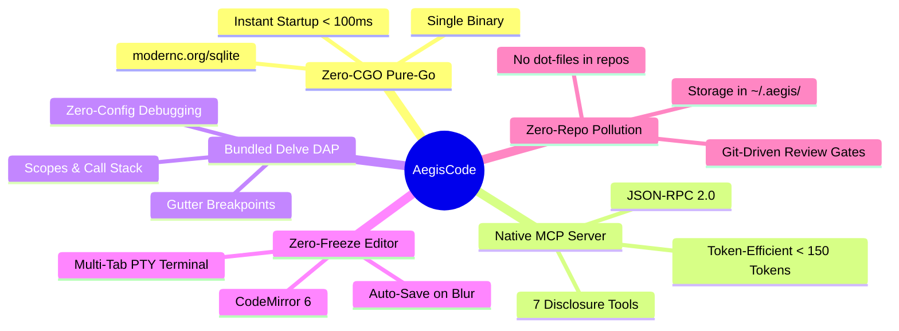
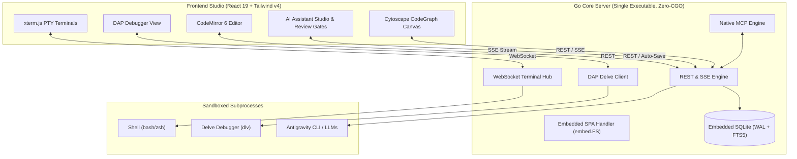

# AegisCode 🛡️⚡

> **Next-Generation Lightweight Web IDE + Local Cross-Platform Go Core Server + Interactive Visual CodeGraph**

[](RELEASE_NOTES.md)
[](LICENSE)
[](https://golang.org)
[](https://react.dev)
[](https://tailwindcss.com)
[](docs/architecture/architecture-overview.md)

---

## ⚡ 1-Line Quickstart

Launch the standalone IDE workbench instantly (macOS Apple Silicon pre-built binary):

```bash
curl -fsSL https://raw.githubusercontent.com/aditlab-code/AegisCode/main/scripts/install.sh | bash || ./bin/aegiscode-darwin-arm64 --open
```

Then navigate to:
```text
http://127.0.0.1:8080
```

---

## 🌟 Overview

**AegisCode** is an open-source, ultra-responsive developer workbench engineered to replace sluggish, multi-gigabyte memory-heavy IDEs. It couples a modular **React 19** front-end with an efficient **Go Core Server** compiled into a standalone, zero-dependency single executable.

Whether running as a native desktop application on macOS via a lightweight Cocoa WKWebView wrapper, running headless on a local server, or broadcasting an interactive coding session to your iPad or Android tablet, AegisCode guarantees instant cold-start times (<100ms) and minimal RAM utilization.

---

## 🛡️ Key Pillars & Capabilities



* **Zero-CGO Pure-Go Core**: Compiles seamlessly on macOS, Linux, and Windows with `CGO_ENABLED=0`. Powered by pure-Go SQLite (`modernc.org/sqlite`) in WAL mode with FTS5 instant search.
* **Native Model Context Protocol (MCP)**: Native stdio JSON-RPC 2.0 runner exposing 7 progressive disclosure tools (`get_file_outline`, `get_symbol_definition`, `query_subgraph`, etc.) keeping AI context overhead under 150 tokens.
* **Bundled Delve DAP Debugger**: Zero-config Go debugging with Delve (`dlv`). Set gutter breakpoints, inspect variable scopes, view active call stacks, and control execution with floating controls.
* **Zero-Freeze Editor & PTY Terminal**: Lightning-fast CodeMirror 6 with smart dirty buffer management and auto-save on blur, paired with multi-tab `@xterm/xterm` pseudoterminals over WebSockets.
* **Interactive Cytoscape CodeGraph**: Live graph visualization supporting Hierarchical (Dagre) and Clustered (CoSE) layouts, symbol search, jump-to-source on double-click, and real-time AI tracing.
* **Git-Driven Review Gates**: Every modification proposed by an AI agent is verified through an interactive line-by-line diff inspector before touching disk.
* **Zero-Repo Pollution**: All app configs, chats, and workspace graph indices are strictly contained within `~/.aegis/` (`aegis.db` and `graphs/<hash>.db`). No hidden dotfiles in your project repos.

---

## 🏗️ Architecture Blueprint



---

## 💻 Platform Distribution & Status

| Platform | Format | Status | Quick Command |
| :--- | :--- | :---: | :--- |
| **macOS Apple Silicon** (M1–M4) | `.dmg` Installer<br>`aegiscode-darwin-arm64` | **`[Tested & Verified]`** | Mount `bin/AegisCode.dmg` or run `./bin/aegiscode-darwin-arm64 --open` |
| **macOS Intel** (x86_64) | `aegiscode-darwin-amd64` | **`[Ready for Testing]`** | `./bin/aegiscode-darwin-amd64 --open` |
| **Linux** (x64 / ARM64) | `aegiscode-linux-amd64`<br>`aegiscode-linux-arm64` | **`[Ready for Testing]`** | `./bin/aegiscode-linux-amd64 --open` |
| **Windows** (x64) | `aegiscode-windows-amd64.exe` | **`[Ready for Testing]`** | `.\bin\aegiscode-windows-amd64.exe --open` |

---

## 🚀 Building from Source

### Prerequisites
- **Go**: Version `1.23+` ([golang.org](https://golang.org))
- **Node.js**: Version `20+` ([nodejs.org](https://nodejs.org))

```bash
# 1. Clone repository
git clone https://github.com/aditlab-code/AegisCode.git
cd AegisCode

# 2. Install dependencies & build frontend bundle
npm install
npm run build

# 3. Compile standalone single binary (Zero-CGO)
npm run build:binary

# 4. Launch the binary
./bin/aegiscode-darwin-arm64 --open
```

---

## 📚 Documentation Index

Explore our comprehensive documentation suite:

| Category | Guides & References |
| :--- | :--- |
| **User Guides** | [Installation Guide](docs/user-guide/installation.md) • [Getting Started](docs/user-guide/getting-started.md) • [Editor & Terminal](docs/user-guide/editor-and-terminal.md) • [Delve Debugger](docs/user-guide/debugging-with-delve.md) • [AI & Review Gates](docs/user-guide/ai-assistant-and-review-gates.md) • [Visual CodeGraph](docs/user-guide/visual-codegraph.md) • [Troubleshooting & FAQ](docs/user-guide/troubleshooting-and-faq.md) |
| **Architecture** | [Architecture Blueprint](docs/architecture/architecture-overview.md) • [Database Schema & Partitioning](docs/architecture/database-schema.md) • [ADR Catalog](docs/adr/README.md) |
| **Developers & MCP** | [MCP Specification](docs/developers/mcp-specification.md) • [Local REST & SSE APIs](docs/developers/local-rest-and-sse-api.md) • [Plugin & Extension Guide](docs/developers/plugin-and-extension-guide.md) |
| **Community & Policies**| [Contributing Guidelines](CONTRIBUTING.md) • [Code of Conduct](CODE_OF_CONDUCT.md) • [Security Policy](SECURITY.md) • [Changelog](CHANGELOG.md) • [Roadmap](ROADMAP.md) |

---

## 📄 License & Attribution

AegisCode is open-source software licensed under the **[MIT License](LICENSE)**.  
Third-party component attributions and dependencies are cataloged in **[NOTICE](NOTICE)**.
