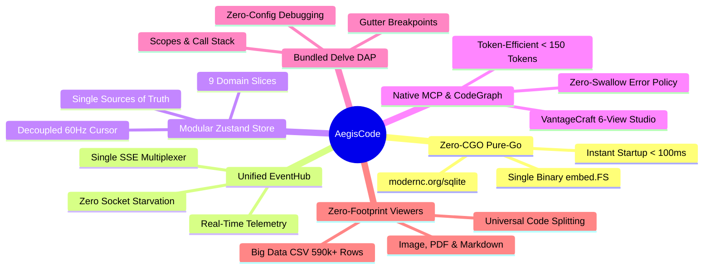
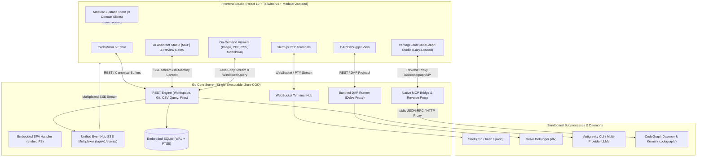

# AegisCode 🛡️⚡

> **Next-Generation Lightweight Web IDE + Local Cross-Platform Go Core Server + Interactive Visual CodeGraph**

[](RELEASE_NOTES.md)
[](LICENSE)
[](https://golang.org)
[](https://react.dev)
[](https://tailwindcss.com)
[](docs/internal/architecture.md)
[](test/frontend/)
[](server/)

---

## ⚡ 1-Line Quickstart

Launch the standalone IDE workbench instantly (macOS Apple Silicon pre-built binary):

```bash
curl -fsSL https://raw.githubusercontent.com/aditlab-code/AegisCode/main/scripts/install.sh | bash || ./bin/aegiscode-darwin-arm64 --open
```

Then navigate to:
```text
http://127.0.0.1:8080
```

---

## 🌟 Overview

**AegisCode** is an open-source, ultra-responsive developer workbench engineered to replace sluggish, multi-gigabyte memory-heavy IDEs. It couples a modular **React 19** front-end with an efficient **Go Core Server** compiled into a standalone, zero-dependency single executable.

Whether running as a native desktop application on macOS via a lightweight Cocoa WKWebView wrapper, running headless on a local server, or broadcasting an interactive coding session to your iPad or Android tablet, AegisCode guarantees instant cold-start times (<100ms) and minimal RAM utilization.

---

## 🛡️ Key Pillars & Capabilities



* **Zero-CGO Pure-Go Core**: Compiles seamlessly on macOS, Linux, and Windows with `CGO_ENABLED=0`. Single standalone binary (~7.5 MB UPX) embedding React 19 production assets via Go `embed.FS`. Powered by pure-Go SQLite (`modernc.org/sqlite`) in WAL mode with FTS5 instant search.
* **Unified EventHub SSE Multiplexer ([ADR 0016](docs/adr/0016-http1-socket-starvation-prevention-and-canonical-workspace-buffer-lifecycle.md))**: Solves HTTP/1.1 browser socket starvation by multiplexing workspace, logs, workers, debug, and LSP telemetry across a single persistent SSE stream (`GET /api/v1/events`).
* **Modular Zustand Architecture ([`src/store/index.ts`](src/store/index.ts))**: 9 typed domain slices (`createWorkspaceSlice`, `createEditorSlice`, `createChatSlice`, `createGitSlice`, `createDebugSlice`, `createTerminalSlice`, `createLayoutSlice`, `createSettingsSlice`, `codegraphSlice`) with single sources of truth, decoupled 60Hz cursor rendering (`useCursorPosition`), and dynamic host shell auto-detection (`detectDefaultShell()`).
* **Concurrency-Hardened Buffer Lifecycle ([ADR 0016](docs/adr/0016-http1-socket-starvation-prevention-and-canonical-workspace-buffer-lifecycle.md))**: Single canonical POSIX path indexing, in-flight save keystroke preservation (`OPT-BUF-01`), 800ms self-save watcher echo suppression (`OPT-BUF-02`), and per-file monotonic fetch sequence tokens (`OPT-BUF-05`).
* **Universal On-Demand Code Splitting for Non-Code Viewers**: Non-code viewer panes (`ImageViewer`, `MarkdownViewer`, `PdfViewer`, `CsvViewer`, `CodeGraphShell`) load asynchronously on-demand via `React.lazy()` with zero initial RAM bloat during standard code editing.
* **Native Go Big Data CSV Query Engine**: High-throughput RFC 4180 row offset scanner in Go parsing 590,000+ rows / 394 columns in 770ms using only ~4.7 MB RAM, supporting instant random-access seeks (< 0.20ms) and server-side column windowing.
* **Native Model Context Protocol (MCP)**: Native stdio JSON-RPC 2.0 bridge to `@colbymchenry/codegraph` exposing 10 progressive disclosure tools keeping AI context overhead under 150 tokens.
* **Bundled Delve DAP Debugger**: Zero-config Go debugging with Delve (`dlv`). Set gutter breakpoints, inspect variable scopes, view active call stacks, and control execution with floating controls.
* **Zero-Freeze Editor & Multi-Session PTY Terminal**: Lightning-fast CodeMirror 6 paired with multi-tab cross-platform terminal PTYs over WebSockets/SSE with host shell auto-detection (`pwsh`/`powershell` on Windows, `zsh`/`bash` on macOS/Linux).
* **VantageCraft CodeGraph Studio ([ADR 0014](docs/adr/0014-native-colbymchenry-codegraph-and-vantagecraft-ui.md) & [ADR 0015](docs/adr/0015-native-codegraph-contract-alignment-and-zero-swallow.md))**: Multi-view architectural studio backed by native reverse proxying (`/api/codegraph/ui/*`) featuring Entrypoints & APIs, Execution Steps, Directed Flow & Trails, Screens & Events, and Bounded Inspection with zero-swallow error policy.
* **AI Drawer with Visual [MCP] Badges & Review Gates**: Multi-provider support (Antigravity, Claude, OpenCode, OpenRouter), dynamic skill discovery, interactive thinking accordion, and Git-driven review gates ensuring all modifications are inspected line-by-line in a side-by-side diff editor before touching disk.
* **Zero-Repo Pollution**: All app configs, chats, and global metadata reside in `~/.aegiscode/`. AI runtime instructions are injected in-memory without polluting repository `AGENTS.md` files.

---

## 🏗️ Architecture Blueprint



---

## 💻 Platform Distribution & Status

| Platform | Format | Status | Quick Command |
| :--- | :--- | :---: | :--- |
| **macOS Apple Silicon** (M1–M4) | `.dmg` Installer<br>`aegiscode-darwin-arm64` | **`[Tested & Verified]`** | Mount `bin/AegisCode.dmg` or run `./bin/aegiscode-darwin-arm64 --open` |
| **macOS Intel** (x86_64) | `aegiscode-darwin-amd64` | **`[Ready for Testing]`** | `./bin/aegiscode-darwin-amd64 --open` |
| **Linux** (x64 / ARM64) | `aegiscode-linux-amd64`<br>`aegiscode-linux-arm64` | **`[Ready for Testing]`** | `./bin/aegiscode-linux-amd64 --open` |
| **Windows** (x64) | `aegiscode-windows-amd64.exe` | **`[Ready for Testing]`** | `.\bin\aegiscode-windows-amd64.exe --open` |

---

## 🚀 Building from Source

### Prerequisites
- **Go**: Version `1.23+` ([golang.org](https://golang.org))
- **Node.js**: Version `20+` ([nodejs.org](https://nodejs.org))

```bash
# 1. Clone repository
git clone https://github.com/aditlab-code/AegisCode.git
cd AegisCode

# 2. Install dependencies & build frontend bundle
npm install
npm run build

# 3. Setup global CodeGraph MCP for AI agents (Claude, Cursor, Antigravity)
npm run mcp:install

# 4. Compile standalone single binary (Zero-CGO)
npm run build:binary

# 5. Launch the binary
./bin/aegiscode-darwin-arm64 --open
```

### Verification & Quality Gates
```bash
npm run build    # Vite production bundle build (0 errors)
npm run format   # Code formatting verification via oxfmt
npx vitest run   # 303 frontend unit tests passing across 28 files
cd server && go test ./...  # 193 backend unit tests passing across 14 packages
```

---

## 📚 Documentation Index

Explore our comprehensive documentation suite:

| Category | Guides & References |
| :--- | :--- |
| **Documentation Index** | [Master Documentation Index](docs/README.md) |
| **Architecture & Core** | [System Architecture](docs/internal/architecture.md) • [Architecture Blueprint](docs/architecture/architecture-overview.md) • [Database Schema & Partitioning](docs/architecture/database-schema.md) • [Architecture Decision Records (ADR 0001–0016)](docs/adr/README.md) |
| **Frontend & Design** | [Frontend UI Design & Zustand Store](docs/internal/frontend.md) |
| **Backend & APIs** | [Backend Architecture & Features](docs/internal/feature-backend.md) • [Local REST & Unified EventHub SSE API](docs/developers/local-rest-and-sse-api.md) • [MCP Specification](docs/developers/mcp-specification.md) • [Plugin & Extension Guide](docs/developers/plugin-and-extension-guide.md) |
| **Roadmap & Reports** | [Engineering Roadmap](docs/internal/roadmap.md) • [Feature Assessment & Health Report](docs/internal/report.md) • [Public Roadmap](ROADMAP.md) |
| **User Guides** | [Installation Guide](docs/user-guide/installation.md) • [Getting Started](docs/user-guide/getting-started.md) • [Editor & Terminal](docs/user-guide/editor-and-terminal.md) • [Delve Debugger](docs/user-guide/debugging-with-delve.md) • [AI & Review Gates](docs/user-guide/ai-assistant-and-review-gates.md) • [Visual CodeGraph](docs/user-guide/visual-codegraph.md) • [Troubleshooting & FAQ](docs/user-guide/troubleshooting-and-faq.md) |
| **Community & Policies**| [Contributing Guidelines](CONTRIBUTING.md) • [Code of Conduct](CODE_OF_CONDUCT.md) • [Security Policy](SECURITY.md) • [Changelog](CHANGELOG.md) |

---

## 📄 License & Attribution

AegisCode is open-source software licensed under the **[MIT License](LICENSE)**.  
Third-party component attributions and dependencies are cataloged in **[NOTICE](NOTICE)**.

---

## 🗄️ Deprecated & Legacy Archives

> **Notice**: The historical concepts, legacy facades, and superseded architectures below have been permanently retired:
- **Cytoscape.js Flat Graph Viewer**: Superseded by VantageCraft 6-View Studio (`CodeGraphShell.tsx`) per [ADR 0014](docs/adr/0014-native-colbymchenry-codegraph-and-vantagecraft-ui.md) and [ADR 0015](docs/adr/0015-native-codegraph-contract-alignment-and-zero-swallow.md).
- **Custom In-Process Go AST Extractors**: Superseded by native `@colbymchenry/codegraph` Tree-sitter and Rust kernel extraction.
- **Fragmented Standalone SSE Streams**: Superseded by Unified Go `EventHub` multiplexer (`GET /api/v1/events`) per [ADR 0016](docs/adr/0016-http1-socket-starvation-prevention-and-canonical-workspace-buffer-lifecycle.md).
- **Monolithic Context Facades**: Pre-Wave 4 `editorCore.ts`, `workspaceCore.ts`, and `settingsCore.ts` superseded by 9 modular Zustand slices in `src/store/slices/`.
- **Purged REST Endpoints (Wave 5 / MP-5.1)**: `/api/v1/auth/handshake`, `/api/v1/pairing/info`, `/api/v1/mcp/rpc`, `/api/v1/mcp/events`, `/api/v1/codegraph/init`, and `/api/codegraph/entrypoints`.
