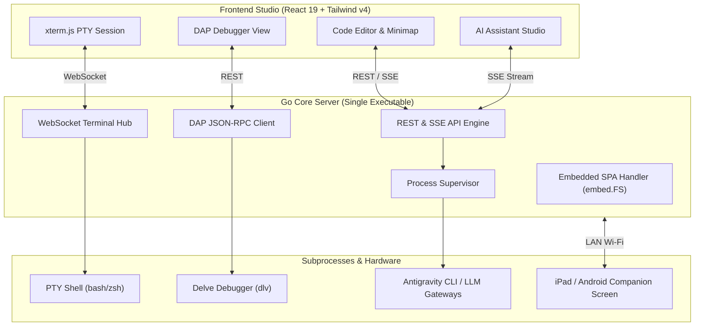

# AegisCode 🛡️⚡

> **Lightweight, High-Performance Web IDE + Local Cross-Platform Go Server + Remote Tablet Companion**

[](RELEASE_NOTES.md)
[](LICENSE)
[](https://golang.org)
[](https://react.dev)
[](https://tailwindcss.com)

---

## Overview

**AegisCode** is an open-source, ultra-responsive developer workbench engineered to replace sluggish, memory-heavy IDEs. It couples a modular **React 19** front-end with an efficient **Go Core Server** compiled into a zero-dependency standalone single binary.

Whether running as a native desktop application on macOS via a lightweight Cocoa WKWebView wrapper, running headless on a remote server, or broadcasting an interactive coding session to your iPad or Android tablet, AegisCode maintains instant startup times (<100ms) and minimal RAM utilization.

---

## Core Capabilities

* **Single-Binary Zero-Dependency Deployment**: The Go server embeds the production React 19 single-page application via `embed.FS`. A single binary executes the complete IDE with no Node.js or Python runtime required at execution time.
* **Native macOS Desktop Application (`.dmg`)**: Packaged with a native Swift/Cocoa WKWebView wrapper for macOS Apple Silicon, delivering native desktop behavior without Electron overhead.
* **Integrated Multi-Provider AI Studio**: Native streaming chat supporting **Antigravity CLI (`agy`)**, **Anthropic Claude**, and **OpenAI/OpenCode/OpenRouter** via Server-Sent Events (SSE) with automated tool-call visualization and path normalizers.
* **Full DAP Debugger**: Bundled Debug Adapter Protocol client communicating directly with Go Delve (`dlv`) for breakpoints, step execution, call stacks, and variable scopes.
* **Real-Time PTY Terminal**: Multi-tabbed terminal sessions powered by `@xterm/xterm` with automatic viewport resizing over WebSockets.
* **Wireless Tablet Companion (`/?mode=companion`)**: Turn an iPad or Android tablet on your local Wi-Fi into an interactive second screen with a live web preview and a touch-friendly code scratchpad.

---

## Architecture at a Glance



---

## Platform Availability & Test Status

| Platform | Distribution Format | Status | Quick Command |
| :--- | :--- | :--- | :--- |
| **macOS Apple Silicon** | `bin/AegisCode.dmg`<br>`bin/aegiscode-darwin-arm64` | **`[Tested & Verified]`** | Mount DMG or run `./bin/aegiscode-darwin-arm64` |
| **macOS Intel** | `bin/aegiscode-darwin-amd64` | **`[Untested / Experimental]`** | `./bin/aegiscode-darwin-amd64` |
| **Windows x64** | `bin/aegiscode-windows-amd64.exe` | **`[Untested / Experimental]`** | `.\bin\aegiscode-windows-amd64.exe` |
| **Linux (x64 / ARM64)** | `bin/aegiscode-linux-amd64`<br>`bin/aegiscode-linux-arm64` | **`[Untested / Experimental]`** | `./bin/aegiscode-linux-amd64` |

*For complete installation instructions and macOS Gatekeeper bypass steps, read the [Installation Guide](INSTALLATION.md).*

---

## Quickstart

### 1. Launching Pre-Built Standalone Binary
```bash
# Make binary executable (macOS / Linux)
chmod +x ./bin/aegiscode-darwin-arm64

# Start local server and auto-open browser
./bin/aegiscode-darwin-arm64 --open
```

The IDE web workbench will be immediately accessible at:
```text
http://localhost:8080
```

### 2. Building from Source
Ensure you have **Node.js 20+** and **Go 1.23+** installed:

```bash
# 1. Clone repository
git clone https://github.com/aditwicaksono/AegisCodev2.git
cd AegisCodev2

# 2. Install dependencies & build web client
npm install
npm run build

# 3. Compile standalone single binary
npm run build:binary

# 4. (macOS) Package native .dmg installer
npm run package:dmg
```

---

## Documentation

* **Release & User Guides**:
  * [README.md](README.md) — Main repository introduction
  * [INSTALLATION.md](INSTALLATION.md) — Comprehensive installation & setup guide
  * [RELEASE_NOTES.md](RELEASE_NOTES.md) — Community release notes for `v1.0.0-beta.1`
  * [LICENSE](LICENSE) — MIT License
* **Internal Developer & Technical Specifications**:
  * [`docs/README.md`](docs/README.md) — Internal documentation index
  * [`docs/internal/architecture.md`](docs/internal/architecture.md) — Architectural principles and module layout
  * [`docs/internal/feature-backend.md`](docs/internal/feature-backend.md) — Go backend endpoints, DAP, and supervisors
  * [`docs/internal/frontend.md`](docs/internal/frontend.md) — UI design tokens and layout modules
  * [`docs/internal/roadmap.md`](docs/internal/roadmap.md) — Engineering phases and milestone tracker
  * [`docs/internal/skills.md`](docs/internal/skills.md) — Engineering skills and agent workflows
  * [`docs/adr/`](docs/adr/) — Architecture Decision Records

---

## License

AegisCode is licensed under the [MIT License](LICENSE).  
Copyright (c) 2026 Adit Wicaksono.
