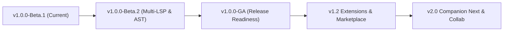

# AegisCode Public Roadmap

This roadmap outlines the strategic milestones and technical trajectory for **AegisCode** as we progress from Beta preview toward General Availability (GA) v1.0 and beyond.

---

## 🗺️ Milestone Overview

---

## Phase 1: Current Status — v1.0.0-Beta.1 (Active)
- [x] Single-binary standalone runtime with embedded React 19 SPA (`embed.FS`).
- [x] Pure-Go Zero-CGO SQLite engine (`modernc.org/sqlite`) with WAL mode and FTS5 search.
- [x] Native macOS Cocoa/Swift WKWebView wrapper and `.dmg` packaging.
- [x] DAP Debugger with bundled Delve (`dlv`) orchestration and UI scopes.
- [x] Terminal PTY runner over WebSockets with xterm.js and viewport auto-fit.
- [x] Model Context Protocol (MCP) server with 7 progressive disclosure tools and native `@colbymchenry/codegraph` bridge.
- [x] VantageCraft 6-View CodeGraph Studio (Entrypoints, Steps, Map, Flow, Screens, FileCode).
- [x] AI Assistant Studio with Antigravity CLI (`agy`), Claude, and OpenAI SSE streams.
- [x] Git-driven Review Gates for safe line-by-line file application.

---

## Phase 2: Milestone v1.0.0-Beta.2 — Multi-Language LSP & AST Expansion
*Focus: First-class polyglot language intelligence and semantic AST analysis without heavyweight background daemons.*

- [x] **Expanded Built-in Language Server Bundles**:
  - **Rust**: Integrated `rust-analyzer` management with auto-download and background diagnostics.
  - **TypeScript / JavaScript**: Embedded `vtsls` or `typescript-language-server` integration.
  - **Python**: Lightweight `pyright` / `basedpyright` support.
  - **Go**: Native `gopls` toolchain bridge via Go process supervisor.
- [x] **Polyglot Code Intelligence & Tree-Sitter Synthesizers**:
  - Native `@colbymchenry/codegraph` Tree-sitter & Rust kernel multi-language engine integration.
  - Cross-language dependency graph resolution (e.g. Go backend calling Python microservice or React frontend calling Go API).
  - Real-time diagnostics multiplexer streaming LSP problems into the editor gutter and Problems view.

---

## Phase 3: Milestone GA — v1.0.0 (Target: 2027)
*Focus: Release hardening, cross-platform distribution, and automated CI/CD.*

- [ ] **Cross-Platform Release Automation**:
  - Automated GitHub Actions build matrix producing pre-compiled binaries for Linux (x64/arm64), Windows (x64), and macOS (Apple Silicon & Intel).
  - Apple Developer ID code signing and notarization for frictionless macOS Gatekeeper execution.
  - Windows Authenticode signing and portable `.zip` / lightweight NSIS installer.
- [ ] **Zero-Config Local Git Workspace Management**:
  - Enhanced multi-root workspace support.
  - Interactive branch switching and visual merge conflict resolution in editor gutter.
- [ ] **Robust WAL Checkpointing**:
  - Automated idle database checkpointing (`PRAGMA wal_checkpoint(TRUNCATE)`) to minimize `.db-wal` disk footprints.

---

## Phase 4: Milestone v1.2 — Extension Architecture & Plugin Marketplace
*Focus: Extensibility for custom tools, custom UI panels, and third-party AI agents.*

- [ ] **Sandboxed Extension API**:
  - Safe iframe and Web Worker extension runtime for adding custom editor tabs, status bar widgets, and graph views.
  - REST and SSE hook registrations for third-party extensions.
- [ ] **External Agent MCP Bridge**:
  - One-click configuration generator for connecting Cursor, Claude Code, Windsurf, and local Ollama instances to the AegisCode MCP daemon.
- [ ] **Decentralized Plugin Registry**:
  - Lightweight GitHub-backed extension catalog with semantic versioning.
- [ ] **First-Party Scientific & Academic Extension Bundles**:
  - **Aegis LaTeX Studio**: Live KaTeX/MathJax formula preview, SyncTeX bi-directional jumping between CM6 editor and compiled PDF, and automated `tectonic` / system compiler execution.
  - **Aegis Quant Research Hub**: Large-scale tabular spreadsheet inspector (`.csv`, `.tsv`, `.parquet`), interactive scientific visualization canvases (Matplotlib/Plotly output), and Python statistical REPL bridge.

---

## Phase 5: Milestone v2.0 — Companion Next & Remote Pair-Programming
*Focus: Hardware acceleration, mobile companions, and collaborative workflows.*

- [ ] **Bidirectional Tablet Companion 2.0**:
  - Full touch-optimized code editing and split-screen live preview on iPadOS and Android tablets.
  - Stylus and Apple Pencil sketch-to-code annotations overlaid on top of the live CodeGraph.
- [ ] **Encrypted Remote Pairing (P2P)**:
  - End-to-end encrypted WebRTC/WireGuard tunnel pairing allowing developers to access their desktop AegisCode instance securely from anywhere without port forwarding.

---

## Suggesting New Features

Have an idea for the roadmap?
1. Check our [Existing Issues](https://github.com/aditlab-code/AegisCode/issues) or [Feature Request Form](.github/ISSUE_TEMPLATE/feature_request.yml).
2. Propose ideas in GitHub Discussions or submit an architectural proposal under `docs/adr/`.

---

## 🗄️ Deprecated & Legacy Archives

> **Notice**: The historical concepts and superseded architectures below have been permanently retired:
- **Cytoscape.js Flat Graph Viewer**: Superseded by VantageCraft 6-View Studio (`CodeGraphShell.tsx`) per ADR 0014 and ADR 0015.
- **Custom In-Process Go AST Extractors**: Superseded by native `@colbymchenry/codegraph` Tree-sitter and Rust kernel extraction.
- **Fragmented Standalone SSE Streams**: Superseded by Unified Go `EventHub` multiplexer (`GET /api/v1/events`) per ADR 0016.
- **Monolithic Context Facades**: Pre-Wave 4 `editorCore.ts`, `workspaceCore.ts`, and `settingsCore.ts` superseded by 9 modular Zustand slices in `src/store/slices/`.

