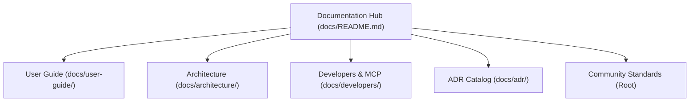

# AegisCode Documentation Index 🛡️📚

Welcome to the **AegisCode** documentation portal. This hub indexes the user guides, architectural blueprints, developer API specifications, and community governance resources.

---

## 🧭 Documentation Map

---

## 📖 1. User & Operations Guide (`docs/user-guide/`)

Comprehensive guides for developers using AegisCode as their daily coding workbench:

| Guide | Description |
| :--- | :--- |
| **[Installation Guide](user-guide/installation.md)** | Pre-built binaries, building from source, checksums, and macOS Gatekeeper. |
| **[Getting Started](user-guide/getting-started.md)** | First workspace launch, `~/.aegis/` storage locations, and AI configuration. |
| **[Editor & Terminal](user-guide/editor-and-terminal.md)** | CodeMirror shortcuts, dirty buffer sync, auto-save on blur, and PTY terminal. |
| **[Delve Debugger](user-guide/debugging-with-delve.md)** | Zero-config Go debugging with Delve DAP, gutter breakpoints, and variable scopes. |
| **[AI Assistant & Review Gates](user-guide/ai-assistant-and-review-gates.md)** | Multi-provider streaming, collapsible thoughts, and Git-driven line-by-line diff gates. |
| **[Visual CodeGraph](user-guide/visual-codegraph.md)** | Navigating Hierarchical (Dagre) and Clustered (CoSE) layouts with live AI tracing. |
| **[Troubleshooting & FAQ](user-guide/troubleshooting-and-faq.md)** | SQLite WAL crash recovery, cache reset, port conflict resolution, and large codebase tuning. |

---

## 🏛️ 2. Architecture & Design Records (`docs/architecture/` & `docs/adr/`)

Technical specifications and formal decision records governing system internals:

| Document | Description |
| :--- | :--- |
| **[Architecture Overview](architecture/architecture-overview.md)** | Hybrid Multi-Process blueprint, disk watcher events, and zero-freeze execution. |
| **[Database Schema & Partitioning](architecture/database-schema.md)** | SQLite3 data dictionary (`aegis.db` and workspace `graphs/*.db`), WAL mode, and FTS5. |
| **[ADR Catalog](adr/README.md)** | Categorized index of Architecture Decision Records (ADR 0001 through ADR 0013). |

---

## 🛠️ 3. Extensibility, API & MCP Reference (`docs/developers/`)

Specifications for integrating external tools, custom UI modules, and AI agents:

| Reference | Description |
| :--- | :--- |
| **[MCP Specification](developers/mcp-specification.md)** | Model Context Protocol JSON-RPC 2.0 runner and 7 progressive disclosure tools. |
| **[Local REST & SSE APIs](developers/local-rest-and-sse-api.md)** | Comprehensive endpoint catalog for workspace, Git, terminal, and AI streams. |
| **[Plugin & Extension Guide](developers/plugin-and-extension-guide.md)** | Building custom UI panels, connecting Cursor/Claude via MCP, and AST extractors. |

---

## 🔧 4. Community Standards & Policies (Root Repository)

* **[README.md](../README.md)** — Project elevator pitch, features, and quickstart.
* **[CONTRIBUTING.md](../CONTRIBUTING.md)** — Development setup, Conventional Commits, and PR checklist.
* **[CODE_OF_CONDUCT.md](../CODE_OF_CONDUCT.md)** — Community pledge and Contributor Covenant v2.1.
* **[SECURITY.md](../SECURITY.md)** — Threat model, socket isolation, and private vulnerability disclosure.
* **[CHANGELOG.md](../CHANGELOG.md)** — Version history adhering to Keep a Changelog.
* **[RELEASE_NOTES.md](../RELEASE_NOTES.md)** — Highlight notes for current beta release.
* **[ROADMAP.md](../ROADMAP.md)** — Strategic milestones from Beta to GA and v2.0.
