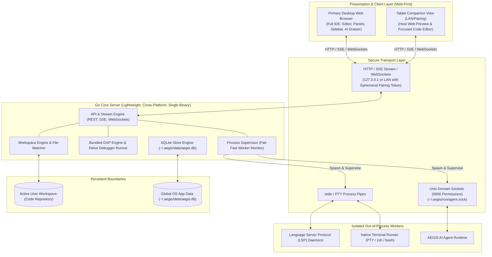

# AegisCode System Architecture

> **Objective**: Lightweight, Web-Based IDE with a Local Cross-Platform Go Backend and Remote Tablet Companion.  
> **Core Architecture**: Hybrid Layered Core with Out-of-Process Worker Supervision.  
> **Core Principle**: Do Not Over-Engineer.

---

## 1. High-Level Architectural Vision

AegisCode is engineered as a modern, lightweight, web-first IDE designed for local developer workflows with remote extension capabilities. It rejects heavy multi-gigabyte runtimes and enterprise microservice sprawl in favor of a lean, high-performance architecture:

### Core Architecture Pillars
1. **Web-Based & Remote-Ready**: The frontend runs natively in modern web standards. Developers can use the desktop browser for full IDE operations and connect a tablet over the local network as a secondary companion host (live preview or dedicated focus editor).
2. **Cross-Platform & Single Standalone Binary (`embed.FS`)**: Compiled into a single zero-dependency standalone native binary (~7.5 MB) for macOS, Linux, and Windows, embedding the production React 19 frontend via Go `embed.FS` (`server/internal/web`). The backend runtime is stateless and immutable; dynamic states are isolated exclusively inside SQLite in the OS App Data directory.
3. **Bundled Backend Debugging**: Debug Adapter Protocol (DAP) and native debugger runners (such as Delve) are bundled directly into the backend supervision engine.
4. **Resilient Isolation**: Heavy or crash-prone tasks (LSP engines, PTY terminal shells, agent reasoning) run as supervised external worker processes so crashes never terminate the core server or freeze editor UI buffers.
5. **Zero-Footprint On-Demand Viewers (Universal PWA Code Splitting)**: To prevent application bundle bloat beyond 50MB+ and protect client memory, every specialized non-code viewer and external parser (including `@tldraw/tldraw` for Wireframe Studio `.canvas`/`.design`, PDF.js for `.pdf`, spreadsheet engines for `.csv`/`.xls`, media viewers for `.svg`/`.png`/`.jpg`, and rich Markdown preview for `.md`) is strictly partitioned into asynchronous dynamic chunks loaded via `React.lazy()` and dynamic `import()`. During standard code editing, all specialized viewer runtimes consume 0 MB RAM, remain unparsed, and never inflate initial load times.

---

## 2. Directory Hierarchy & Folder Responsibilities

The codebase adheres strictly to folder-level boundaries. Each directory owns a distinct architectural responsibility:

### Root Level
- [`/`](file:///Users/aditwicaksono/Documents/Project-AI/AegisCodev2): Root workspace housing configuration manifests (`package.json`, `tsconfig.json`, `vite.config.ts`), agent guidelines, and primary documentation indexes.
- [`src/`](file:///Users/aditwicaksono/Documents/Project-AI/AegisCodev2/src): Complete frontend source code written in React 19, TypeScript, and Tailwind CSS v4.
- [`server/`](file:///Users/aditwicaksono/Documents/Project-AI/AegisCodev2/server): Go Core Server implementation (planned & structured for single-binary cross-platform delivery).
- [`docs/`](file:///Users/aditwicaksono/Documents/Project-AI/AegisCodev2/docs): Official English project documentation, design references, specifications, and ADRs.
- [`.agents/`](file:///Users/aditwicaksono/Documents/Project-AI/AegisCodev2/.agents): Agent skill library, persona definitions, and autonomous workflow specifications.
- [`dist/`](file:///Users/aditwicaksono/Documents/Project-AI/AegisCodev2/dist): Optimized static production bundle produced by Vite for deployment and embedding.
- [`public/`](file:///Users/aditwicaksono/Documents/Project-AI/AegisCodev2/public): Static web assets served verbatim (favicons, manifest metadata).

---

### Frontend Hierarchy (`src/`)

- [`src/components/layout/`](file:///Users/aditwicaksono/Documents/Project-AI/AegisCodev2/src/components/layout): Houses layout orchestrators and composite view panels. Every subfolder owns its respective UI view and co-located stylesheets:
  - `header/`: Window management, quick launcher triggers, layout toggles.
  - `activity-rail/`: Primary navigation rail switching sidebar activity modes.
  - `sidebar/`: Multi-view sidebar containing Explorer, Source Control Git, Search & Replace.
  - `editor/`: Multi-pane text editor workbench, window groups, breadcrumbs, buffer manager, and minimap.
  - `bottom-panel/`: Tabbed lower drawer hosting Multi-session Terminal, Problems diagnostics, and Output logs.
  - `chat/`: AEGIS AI Agent drawer hosting session history, streaming chat, and context triggers.
  - `status-bar/`: Interactive footer displaying line positions, language, git branches, and diagnostic summaries.
  - `settings/`: Modal overlay for IDE settings and configurable keybindings.
  - `command-palette/`: Global command palette launcher (Ctrl/Cmd + K).
- [`src/components/ui/`](file:///Users/aditwicaksono/Documents/Project-AI/AegisCodev2/src/components/ui): Atomic, domain-agnostic UI primitives (icons, icon buttons, badges, toasts, modal backdrops). No business logic is placed here.
- [`src/context/`](file:///Users/aditwicaksono/Documents/Project-AI/AegisCodev2/src/context): Shared React Contexts and hooks (`WorkbenchContext`) governing editor buffers, active panes, terminal streams, and panel states.
- [`src/data/`](file:///Users/aditwicaksono/Documents/Project-AI/AegisCodev2/src/data): Initial mocks, constant registries, AI model definitions, and autocomplete catalogs.
- [`src/styles/`](file:///Users/aditwicaksono/Documents/Project-AI/AegisCodev2/src/styles): Tailwind CSS v4 design token definitions (`tokens.css`), global resets (`base.css`), reusable utility components (`ui.css`), and master frame layout shells (`shell.css`).
- [`src/utils/`](file:///Users/aditwicaksono/Documents/Project-AI/AegisCodev2/src/utils): Client-side utilities including client linter engines, syntax tokenizers, and browser native AI bridge helpers.

---

### Backend Hierarchy (`server/`)

The Go Core Server adheres to a pragmatic, flat package-by-feature layout avoiding deep DDD or hexagonal abstractions:

- `server/cmd/server/`: Executable entry point (`main.go`), CLI flag parsing, configuration bootstrap, and graceful shutdown signal traps.
- `server/internal/api/`: REST routing handlers, SSE multiplexer streams, WebSocket bidirectional event pipes, and pairing authentication middleware.
- `server/internal/config/`: Immutable configuration parser reading environment variables and defaults into read-only struct instances.
- `server/internal/dap/`: Bundled Debug Adapter Protocol runner, managing debug sessions, breakpoints, and Delve daemon proxies.
- `server/internal/store/`: Embedded SQLite storage client managing user profiles, session logs, and IDE preferences in `~/.aegis/data/aegis.db`.
- `server/internal/supervisor/`: Process supervisor managing child workers (LSP, PTY, Agent) with fail-fast crash detection and auto-restart policies.
- `server/internal/terminal/`: Native pseudoterminal (PTY) session manager handling zsh/bash allocation, resizing, and streaming.
- `server/internal/web/`: Embedded production web assets (`embed.FS`) and Single Page Application (SPA) fallback handler serving production React assets.
- `server/internal/workspace/`: Project workspace indexing, file system CRUD actions, safe path validation, and recursive file watchers.

---

### Documentation Hierarchy (`docs/`)

- [`docs/architecture.md`](file:///Users/aditwicaksono/Documents/Project-AI/AegisCodev2/docs/architecture.md): This file — system blueprint and folder-level ownership guide.
- [`docs/frontend.md`](file:///Users/aditwicaksono/Documents/Project-AI/AegisCodev2/docs/frontend.md): UI layout reference organized by component layout folder, updated when visual specifications change.
- [`docs/roadmap.md`](file:///Users/aditwicaksono/Documents/Project-AI/AegisCodev2/docs/roadmap.md): Milestone progression tracking Phases 1 through 9.
- [`docs/feature-backend.md`](file:///Users/aditwicaksono/Documents/Project-AI/AegisCodev2/docs/feature-backend.md): Backend technical blueprint, core features, and critical REST/SSE/WS endpoints.
- [`docs/report.md`](file:///Users/aditwicaksono/Documents/Project-AI/AegisCodev2/docs/report.md): Feature assessment guidelines, scorecard metrics, and pre-implementation gate checklist.
- [`docs/installation.md`](file:///Users/aditwicaksono/Documents/Project-AI/AegisCodev2/docs/installation.md): Installation prerequisites, build instructions, and developer setup.
- [`docs/adr/`](file:///Users/aditwicaksono/Documents/Project-AI/AegisCodev2/docs/adr): Architectural Decision Records (ADR 0001 through 0008).

---

## 3. Communication & Data Flow Contracts

1. **Client to Core Server**:
   - Primary communication occurs over HTTP loopback (`127.0.0.1`) or local LAN with an ephemeral Bearer pairing token generated on server startup.
   - Streaming data (terminal output, file change notifications, AI token streams) flows via Server-Sent Events (SSE) or WebSockets.
2. **Core Server to Workers**:
   - LSP compilers and terminal PTY processes communicate over standard input/output (`stdio`) JSON-RPC.
   - High-throughput local agent tools interact via restricted Unix Domain Sockets (`~/.aegis/run/agent.sock`, mode `0600`).
3. **Tablet Companion Flow**:
   - The desktop initiates a pairing session displaying a tokenized URL or local QR code.
   - The tablet browser connects to the Go server on the local network.
   - The tablet interface renders in **Companion Mode**: enabling switching between running host web previews and a lightweight, focused code editor buffer with two-way file synchronization.
