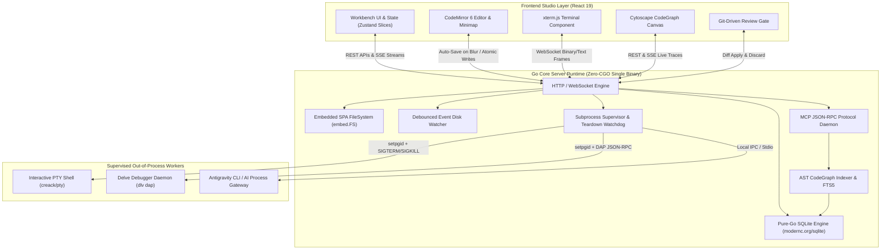

# AegisCode Architecture Overview

AegisCode is engineered around a **Hybrid Multi-Process Architecture** designed to deliver instant startup, zero UI freezing, and strict memory safety.

---

## 1. High-Level System Architecture

---

## 2. Core Architectural Pillars

### 1. Zero-CGO Standalone Binary Distribution
* AegisCode compiles cleanly with `CGO_ENABLED=0`.
* By embedding the production React 19 single-page application into the Go binary via `embed.FS` and adopting pure-Go SQLite (`modernc.org/sqlite`), a single binary execution provides the entire IDE without requiring Node.js, Python, or GCC on target systems.

### 2. Zero-Freeze Architecture & Offloaded Workers
* Heavy computations (AST parsing, graph traversals, SQLite WAL checkpointing, full-text indexing, PTY buffer streaming) execute strictly in the Go backend or web workers.
* The main React rendering thread is never blocked. UI typing and editor interactions retain < 16ms frame times.

### 3. Event-Driven Disk Watcher & Fast SHA-256 Bailout
* File changes trigger non-blocking filesystem events.
* Before parsing modified files into the AST CodeGraph, AegisCode computes a streaming SHA-256 hash. If the hash matches the cached entry in `graph_files`, parsing is immediately aborted (bailout), saving valuable CPU cycles during rapid saves or external Git checkouts.

### 4. Process Group Isolation & Teardown
* Background workers (PTY shells, Delve DAP instances, and AI subprocesses) are spawned in dedicated process groups using `syscall.Setpgid`.
* The supervisor maintains heartbeat monitors. On server shutdown, `SIGTERM` signals are dispatched to child process groups, followed by an automated `SIGKILL` watchdog, preventing orphaned processes from leaking CPU or port bindings.
