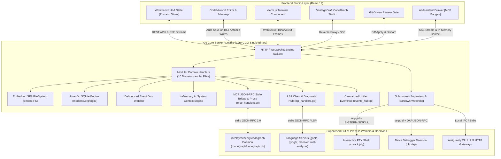

# AegisCode Architecture Overview

AegisCode is engineered around a **Hybrid Multi-Process Architecture** designed to deliver instant startup, zero UI freezing, and strict memory safety.

---

## 1. High-Level System Architecture

---

## 2. Core Architectural Pillars

### 1. Zero-CGO Standalone Binary Distribution
* AegisCode compiles cleanly with `CGO_ENABLED=0`.
* By embedding the production React 19 single-page application into the Go binary via `embed.FS` and adopting pure-Go SQLite (`modernc.org/sqlite`), a single binary execution provides the entire IDE without requiring Node.js, Python, or GCC on target systems.

### 2. Zero-Freeze Architecture & Offloaded Workers
* Heavy computations (graph layout calculation, full-text indexing, PTY buffer streaming) execute strictly in background daemons, web workers, or the Go core.
* The main React rendering thread is never blocked. UI typing and editor interactions retain < 16ms frame times.
* The AI Assistant eliminates forced editor splits from chat activity cards, avoiding layout thrashing during streaming.

### 3. Native CodeGraph Engine & Zero Repo Pollution
* Codebase intelligence is delegated out-of-process to the native `@colbymchenry/codegraph` daemon engine (`.codegraph/codegraph.db`), delivering sub-150-token progressive disclosure without AST parsing bloat.
* AegisCode injects MCP guidelines dynamically into AI provider prompts in-memory (`<system_context>`). Repository `AGENTS.md` files are treated as read-only, preventing unstaged git pollution.

### 4. Process Group Isolation & Teardown
* Background workers (PTY shells, Delve DAP instances, and AI subprocesses) are spawned in dedicated process groups using `syscall.Setpgid`.
* The supervisor maintains heartbeat monitors. On server shutdown, `SIGTERM` signals are dispatched to child process groups, followed by an automated `SIGKILL` watchdog, preventing orphaned processes from leaking CPU or port bindings.

### 5. Modular Domain-Driven HTTP Presentation Layer (`server/internal/api/`)
* **Package-Internal Decomposition**: The monolithic HTTP handler file (`api.go`, originally 3,420 LOC) is modularized into 1 core orchestrator (~350 LOC) and 10 domain-specific handler files (~180–580 LOC each). All files reside in `package api`, sharing `*Server` receiver methods with zero runtime overhead and zero breaking changes to frontend contracts:
  * `api.go`: `Server` struct, `NewServer()`, CORS/auth middleware, dependency injection, and router mux.
  * `workspace_handlers.go`: Workspace lifecycle, directory traversal, file CRUD, CSV query engine, fuzzy find, and indexing telemetry.
  * `git_handlers.go`: 21 Git operations (status, branch checkout/creation, staging, commit, diff, sync, remote tracking).
  * `terminal_handlers.go`: PTY session lifecycle, terminal SSE streams, and centralized logging (`BroadcastLog`).
  * `supervisor_handlers.go`: Out-of-process worker supervision, health metrics, and crash dispatch (`BroadcastWorkerCrash`).
  * `storage_handlers.go`: App config, window state, chat ledger search, and content-addressed blob storage.
  * `ai_handlers.go`: LLM provider connectivity probe, model enumeration, dynamic skill registry, and token streaming.
  * `debug_handlers.go`: Delve DAP debugger lifecycle, breakpoint orchestration, execution stepping, and graceful server shutdown.
  * `lsp_handlers.go`: Language Server Protocol client methods and diagnostics streaming.
  * `mcp_handlers.go`: Model Context Protocol JSON-RPC runner, events ingestion, status broadcasting, and EventHub bridges.
  * `codegraph_handlers.go`: CodeGraph reverse proxy, AST reindexing, file code outlines/calls, and entrypoint search.

---

## 3. LSP & MCP Protocol Subsystems

### Language Server Protocol (LSP) Engine (`server/internal/lsp/`)
* **Multi-Language Server Orchestration**: The Go Core Server dynamically manages out-of-process language servers (`gopls`, `pyright`, `typescript-language-server`, `rust-analyzer`, etc.) based on active document extensions.
* **Document Synchronization**: Handlers proxy text synchronization (`didOpen`, `didChange`, `didSave`, `didClose`) via JSON-RPC stdio pipes.
* **Code Intelligence Queries**: Document symbols, completions, hover tooltips, go-to-definition, and on-demand formatting are queried asynchronously and returned to the CodeMirror 6 client.
* **Real-Time Diagnostic Streaming**: Published diagnostics are forwarded over SSE (`/api/v1/events/lsp`) and multiplexed into the centralized `EventHub` (`channel: lsp, type: diagnostics`).

### Model Context Protocol (MCP) Engine (`server/internal/mcp/`)
* **Standardized AI Extensibility**: Implements the Model Context Protocol (MCP) JSON-RPC 2.0 specification (`POST /api/v1/mcp`) over stdio and HTTP, allowing AI assistants to invoke native tools safely.
* **Event Ingestion & Broadcast**: Tool lifecycle events (`running`, `completed`, `error`) are tracked and broadcasted via `BroadcastMCPEventStatus` with automatic unwrapping for Antigravity CLI and Gemini wrappers (`call_mcp_tool`).
* **Unified EventHub Bridging**: The MCP subsystem connects filesystem mutations, debugger state transitions, and LSP diagnostics directly into the central EventHub broker.

