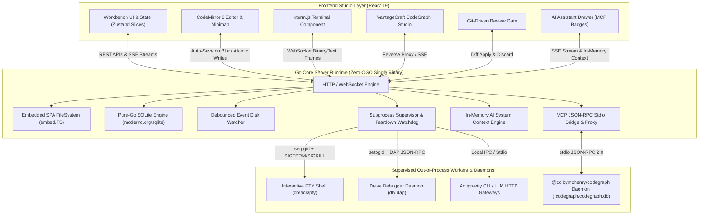

# AegisCode Architecture Overview

AegisCode is engineered around a **Hybrid Multi-Process Architecture** designed to deliver instant startup, zero UI freezing, and strict memory safety.

---

## 1. High-Level System Architecture

---

## 2. Core Architectural Pillars

### 1. Zero-CGO Standalone Binary Distribution
* AegisCode compiles cleanly with `CGO_ENABLED=0`.
* By embedding the production React 19 single-page application into the Go binary via `embed.FS` and adopting pure-Go SQLite (`modernc.org/sqlite`), a single binary execution provides the entire IDE without requiring Node.js, Python, or GCC on target systems.

### 2. Zero-Freeze Architecture & Offloaded Workers
* Heavy computations (graph layout calculation, full-text indexing, PTY buffer streaming) execute strictly in background daemons, web workers, or the Go core.
* The main React rendering thread is never blocked. UI typing and editor interactions retain < 16ms frame times.
* The AI Assistant eliminates forced editor splits from chat activity cards, avoiding layout thrashing during streaming.

### 3. Native CodeGraph Engine & Zero Repo Pollution
* Codebase intelligence is delegated out-of-process to the native `@colbymchenry/codegraph` daemon engine (`.codegraph/codegraph.db`), delivering sub-150-token progressive disclosure without AST parsing bloat.
* AegisCode injects MCP guidelines dynamically into AI provider prompts in-memory (`<system_context>`). Repository `AGENTS.md` files are treated as read-only, preventing unstaged git pollution.

### 4. Process Group Isolation & Teardown
* Background workers (PTY shells, Delve DAP instances, and AI subprocesses) are spawned in dedicated process groups using `syscall.Setpgid`.
* The supervisor maintains heartbeat monitors. On server shutdown, `SIGTERM` signals are dispatched to child process groups, followed by an automated `SIGKILL` watchdog, preventing orphaned processes from leaking CPU or port bindings.
