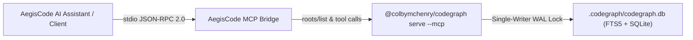

# Model Context Protocol (MCP) Specification

AegisCode integrates with the native `@colbymchenry/codegraph` daemon engine through an out-of-process Model Context Protocol (MCP) stdio bridge and HTTP JSON-RPC proxy. This architecture gives AI agents and external coding tools full, high-fidelity codebase intelligence powered by Rust AST parsing, cross-file symbol resolution, and framework synthesizers.

---

## 1. Transport & Protocol Architecture

### Stdio & JSON-RPC Transport
- **Client Protocol Version**: `2024-11-05`
- **Reverse Root Negotiation**: Implements bidirectional `roots/list` request handling and `notifications/roots/list_changed` notifications when switching workspaces.
- **Auto-Injection Middleware**: Automatically injects `"projectPath": "<active_workspace_root>"` when AI agents omit the workspace parameter.
- **Process Isolation**: Spawns isolated process groups (`Setpgid` on Unix / `CREATE_NEW_PROCESS_GROUP` on Windows) with clean signal teardown on shutdown.

---

## 2. Progressive Disclosure Philosophy

Standard LLM tool calling exhausts context windows by returning massive file dumps or thousands of irrelevant AST nodes. AegisCode enforces **Progressive Disclosure**:
- Every tool response is compressed and structured to consume **proportional token budgets**.
- Native tools prioritize hub symbols, spine clusters, and 3-hop blast radius summaries without overwhelming the conversation transcript.

---

## 3. Catalog of Native Intelligence Tools

| Tool Name | Primary Purpose | Key Parameters |
| :--- | :--- | :--- |
| `codegraph_explore` | Proportional token codebase exploration and call graph discovery | `query`, `projectPath`, `depth`, `budget` |
| `codegraph_status` | Index freshness, node/edge counts, languages, and WAL DB status | `projectPath` |
| `codegraph_node` | Full symbol definition, qualified name, hierarchy, and 3-hop blast radius | `nodeId`, `projectPath` |
| `codegraph_search` | BM25 / FTS5 ranked symbol and keyword search across all indexed files | `query`, `limit`, `projectPath` |
| `codegraph_callers` | Direct and indirect upstream callers reaching a target function | `symbol`, `limit`, `projectPath` |
| `codegraph_callees` | Direct downstream dependencies and functions called by a target | `symbol`, `limit`, `projectPath` |
| `codegraph_flow` | Directed call path between two symbols with dynamic dispatch detection | `from`, `to`, `symbols`, `projectPath` |
| `codegraph_impact` | Blast-radius assessment and files requiring re-verification upon changes | `symbol`, `depth`, `projectPath` |
| `codegraph_affected` | List of symbols affected by modified git working tree changes | `projectPath` |
| `codegraph_context` | Compact semantic context extraction for target symbols | `symbols`, `projectPath` |

---

## 4. HTTP JSON-RPC & UI Endpoints

AegisCode exposes both raw MCP tool endpoints and the VantageCraft UI reverse proxy:
- `POST /api/v1/mcp`: Standard MCP JSON-RPC 2.0 endpoint for agentic requests (`tools/list`, `tools/call`, `initialize`).
- `GET /api/v1/mcp/events`: Server-Sent Events (SSE) stream for real-time indexing status and tool execution updates.
- `GET /api/codegraph/ui/*`: High-speed reverse proxy routing directly to the background `codegraph ui` daemon.
