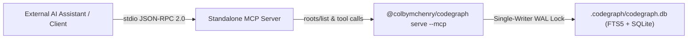

# Model Context Protocol (MCP) Specification (Optional External Tooling)

> [!NOTE]
> **Optional External Modularity (Phase 26+)**:  
> In AegisCode, Model Context Protocol (MCP) and CodeGraph integrations are designed as **optional external tools**. AegisCode Core operates completely self-contained with zero background MCP daemon requirement, powering all IDE symbol navigation, definitions, and outlines natively via Language Server Protocol (LSP).  
> Developers and AI agents (such as Claude Desktop, Cursor, or Antigravity) are free to run `@colbymchenry/codegraph serve --mcp` or any custom MCP server externally to gain graph-augmented code intelligence on-demand.

---

## 1. Transport & Protocol Architecture (External Standalone Tool)

### Stdio & JSON-RPC Transport
- **Client Protocol Version**: `2024-11-05`
- **Reverse Root Negotiation**: Implements bidirectional `roots/list` request handling and `notifications/roots/list_changed` notifications when switching workspaces.
- **Auto-Injection Middleware**: Automatically injects `"projectPath": "<active_workspace_root>"` when AI agents omit the workspace parameter.
- **Process Isolation**: Spawns isolated process groups (`Setpgid` on Unix / `CREATE_NEW_PROCESS_GROUP` on Windows) with clean signal teardown on shutdown.

---

## 2. Progressive Disclosure Philosophy

Standard LLM tool calling exhausts context windows by returning massive file dumps or thousands of irrelevant AST nodes. AegisCode enforces **Progressive Disclosure**:
- Every tool response is compressed and structured to consume **proportional token budgets**.
- Native tools prioritize hub symbols, spine clusters, and 3-hop blast radius summaries without overwhelming the conversation transcript.

---

## 3. Catalog of Native Intelligence Tools

| Tool Name | Primary Purpose | Key Parameters |
| :--- | :--- | :--- |
| `codegraph_explore` | Proportional token codebase exploration and call graph discovery | `query`, `maxFiles`, `projectPath` |
| `codegraph_status` | Index freshness, node/edge counts, languages, and WAL DB status | `projectPath` |
| `codegraph_node` | Full symbol definition, qualified name, hierarchy, and 3-hop blast radius | `symbol` (or `nodeId`), `file`, `includeCode`, `projectPath` |
| `codegraph_search` | BM25 / FTS5 ranked symbol and keyword search across all indexed files | `query`, `limit`, `projectPath` |
| `codegraph_callers` | Direct and indirect upstream callers reaching a target function | `symbol`, `limit`, `projectPath` |
| `codegraph_callees` | Direct downstream dependencies and functions called by a target | `symbol`, `limit`, `projectPath` |
| `codegraph_flow` | Directed call path between two symbols with dynamic dispatch detection | `from`, `to`, `symbols`, `projectPath` |
| `codegraph_impact` | Blast-radius assessment and files requiring re-verification upon changes | `symbol`, `depth`, `projectPath` |
| `codegraph_affected` | List of symbols affected by modified git working tree changes | `projectPath` |
| `codegraph_context` | Compact semantic context extraction for target symbols | `symbols`, `projectPath` |

---

## 4. HTTP JSON-RPC & UI Endpoints

AegisCode exposes both raw MCP tool endpoints and the VantageCraft UI reverse proxy:
- `POST /api/v1/mcp`: Standard MCP JSON-RPC 2.0 endpoint for agentic requests (`tools/list`, `tools/call`, `initialize`).
- `GET /api/v1/events` (channel `"mcp"`): Unified Server-Sent Events (SSE) multiplexer channel for real-time tool execution lifecycle updates.
- `POST /api/v1/events/mcp`: Local event bridge ingestion endpoint for stdio MCP tool invocation events.
- `GET /api/codegraph/ui/*`: High-speed reverse proxy routing directly to the background `codegraph ui` daemon.

---

## 5. AI Drawer MCP Badging & Zero-Repo-Pollution Runtime

### In-Memory Runtime Context Injection
AegisCode enforces CodeGraph MCP precedence without touching or polluting user repository files:
- **`FormatCodeGraphSystemInstruction()`**: Generates markdown rules mandating `codegraph_explore` before shell tools when `.codegraph/` is detected.
- **`WrapPromptWithSystemContext()`**: Injects `<system_context>` and `<user_request>` in-memory during dispatch to CLI engines (`agy`, `claude`) and prepends system messages in OpenAI/Claude HTTP payloads.
- **Workspace Protection**: `AGENTS.md` in the workspace root is treated as strictly read-only / user-domain.
- **Global Wiring**: `npm run mcp:install` uses `codegraph install --yes --location=global --init` to configure agent profiles in the user's home directory.

### Visual Badging & Lag-Free Navigation
In `ToolCallActivity.tsx`:
- Tools matching `codegraph_*` or `mcp__*` are parsed with `protocol: "mcp"` and `serverName: "codegraph"`.
- A semantic `[MCP]` badge pill (`bg-accent/15 text-accent border border-accent/30 font-mono text-[9px] px-1 py-0.5`) is rendered on the activity card.
- Forced split buttons have been eliminated in favor of direct `[Open]` navigation, guaranteeing 0ms latency and zero CSS grid reflow during AI streaming.

