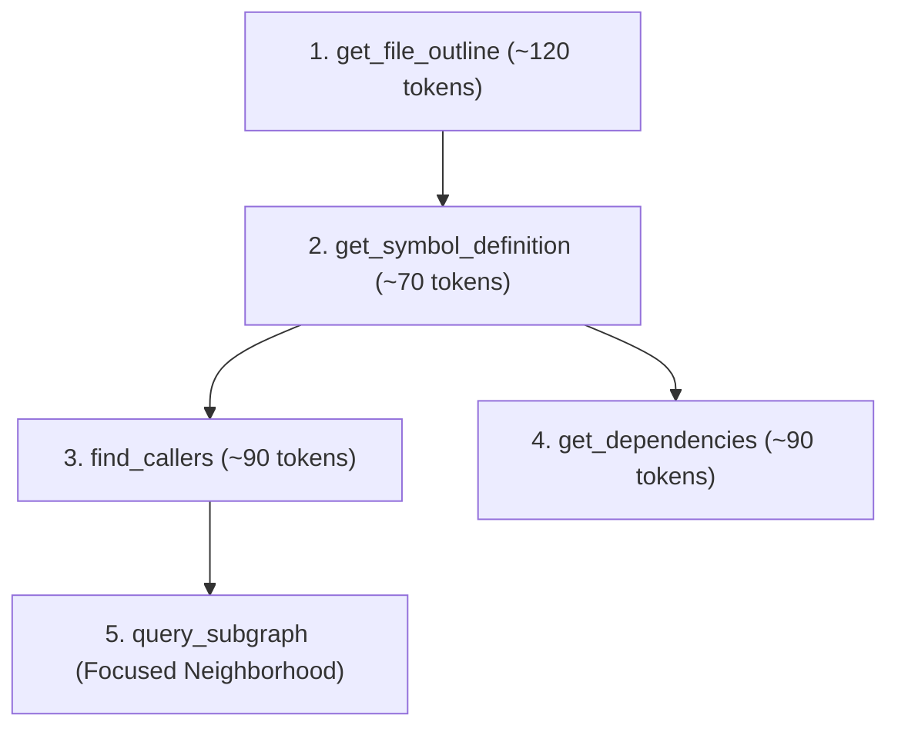

# Model Context Protocol (MCP) Specification

AegisCode implements the open **Model Context Protocol (MCP)** specification, exposing an out-of-process JSON-RPC 2.0 server. This allows AI assistants and external agentic runtimes (e.g. Antigravity CLI, Cursor, Claude Code, Windsurf) to query the codebase AST and dependency graph with minimal token overhead.

---

## 1. Transport & Protocol Modes

The AegisCode MCP engine operates across two supported transports:

1. **Stdio Transport**: Standard JSON-RPC 2.0 frames over newline-delimited standard I/O (`stdin` / `stdout`). Ideal for local process execution via agent config manifests.
   ```bash
   aegiscode mcp --workspace /path/to/project
   ```
2. **HTTP JSON-RPC Transport**: Accessible via the local server REST endpoints:
   - Primary Endpoint: `POST /api/v1/mcp`
   - Alias Endpoint: `POST /api/v1/mcp/rpc`
   - Real-Time Event Stream: `GET /api/v1/mcp/events`

---

## 2. Progressive Disclosure Philosophy

Standard LLM tool calling often exhausts context windows by returning massive file dumps or thousands of irrelevant AST nodes.

AegisCode enforces **Progressive Disclosure**:
- Every tool response is compressed and structured to consume **< 150 tokens**.
- Models are encouraged to traverse code intentionally: first inspecting compact file outlines, then fetching exact function signatures, and finally following directed edges.

---

## 3. Catalog of Progressive Disclosure Tools



### 1. `get_file_outline`
Returns a compact summary of all function, struct, interface, and method declarations in a target file without method bodies.

* **Parameters**:
  ```json
  {
    "file_path": "server/internal/store/db.go"
  }
  ```
* **Sample Output (< 150 tokens)**:
  ```json
  {
    "file": "server/internal/store/db.go",
    "symbols": [
      {"kind": "struct", "name": "DB", "lines": "18-24"},
      {"kind": "function", "name": "Open", "signature": "Open(path string) (*DB, error)", "lines": "26-54"},
      {"kind": "method", "name": "Close", "signature": "(d *DB) Close() error", "lines": "56-62"}
    ]
  }
  ```

---

### 2. `get_symbol_definition`
Retrieves exact symbol signature, line boundaries, docstrings, and enclosing scope without returning the full source file.

* **Parameters**:
  ```json
  {
    "name": "MigrateGraphSchema",
    "file_hint": "codegraph"
  }
  ```
* **Sample Output (< 80 tokens)**:
  ```json
  {
    "name": "MigrateGraphSchema",
    "kind": "function",
    "file": "server/internal/codegraph/db.go",
    "signature": "func MigrateGraphSchema(db *sql.DB) error",
    "lines": "98-156",
    "doc": "MigrateGraphSchema creates graph_files, code_symbols, code_edges tables."
  }
  ```

---

### 3. `find_callers`
Identifies functions or methods that invoke or call the specified target symbol.

* **Parameters**:
  ```json
  {
    "symbol_name": "OpenGraphDB"
  }
  ```
* **Sample Output (< 90 tokens)**:
  ```json
  {
    "symbol": "OpenGraphDB",
    "callers": [
      {"file": "server/cmd/server/main.go", "symbol": "main", "line": 78},
      {"file": "server/internal/api/api.go", "symbol": "NewRouter", "line": 42}
    ]
  }
  ```

---

### 4. `get_dependencies`
Lists outbound symbols, functions, and interfaces required by the target symbol.

* **Parameters**:
  ```json
  {
    "symbol_name": "NewServer"
  }
  ```
* **Sample Output (< 90 tokens)**:
  ```json
  {
    "symbol": "NewServer",
    "dependencies": [
      {"name": "Engine", "kind": "struct", "file": "server/internal/codegraph/indexer.go"},
      {"name": "registerTools", "kind": "method", "file": "server/internal/mcp/server.go"}
    ]
  }
  ```

---

### 5. `query_subgraph`
Fetches a tightly-scoped sub-neighborhood of connected symbols centered on a seed symbol up to a specified depth (default depth: 1).

* **Parameters**:
  ```json
  {
    "seed_symbol": "HandleChatStream",
    "depth": 1
  }
  ```
* **Sample Output (< 150 tokens)**:
  ```json
  {
    "nodes": [
      {"id": "HandleChatStream", "kind": "method"},
      {"id": "AppendEvent", "kind": "method"},
      {"id": "StreamWriter", "kind": "struct"}
    ],
    "edges": [
      {"from": "HandleChatStream", "to": "AppendEvent", "relation": "calls"},
      {"from": "HandleChatStream", "to": "StreamWriter", "relation": "uses"}
    ]
  }
  ```

---

### 6. `search_symbols`
Performs full-text token search across indexed symbol signatures and docstrings via SQLite FTS5.

* **Parameters**:
  ```json
  {
    "query": "breakpoint",
    "limit": 5
  }
  ```

---

### 7. `get_node_neighbors`
Inspects immediate incoming and outgoing edges for an individual CodeGraph node.

* **Parameters**:
  ```json
  {
    "node_id": "142"
  }
  ```

---

## 4. Real-Time UI Trace Dispatching

Whenever an AI model calls an MCP tool, the AegisCode MCP daemon emits an event to the local event bus:
```json
{
  "event": "mcp_tool_invoked",
  "tool": "get_symbol_definition",
  "symbol": "MigrateGraphSchema",
  "timestamp": 1728876400
}
```
This event stream automatically illuminates the queried nodes in the **Cytoscape CodeGraph** canvas, giving developers immediate visual confirmation of the AI's contextual exploration.
