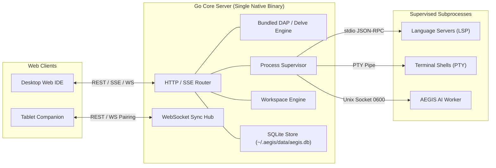

# AegisCode Backend Architecture & Feature Reference

> **Objective**: Lightweight, Immutable, Cross-Platform Go Core Server.  
> **Core Constraints**:  
> 1. Do Not Catch Errors Silently — Break the function and report explicitly.  
> 2. Do Not Write Spaghetti Try/Catch / Nested Error Handling — One clear validation path per function.  
> 3. Do Not Over-Engineer — Flat package layout, standard Go library idioms, zero bloated microservice frameworks.

---

## 1. Backend Architecture Overview

The backend is implemented in **Go (Golang)** as a single compiled native binary. It acts as a lightweight local server and process orchestrator:

### Core Characteristics
1. **Lightweight Footprint**: Memory usage <30MB at baseline, sub-30ms startup latency.
2. **Immutable Runtime**: The server executable is read-only. Runtime configuration is parsed into immutable Go structs. Dynamic user preferences, session history, and indices live strictly in SQLite (`~/.aegis/data/aegis.db`).
3. **Cross-Platform**: Compiles natively for macOS (`darwin/arm64`, `darwin/amd64`), Linux (`linux/amd64`, `linux/arm64`), and Windows (`windows/amd64`).

---

## 2. Bundled Backend Debugging (DAP & Delve)

AegisCode includes a bundled debug runtime directly inside the Go backend:
- **Debug Adapter Protocol (DAP)**: The core server implements a lightweight DAP client proxy to communicate with debug targets.
- **Bundled Delve Engine**: For Go backend development, the Delve (`dlv`) debugger is bundled or automatically supervised out-of-the-box.
- **Workflow**:
  1. Frontend triggers a debug session via the Run menu or Command Palette.
  2. The server spawns the debug runner in DAP mode.
  3. Breakpoints, stack traces, variable evaluations, and step commands (Over, Into, Out, Continue) are streamed back to the frontend over WebSockets/SSE.
  4. Debug state is shared so that companion tablet sessions can monitor running logs and server status in real time.

---

## 3. Remote Tablet Pairing & Companion Synchronization

To enable multi-screen remote workflows on tablets without external cloud servers:
1. **Local LAN Binding**: In addition to `127.0.0.1`, the server can optionally bind to local network interfaces (`0.0.0.0:<port>`) when remote companion mode is enabled.
2. **Ephemeral Pairing Token / QR Code**: On launch or on user request, the server generates a cryptographically secure 6-character pairing code or QR code containing `http://<lan-ip>:<port>/?mode=companion&token=<pairing-token>`.
3. **Dual Tablet Views**:
   - **Host Web Preview**: Serves the application running in the developer's workspace directly to the tablet iframe.
   - **Focused Code Editor**: Connects to the workspace file buffer with lightweight, touch-friendly editing. Any keystroke on the tablet updates the desktop workspace buffer instantaneously via the WebSocket sync hub.

---

## 4. Key Endpoints & API Contracts

### A. Authentication & Pairing
- `POST /api/v1/auth/handshake`
  - Body: `{ "clientType": "desktop" | "companion", "pairingToken": "string" }`
  - Response: `{ "sessionToken": "string", "expiresIn": 86400 }`
- `GET /api/v1/pairing/info`
  - Returns current LAN IP, pairing port, QR code data, and active companion sessions.

### B. Workspace & File System Operations
- `GET /api/v1/workspace/tree`
  - Query: `?depth=3&showHidden=false`
  - Response: Recursive JSON file tree with file metadata, types, and git status flags.
- `GET /api/v1/workspace/file`
  - Query: `?path=relative/path/to/file.ts`
  - Response: File text content, encoding, modified timestamp, and read-only status.
- `POST /api/v1/workspace/file`
  - Body: `{ "path": "string", "content": "string", "createParents": true }`
  - Response: `{ "status": "ok", "bytesWritten": 1024, "updatedAt": 1700000000 }`
- `DELETE /api/v1/workspace/file`
  - Query: `?path=relative/path/to/file.ts&recursive=false`
  - Response: `{ "status": "deleted" }`
- `POST /api/v1/workspace/rename`
  - Body: `{ "oldPath": "string", "newPath": "string" }`
  - Response: `{ "status": "renamed" }`

### C. Server-Sent Events (SSE) Streaming
- `GET /api/v1/events/workspace`
  - Headers: `Accept: text/event-stream`
  - Events: `file:created`, `file:modified`, `file:deleted`, `git:status_change`.
- `GET /api/v1/events/terminal/:sessionId`
  - Headers: `Accept: text/event-stream`
  - Streams raw PTY byte output chunks to the terminal emulator.

### D. WebSocket Event Hub (Bi-directional Sync)
- `WS /api/v1/ws/sync`
  - Used for real-time document buffer synchronization between Desktop and Tablet Companion:
  - Message Types:
    - `buffer:open`: Register open file buffer.
    - `buffer:change`: Send incremental diff / cursor position.
    - `buffer:save`: Trigger disk write.
    - `preview:reload`: Force refresh on tablet host preview.

### E. Bundled Debugger (DAP Engine)
- `POST /api/v1/debug/start`
  - Body: `{ "program": "./cmd/server", "args": [], "mode": "debug" }`
  - Response: `{ "debugSessionId": "string", "port": 40001 }`
- `POST /api/v1/debug/breakpoints`
  - Body: `{ "file": "main.go", "lines": [25, 42] }`
  - Response: Verified breakpoints list.
- `POST /api/v1/debug/step`
  - Body: `{ "action": "continue" | "stepOver" | "stepIn" | "stepOut" }`
  - Response: Execution state and thread position.
- `POST /api/v1/debug/terminate`
  - Terminates the debug target process cleanly.

### F. Terminal & Process Management
- `POST /api/v1/terminal/create`
  - Body: `{ "shell": "zsh" | "bash", "cwd": "/path/to/project", "cols": 120, "rows": 32 }`
  - Response: `{ "sessionId": "term-1", "pid": 4821 }`
- `POST /api/v1/terminal/:sessionId/input`
  - Body: `{ "data": "ls -la\n" }`
- `POST /api/v1/terminal/:sessionId/resize`
  - Body: `{ "cols": 140, "rows": 40 }`
- `DELETE /api/v1/terminal/:sessionId`
  - Sends `SIGTERM` / `SIGKILL` to close the PTY session.

---

## 5. Process Supervision & Worker Isolation

The Core Server implements a resilient Process Supervisor ([ADR 0004](file:///Users/aditwicaksono/Documents/Project-AI/AegisCodev2/docs/adr/0004-worker-supervision-and-agent-isolation.md)):

1. **Crash Isolation**: Subprocess crashes (e.g., an LSP server running out of memory or a terminal shell exiting abnormally) are strictly isolated. The supervisor intercepts the exit code and notifies the frontend immediately without dropping the core HTTP server.
2. **Fail-Fast Policy**: Backend code does not swallow errors silently. If a disk write fails, permissions are denied, or a worker terminates unexpectedly:
   - The function breaks immediately.
   - An explicit error event is dispatched to the client.
   - The supervisor executes a clean restart policy if configured.
3. **Data Boundary**: User workspace directories are strictly read/write for project files only. All internal databases, vector embeddings, and session logs are kept in the global app directory (`~/.aegis/data/`).
