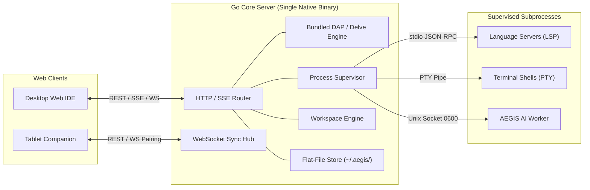

# AegisCode Backend Architecture & Feature Reference

> **Objective**: Lightweight, Immutable, Cross-Platform Go Core Server.  
> **Core Constraints**:  
> 1. Do Not Catch Errors Silently — Break the function and report explicitly.  
> 2. Do Not Write Spaghetti Try/Catch / Nested Error Handling — One clear validation path per function.  
> 3. Do Not Over-Engineer — Flat package layout, standard Go library idioms, zero bloated microservice frameworks.

---

## 1. Backend Architecture Overview

The backend is implemented in **Go (Golang)** as a single compiled native binary. It acts as a lightweight local server and process orchestrator:



### Core Characteristics
1. **Lightweight Footprint**: Memory usage <30MB at baseline, sub-30ms startup latency.
2. **Immutable Runtime & Zero-DB Flat-File Isolation**: The server executable is read-only. Runtime configuration is parsed into immutable Go structs. Dynamic user preferences, session history, and recent workspaces live strictly in atomic JSON flat-files (`~/.aegis/config.json`, `~/.aegis/state.json`, `~/.aegis/chats/`).
3. **Cross-Platform**: Compiles natively for macOS (`darwin/arm64`, `darwin/amd64`), Linux (`linux/amd64`, `linux/arm64`), and Windows (`windows/amd64`).

---

## 2. Bundled Backend Debugging (DAP & Delve)

AegisCode includes a bundled debug runtime directly inside the Go backend:
- **Debug Adapter Protocol (DAP)**: The core server implements a lightweight DAP client proxy to communicate with debug targets.
- **Bundled Delve Engine**: For Go backend development, the Delve (`dlv`) debugger is bundled or automatically supervised out-of-the-box.
- **Workflow**:
  1. Frontend triggers a debug session via the Run menu or Command Palette.
  2. The server spawns the debug runner in DAP mode.
  3. Breakpoints, stack traces, variable evaluations, and step commands (Over, Into, Out, Continue) are streamed back to the frontend over WebSockets/SSE.
  4. Debug state is shared so that companion tablet sessions can monitor running logs and server status in real time.

---

## 3. Remote Tablet Pairing & Companion Synchronization

To enable multi-screen remote workflows on tablets without external cloud servers:
1. **Local LAN Binding**: In addition to `127.0.0.1`, the server can optionally bind to local network interfaces (`0.0.0.0:<port>`) when remote companion mode is enabled.
2. **Ephemeral Pairing Token / QR Code**: On launch or on user request, the server generates a cryptographically secure 6-character pairing code or QR code containing `http://<lan-ip>:<port>/?mode=companion&token=<pairing-token>`.
3. **Dual Tablet Views**:
   - **Host Web Preview**: Serves the application running in the developer's workspace directly to the tablet iframe.
   - **Focused Code Editor**: Connects to the workspace file buffer with lightweight, touch-friendly editing. Any keystroke on the tablet updates the desktop workspace buffer instantaneously via the WebSocket sync hub.

---

## 4. Key Endpoints & API Contracts

### A. Authentication & Pairing
- `POST /api/v1/auth/handshake`
  - Body: `{ "clientType": "desktop" | "companion", "pairingToken": "string" }`
  - Response: `{ "sessionToken": "string", "expiresIn": 86400 }`
- `GET /api/v1/pairing/info`
  - Returns current LAN IP, pairing port, QR code data, and active companion sessions.

### B. Workspace & File System Operations (Phase 6 Sub-Phase 1 Active)
- `GET /api/v1/workspace/info`
  - Returns current active workspace root path and folder name. If no workspace is open (e.g. server booted without `WORKSPACE_ROOT` or workspace was closed), returns empty strings:
  - Response (Active): `{ "rootPath": "/Users/...", "name": "AegisCodev2" }`
  - Response (Empty / Closed): `{ "rootPath": "", "name": "" }`
- `POST /api/v1/workspace/open`
  - Body: `{ "path": "/Users/path/to/folder" }`
  - Sanitizes and normalizes the path with `filepath.Clean(strings.TrimSpace(path))` to prevent trailing slash mismatches.
  - Response: `{ "status": "ok", "rootPath": "string", "name": "string" }`
- `POST /api/v1/workspace/close`
  - Closes active root workspace directory, resets `rootPath` to empty `""`, and clears internal watchers.
  - Response: `{ "status": "closed" }`
- `POST /api/v1/workspace/pick-folder`
  - Triggers native OS folder dialog (`osascript` on macOS, PowerShell on Windows, `zenity`/`kdialog` on Linux).
  - Automatically cleans and normalizes returned path (stripping OS trailing slashes).
  - Response (Success): `{ "status": "ok", "path": "string", "name": "string", "rootPath": "string" }`
  - Response (Cancelled): `{ "status": "cancelled", "cancelled": true }`
  - Response (Unsupported/Headless): `{ "status": "unsupported", "unsupported": true, "error": "string" }`
- `GET /api/v1/workspace/browse`
  - Query: `?path=/optional/path&showHidden=false`
  - Response: `{ "currentPath": "string", "parentPath": "string", "homePath": "string", "rootPath": "string", "directories": [ { "name": "string", "path": "string" } ] }`
- `POST /api/v1/workspace/folder`
  - Body: `{ "path": "/absolute/or/relative/path" }`
  - Response: `{ "status": "ok", "path": "string" }`
- `GET /api/v1/workspace/tree`
  - Query: `?depth=8&showHidden=false`
  - Response: Recursive JSON file tree: `{ "tree": [ { "path": "src/App.tsx", "name": "App.tsx", "type": "file" | "folder", "depth": 0, "children": [] } ] }`
- `GET /api/v1/workspace/file`
  - Query: `?path=relative/path/to/file.ts`
  - Path Boundary Security: Strictly validated via `filepath.Rel(m.rootPath, target)`. Directory traversal sequences (`..`) and host absolute escapes outside `rootPath` immediately return `400 Bad Request` with descriptive error payload.
  - Response: `{ "path": "string", "content": "string" }`
- `POST /api/v1/workspace/file`
  - Body: `{ "path": "string", "content": "string", "isFolder": boolean }`
  - Path Boundary Security: Enforces strict containment within `m.rootPath`. Out-of-bounds writes return `400 Bad Request` with `{ "error": "path '...' escapes root directory '...'" }`.
  - Review Gate Integration (Sub-Phase 6.10): Writes AI code generation directly to disk, triggering the in-editor Side-by-Side review gate (`DiffEditorPane.tsx`) without redundant temporary buffers.
  - Response: `{ "status": "ok", "path": "string" }`
- `DELETE /api/v1/workspace/file`
  - Query: `?path=relative/path/to/file.ts`
  - Path Boundary Security: Rejects root directory deletion and out-of-workspace targets with `400 Bad Request`.
  - Response: `{ "status": "deleted", "path": "string" }`
- `POST /api/v1/workspace/rename`
  - Body: `{ "oldPath": "string", "newPath": "string" }`
  - Validates boundaries for both `oldPath` and `newPath`.
  - Response: `{ "status": "renamed", "oldPath": "string", "newPath": "string" }`
- `POST /api/v1/workspace/move`
  - Body: `{ "sourcePath": "string", "targetDirectory": "string" }`
  - Validates boundaries for both `sourcePath` and `targetDirectory`.
  - Response: `{ "status": "moved", "sourcePath": "string", "newPath": "string" }`
- `POST /api/v1/workspace/search`
  - Body: `{ "query": "string", "isRegex": boolean, "isMatchCase": boolean, "isWholeWord": boolean }`
  - Response: `{ "results": [ { "filename": "string", "matches": [ { "lineNumber": 1, "column": 5, "lineContent": "string", "matchText": "string" } ] } ] }`
- `POST /api/v1/workspace/replace-all`
  - Body: `{ "query": "string", "replacement": "string", "isRegex": boolean, "isMatchCase": boolean, "isWholeWord": boolean }`
  - Response: `{ "status": "ok", "replacements": 12, "modifiedFiles": ["string"] }`
- `GET /api/v1/git/status`
  - Reads `.git` directory and `.git/HEAD` to detect current active branch.
  - Safe behavior on empty/closed workspace (`rootPath == ""`): returns `200 OK` with `{ "isRepo": false, "branch": "", "repoName": "" }` without throwing a 500 error.
  - Response: `{ "isRepo": boolean, "branch": "string", "repoName": "string" }`

### C. Git Native CLI Integration (Phase 6 Sub-Phase 2 Active)
All operations interact directly with the local native Git CLI binary on the active workspace root. Zero artificial mocks or fallback simulations:

- `GET /api/v1/git/status`
  - Runs `git status --porcelain=v2 --branch -uall` and parses staged, unstaged, branch, upstream, commit hash, ahead/behind counters, and user profile (`git config user.name`/`user.email`).
  - Response: `{ "isRepo": boolean, "branch": string, "repoName": string, "commitHash": string, "upstream": string, "ahead": number, "behind": number, "staged": [...], "unstaged": [...], "user": { "name": string, "email": string } }`
- `POST /api/v1/git/init`
  - Initializes a new Git repository (`git init -b main` with fallback to `git init`).
  - Response: `{ "status": "ok" }`
- `GET /api/v1/git/branches`
  - Returns local and remote tracking branches (`git branch -a -vv`).
  - Response: `{ "branches": [ { "name": string, "isHead": boolean, "isRemote": boolean, "upstream": string } ] }`
- `POST /api/v1/git/branch/checkout`
  - Switches branches (`git checkout <branch>` or `git checkout -B <local> origin/<remote>`).
  - Body: `{ "branch": "string" }`
  - Response: `{ "status": "ok" }`
- `POST /api/v1/git/branch/create`
  - Creates a new branch with optional checkout (`git branch <name>` or `git checkout -b <name>`).
  - Body: `{ "name": "string", "checkout": boolean }`
  - Response: `{ "status": "ok" }`
- `GET /api/v1/git/log?limit=50`
  - Retrieves git history nodes with author, message, timestamp, head status, and branch/tag decorations (`git log -n<limit> --pretty=format:%H|%h|%an|%ae|%at|%s|%D`).
  - Response: `{ "commits": [ { "id": string, "hash": string, "shortHash": string, "author": string, "message": string, "timestamp": string, "unixTime": number, "branch": string, "tags": [...] } ] }`
- `GET /api/v1/git/timeline?file=<path>&limit=30`
  - Retrieves commit history specific to a file for the Explorer panel TIMELINE section (`git log -n<limit> --pretty=format:... -- <file>`).
  - Response: `{ "commits": [...] }`
- `POST /api/v1/git/stage`
  - Stages specified files or all changes (`git add -- <files>` or `git add -A`).
  - Body: `{ "files": ["string"], "all": boolean }`
  - Response: `{ "status": "ok" }`
- `POST /api/v1/git/unstage`
  - Unstages specified files or all changes. Automatically detects whether `HEAD` exists: uses `git restore --staged -- <files>` if `HEAD` exists; safely falls back to `git rm --cached -r -- <files>` on initial/uncommitted repos where `HEAD` is not yet resolved.
  - Body: `{ "files": ["string"], "all": boolean }`
  - Response: `{ "status": "ok" }`
- `POST /api/v1/git/discard`
  - Discards uncommitted working copy changes. For tracked files, executes `git restore -- <files>`; for untracked/newly created files, automatically removes them from disk. For all changes, executes `git restore .` and `git clean -fd`.
  - Body: `{ "files": ["string"], "all": boolean }`
  - Response: `{ "status": "ok" }`
- `POST /api/v1/git/commit`
  - Creates a commit with the provided message (`git commit -m <message>`). Supports `autoStage: true` if working copy has changes and stage is empty.
  - Body: `{ "message": "string", "autoStage": boolean }`
  - Response: `{ "status": "ok", "commit": { "hash": string, "shortHash": string, "message": string, "author": string } }`
- `POST /api/v1/git/push`
  - Pushes commits to remote origin (`git push` or `git push -u origin <branch>`).
  - Body: `{ "setUpstream": boolean }`
  - Response: `{ "status": "ok" }`
- `POST /api/v1/git/pull`
  - Pulls commits from tracking remote (`git pull`).
  - Response: `{ "status": "ok" }`
- `POST /api/v1/git/sync`
  - Fetches and synchronizes remote tracking branches (`git fetch --prune` and `git pull --rebase` or `git push`).
  - Response: `{ "status": "ok" }`
- `GET /api/v1/git/tags`
  - Lists all repository tags (`git tag -l`).
  - Response: `{ "tags": ["v1.0.0", ...] }`
- `POST /api/v1/git/tag`
  - Creates an annotated or lightweight tag (`git tag -a <name> -m <msg>` or `git tag <name>`).
  - Body: `{ "name": "string", "message": "string" }`
  - Response: `{ "status": "ok" }`
- `POST /api/v1/git/tag/push`
  - Pushes all tags to remote origin (`git push origin --tags`).
  - Response: `{ "status": "ok" }`
- `POST /api/v1/git/remote/add`
  - Configures remote repository URL (`git remote add <name> <url>`).
  - Body: `{ "name": "origin", "url": "string" }`
  - Response: `{ "status": "ok" }`
- `GET /api/v1/git/diff?file=<path>&staged=<bool>&commit=<hash>`
  - Retrieves unified diff text, original content (from HEAD/commit), and modified content for the in-editor Side-by-Side diff viewer (`DiffEditorPane.tsx`).
  - Untracked / New File Support (Sub-Phase 6.10): For untracked files not yet in index/HEAD, automatically generates a synthesized addition diff against `/dev/null` with empty original content and full modified working tree text, enabling unified review gates for newly generated files.
  - Response: `{ "file": string, "staged": boolean, "diff": string, "original": string, "modified": string }`
- `POST /api/v1/git/unlock`
  - Safely scans and removes stale lock files left behind by interrupted external Git commands, AI agents, or crashed editors (`.git/index.lock`, `.git/HEAD.lock`, `.git/config.lock`, `.git/packed-refs.lock`, and any orphaned `.git/refs/**/*.lock`).
  - Response: `{ "unlocked": boolean, "removed": ["index.lock", ...], "message": string }`

#### Git Concurrency & Stale Lock Auto-Recovery Architecture
To eliminate race conditions and the common `fatal: Unable to create '.../.git/index.lock': File exists` error when text editors, AI agents, and file watchers interact simultaneously:
1. **Server Mutex Serialization**: Every Git execution through Go backend `git.Service` is guarded by an internal `sync.Mutex`. Concurrent requests from the frontend (e.g. background polling, multiple tab updates, or rapid staging) are queued and executed sequentially.
2. **Read-Only Lock Isolation (`GIT_OPTIONAL_LOCKS=0`)**: Read operations (`status`, `branches`, `log`, `diff`, `timeline`, `tags`) are executed with `GIT_OPTIONAL_LOCKS=0` and `--no-optional-locks`. Git will never attempt to acquire or update index locks during background queries.
3. **Transient Retry with Backoff**: If an index-mutating command (`stage`, `commit`, `checkout`, `restore`) encounters an active `index.lock`, it retries up to 3 times (50ms, 150ms, 300ms) before failing.
4. **Stale Lock Auto-Recovery**: If a lock file remains after retries and its modification timestamp is older than 2 seconds (`time.Since(modTime) > 2s`), the engine identifies it as an abandoned lock from a crashed process, safely removes `.git/index.lock`, and re-executes the command automatically.
5. **UI Resiliency & Manual Unlock**: The frontend tracks `isRepoLocked` state and renders a dedicated warning banner with an **Unlock Repository** button in the Source Control panel, allowing one-click resolution.

### D. Server-Sent Events (SSE) Streaming
- `GET /api/v1/events/workspace`
  - Headers: `Accept: text/event-stream`
  - Events: `file:created`, `file:modified`, `file:deleted`, `git:status_change`.
- `GET /api/v1/events/terminal/:sessionId`
  - Headers: `Accept: text/event-stream`
  - Streams raw PTY byte output chunks to the terminal emulator.
- `GET /api/v1/events/workers`
  - Headers: `Accept: text/event-stream`
  - Streams real-time fail-fast crash diagnostic events (`worker:crash`) for supervised workers and terminal shells.

### E. WebSocket Event Hub (Bi-directional Sync)
- `WS /api/v1/ws/sync`
  - Used for real-time document buffer synchronization between Desktop and Tablet Companion:
  - Message Types:
    - `buffer:open`: Register open file buffer.
    - `buffer:change`: Send incremental diff / cursor position.
    - `buffer:save`: Trigger disk write.
    - `preview:reload`: Force refresh on tablet host preview.

### F. Bundled Debugger (DAP Engine)
- `POST /api/v1/debug/start`
  - Body: `{ "program": "./cmd/server", "args": [], "mode": "debug" }`
  - Response: `{ "debugSessionId": "string", "port": 40001 }`
- `POST /api/v1/debug/breakpoints`
  - Body: `{ "file": "main.go", "lines": [25, 42] }`
  - Response: Verified breakpoints list.
- `POST /api/v1/debug/step`
  - Body: `{ "action": "continue" | "stepOver" | "stepIn" | "stepOut" }`
  - Response: Execution state and thread position.
- `POST /api/v1/debug/terminate`
  - Terminates the debug target process cleanly.

### G. Terminal & Process Management
- `POST /api/v1/terminal/create`
  - Body: `{ "shell": "zsh" | "bash", "cwd": "/path/to/project", "cols": 120, "rows": 32 }`
  - Response: `{ "sessionId": "term-1", "pid": 4821 }`
- `POST /api/v1/terminal/:sessionId/input`
  - Body: `{ "data": "ls -la\n" }`
- `POST /api/v1/terminal/:sessionId/resize`
  - Body: `{ "cols": 140, "rows": 40 }`
- `DELETE /api/v1/terminal/:sessionId`
  - Sends `SIGTERM` / `SIGKILL` to close the PTY session.
- `GET /api/v1/workers`
  - Retrieves live status, PID, uptime, and restart count of all supervised workers.
- `POST /api/v1/workers`
  - Body: `{ "id": "lsp-go", "name": "Go LSP", "command": "gopls", "args": [], "restartPolicy": "on-failure" }`
  - Launches and registers a new supervised worker process.
- `GET /api/v1/workers/:id`
  - Retrieves live metadata for a specific worker.
- `GET /api/v1/workers/:id/logs`
  - Returns the 64 KB in-memory ring buffer log history (combined stdout/stderr).
- `POST /api/v1/workers/:id/stop` / `DELETE /api/v1/workers/:id`
  - Terminates the worker process group gracefully.

### H. Flat-File Persistence & State Management (Sub-Phase 6.4)
- `GET /api/v1/config`
  - Retrieves global user preferences, model choices, provider credentials, and custom models from `~/.aegis/config.json`.
- `POST /api/v1/config`
  - Body: `{ "theme": "...", "defaultProvider": "...", "defaultModel": "...", "providerKeys": {...}, "providerBaseURLs": {...}, "customModels": [...], "bypassTokens": {...}, "settings": {...} }`
  - Atomically persists user preferences to `~/.aegis/config.json`.
- `GET /api/v1/state`
  - Retrieves application state (`recentProjects`, `lastWorkspace`, `activeSessionId`) from `~/.aegis/state.json`.
- `POST /api/v1/state`
  - Body: `{ "recentProjects": [...], "lastWorkspace": "...", "activeSessionId": "..." }`
  - Atomically updates app state in `~/.aegis/state.json`.
- `POST /api/v1/state/recent`
  - Body: `{ "path": "/path/to/project" }`
  - Adds workspace path to the recent list (deduplicating and moving to head).
- `DELETE /api/v1/state/recent`
  - Query parameters: `?path=<path>` to remove a specific project, or `?all=true` to clear the list.
- `GET /api/v1/chats`
  - Retrieves fast session metadata summaries from `~/.aegis/sessions.json` in $O(1)$ without scanning individual chat files.
- `GET /api/v1/chats/:id`
  - Retrieves chat session and event nodes from `~/.aegis/chats/<id>.jsonl` (or legacy fallback `~/.aegis/chats/<id>.json`). Supports query parameter `?tail=N` for fast reverse-seek hydration.
- `POST /api/v1/chats/:id`
  - Legacy atomic session save endpoint (kept for backward compatibility and shadow migration).
- `POST /api/v1/chats/:id/events`
  - Appends an atomic event node (`GraphNode`) directly to `~/.aegis/chats/<id>.jsonl` in $O(1)$ (`os.O_APPEND`) with parent lineage pointer. Automatically offloads payloads $>4\text{ KB}$ to `~/.aegis/blobs/<session_id>_<hash>.raw`. Supports periodic checkpoint nodes for deep trees.
- `GET /api/v1/blobs/:sessionId/:hash` (or `GET /api/v1/blobs/:hash`)
  - Streams full raw payload for externalized tool execution results or large buffer reads.
- `DELETE /api/v1/chats/:id`
  - Removes session entry from `~/.aegis/sessions.json`, deletes ledger file `~/.aegis/chats/<id>.jsonl`, and instantly cleans up all associated blobs via `filepath.Glob("~/.aegis/blobs/" + id + "_*")`.

### I. AI Provider Testing, Probing & Auto-Discovery (Sub-Phase 6.8)
- `POST /api/v1/ai/test`
  - Body: `{ "provider": "antigravity" | "claude" | "opencode" | "openrouter", "key": "string", "baseURL": "string", "model": "string" }`
  - Executes zero-token cost connectivity verification, latency calculation, and credential probing:
    - **Antigravity Auto-Discovery Probe (`server/internal/ai/probe.go`)**:
      - Automatically discovers and inspects `~/.gemini/oauth_creds.json` and `~/.gemini/antigravity-cli/brain`.
      - Extracts active Google account email, validates OAuth tokens and expiry timestamps, and confirms brain directory availability.
      - Never runs full generative completions, ensuring zero token cost and sub-60ms response latency.
      - Response: `{ "success": true, "latencyMs": 55, "message": "Antigravity OAuth credentials verified", "details": { "account": "...", "brainDir": "...", "tokenExpiry": "..." } }`.
    - **Claude CLI Probe**:
      - Resolves `claude` executable in system `$PATH` via `exec.LookPath`.
      - Executes fast `claude --version` with a 5-second context timeout to verify CLI availability and version information.
    - **OpenCode & OpenRouter HTTP Probe**:
      - Issues lightweight HTTP `GET /models` request with `Authorization: Bearer <key>` header.
      - Confirms HTTP 200 OK and measures live round-trip latency in milliseconds.

### J. AI Agent Execution & Streamed SSE Response (Sub-Phase 6.9)
- `POST /api/v1/ai/chat`
  - Content-Type: `application/json` (Input), `text/event-stream` (Output stream).
  - Body: `{ "workspaceDir": "/path/to/project", "conversationId": "optional-uuid", "model": "gemini-3.8-flash-high", "prompt": "..." }`
  - Executes out-of-process Antigravity CLI (`agy`) bound to the user's active workspace (`cmd.Dir = activeWorkspace`) with `--dangerously-skip-permissions` and `--output-format stream-json`.
  - Streams real-time Server-Sent Events (SSE):
    - `event: start`: Emits initial conversation UUID captured from Antigravity's `init` event:
      `{ "type": "start", "conversationId": "uuid" }`
    - `event: thinking`: Emits real-time reasoning deltas (`thinking_delta`) accumulated from the agent's chain-of-thought:
      `{ "type": "thinking", "conversationId": "uuid", "thinking": "..." }`
      *(Frontend applies windowing to the trailing 3,000 characters during streaming to keep DOM nodes responsive).*
    - `event: tool_call`: Emits structured tool invocation metadata:
      `{ "type": "tool_call", "conversationId": "uuid", "toolCall": { "id": "tc-<stepIdx>", "name": "view_file", "summary": "Viewing file", "status": "running" | "success", "targetFile": "...", "args": { "AbsolutePath": "..." }, "output": "..." } }`
      - **Parameters Extraction**: Directly extracted from `step_update.tool_info.parameters` (with fallback to `tool_args`). Strips outer quotation marks (`"`, `'`, `` ` ``) and whitespace via `SanitizeString`.
      - **Target File Resolution & Anti-Ghost Tab**: Detected via `ExtractTargetFile` across candidate keys (`AbsolutePath`, `TargetFile`, `path`, etc.) with strict validation rejecting empty paths or path values matching tool names (`server/internal/ai/normalizer.go`).
      - **Output Extraction**: Directly extracted from `step_update.tool_info.output` when available, capped at 2,500 characters via `CapOutput` to prevent DOM bloat.
      - **Action Summary**: Extracted from `toolSummary` or `toolAction` arguments with idiomatic fallback action synthesis via `GenerateSummary`.
      - **Step Deduplication**: Keyed by `tc-<step_index>`. When subsequent updates or completion events arrive for the same step, the backend seamlessly updates the existing tool call card in place.
      - **Lifecycle State**: Maps `step_update.state` (`ACTIVE` -> `"running"`, `DONE` -> `"success"`).
    - `event: chunk`: Emits live response text tokens (`text_delta`):
      `{ "type": "chunk", "conversationId": "uuid", "delta": "..." }`
      *(Frontend batches chunk rendering via 40ms RequestAnimationFrame cycles).*
    - `event: done`: Emits final complete message payload with all tool calls marked as `success`:
      `{ "type": "done", "conversationId": "uuid", "message": { "id": "msg-<ts>", "role": "agent", "text": "...", "thinking": "...", "toolCalls": [...], "timestamp": 1234567890, "provider": "antigravity", "model": "gemini-3.8-flash-high" } }`
    - `event: error`: Dispatches explicit error diagnostics if execution fails or is interrupted:
      `{ "type": "error", "conversationId": "uuid", "error": "..." }`
  - **Disk I/O & Persistence Throttling**: While streaming is active, frontend persistence to backend flat-file (`POST /api/v1/chats/:id`) is debounced to every 3,000ms with a guaranteed final flush on `done`, eliminating 98% of disk writes during high-throughput generation.
  - **Fail-Safe Abort & Cancellation**: Tied directly to HTTP request context (`r.Context()`); if the client disconnects or clicks "Stop Generating" (`AbortController`), the backend immediately kills the child process via `cmd.Process.Kill()`, preventing orphaned processes and resource leaks.
  - **Model Normalization Engine**: Automatic mapping of bare model names (e.g., `gemini-3.8-flash` -> `gemini-3.8-flash-high`) ensuring CLI commands never fail due to missing `--effort` arguments.
  - **Conversation Lifecycle Safety**: Pre-checks existence of `~/.gemini/antigravity-cli/brain/<uuid>`. New sessions are executed without `--conversation` to let Antigravity generate a fresh ID officially, preventing `conversation not found` warnings.
- `GET /api/v1/ai/models`
  - In-memory 5-minute cached discovery of available Antigravity models (`agy models`).
  - Response: `{ "models": [ { "id": "gemini-3.8-flash-high", "name": "Gemini 3.8 Flash (High)", "provider": "antigravity", "description": "..." }, ... ] }`.
- `GET /api/v1/ai/skills`
  - Discovers built-in Antigravity skills (`~/.gemini/antigravity-cli/builtin/skills`) and standard slash commands (`/plan`, `/spec`, `/review`, `/debug`, `/simplify`, `/goal`, `/schedule`, `/browser`, `/grill-me`, `/boost`).
  - Response: `{ "skills": [ { "command": "/plan", "name": "Implementation Plan", "description": "..." }, ... ] }`.
- `GET /api/v1/ai/transcript/:id`
  - Rehydrates full conversational turns, thinking traces, and tool call histories directly from Antigravity's native `transcript.jsonl` in `~/.gemini/antigravity-cli/brain/<id>/.system_generated/logs/` (and fallback `~/.gemini/antigravity/brain/...`).
  - Normalizes tool call parameters, action summaries, and output mappings, returning standard `ChatMessage[]` array with accurate tool call cards and execution results.
  - Response: `{ "conversationId": "uuid", "messages": [ ... ] }`.

---

## 5. Process Supervision & Worker Isolation

The Core Server implements a resilient Process Supervisor ([ADR 0004](file:///Users/aditwicaksono/Documents/Project-AI/AegisCodev2/docs/adr/0004-worker-supervision-and-agent-isolation.md)):

1. **Crash Isolation**: Subprocess crashes (e.g., an LSP server running out of memory or a terminal shell exiting abnormally) are strictly isolated. The supervisor intercepts the exit code and notifies the frontend immediately without dropping the core HTTP server.
2. **Fail-Fast Policy**: Backend code does not swallow errors silently. If a disk write fails, permissions are denied, or a worker terminates unexpectedly:
   - The function breaks immediately.
   - An explicit error event is dispatched to the client.
   - The supervisor executes a clean restart policy if configured.
3. **Data Boundary**: User workspace directories are strictly read/write for project files only. All internal databases, vector embeddings, and session logs are kept in the global app directory (`~/.aegis/data/`).

---

## 6. Testing Architecture & Core Test Harness

To prevent regression proliferation and enforce independent testing without artificial mocks or headless browser overhead (non-Playwright):

### Directory Structure & Segregation
Testing is strictly segregated under the root `test/` directory, cleanly separating the UI Shell from the Core Server:
- [`test/frontend/`](file:///Users/aditwicaksono/Documents/Project-AI/AegisCodev2/test/frontend): Pure logic, state machine, and facade integration tests running under **Vitest**.
  - [`virtualWorkspace.ts`](file:///Users/aditwicaksono/Documents/Project-AI/AegisCodev2/test/frontend/virtualWorkspace.ts): In-Memory Virtual Workspace Engine providing a deterministic in-memory filesystem for pure logic testing without dummy mocks.
  - [`core/workbenchCore.test.ts`](file:///Users/aditwicaksono/Documents/Project-AI/AegisCodev2/test/frontend/core/workbenchCore.test.ts): Centralized Frontend Core Test Suite.
- [`test/backend/`](file:///Users/aditwicaksono/Documents/Project-AI/AegisCodev2/test/backend): Native Go Core Server integration and regression suite.
  - [`core/server_core_test.go`](file:///Users/aditwicaksono/Documents/Project-AI/AegisCodev2/test/backend/core/server_core_test.go): Centralized Backend Core Test Suite running end-to-end HTTP scenarios directly against the compiled Core Server binary.

### Core Test Pattern (Table-Driven Scenario Matrix)
Rather than spawning dozens of scattered test files for every bug report or edge case, all regressions register directly into the **Core Test Matrix**:
1. **Frontend Core Test**: The `coreRegressionScenarios` matrix and domain suites (7 suites, 79 tests passing) execute end-to-end state transitions:
   - Workspace file CRUD, buffer dirty flags, and debounced save synchronizations.
   - Editor group tabs, split pane migrations, and automatic un-splitting.
   - Git staging, unstaging, and commit creation.
   - Terminal PTY sessions, command history, and stream pipelines.
   - AI Agent session creation and conversational context streaming.
   - `AsyncSequenceGuard` concurrency safety (monotonic request IDs and AbortController cancellation).
   - Safe Tool Call Activity rendering, step deduplication, and ghost tab prevention (`test/frontend/chat/toolCallActivity.test.ts`).
   - Streaming fast-path zero-parse & Markdown rendering safeguards (`test/frontend/chat/markdownSafeGuard.test.ts`).
   - Review gates and workspace path boundary validation (`test/frontend/core/reviewGatesAndPathBoundary.test.ts`).
   - Git status Explorer badge indicators (`test/frontend/utils/explorerGitStatus.test.ts`).
   - Multi-file touch banner and navigation triggers (`test/frontend/chat/chatMultiFileBanner.test.ts`).
   - `WS-CLOSE-01`: Close workspace lifecycle (tree, buffers, and tab states cleared).
   - `WS-PATH-01`: Path normalization (trailing slash stripping, OS cross-platform paths, recent projects storage).
2. **Backend Core Test**: The `TestCoreServerLifecycle` scenario matrix and internal packages (10 packages, 66 tests passing) spin up the native Core Server binary bound to an ephemeral TCP port and an isolated OS temporary directory (`os.MkdirTemp`). It executes real HTTP/REST requests:
   - `GET /api/v1/workspace/info`
   - `POST /api/v1/workspace/file` (Write & create directories)
   - `GET /api/v1/workspace/file` (Read verification)
   - `POST /api/v1/workspace/move` & `POST /api/v1/workspace/rename`
   - `GET /api/v1/workspace/tree` (Recursive tree hierarchy verification)
   - `POST /api/v1/workspace/search` & `POST /api/v1/workspace/replace-all`
   - `GET /api/v1/git/status` (Repo vs non-repo detection)
   - `DELETE /api/v1/workspace/file` & 404 verification
   - `POST /api/v1/workspace/close` (Close active workspace)
   - `GET /api/v1/workspace/info` (Verify empty rootPath after close)
   - `GET /api/v1/git/status` on empty/closed workspace (Safe 200 OK verification)
   - `POST /api/v1/workspace/open` with trailing slash (Normalization verification)
   Additionally, `TestServerBootWithEmptyWorkspaceRoot` verifies that booting without `WORKSPACE_ROOT` starts in a clean `rootPath == ""` state awaiting folder selection, without hardcoding the Go server's directory.
   All operations run against actual disk files with zero mock structs.

### Verification Commands & Quality Gates
```bash
rtk npm test              # Runs both frontend (Vitest) and backend (Go) core test suites
rtk npm run test:frontend # Runs Vitest frontend scenario matrix
rtk npm run test:backend  # Runs Go server internal package tests and test/backend/core suite
rtk npm run build         # Vite production bundle build verification (0 errors)
rtk npm run format        # Code formatting check with oxfmt
rtk npm run build:binary  # Build cross-platform standalone binaries with UPX compression
rtk npm run package:dmg   # Package native macOS AegisCode.app and AegisCode.dmg installer
```

---

## 7. Standalone Binary, Embedded Frontend (`embed.FS`) & Native Desktop Host

### A. Embedded Static & SPA Web Asset Delivery (`server/internal/web`)
To fulfill the Prime Directive of zero runtime dependencies and a single-binary distribution:
- **`embed.FS` Asset Pipeline**: Production React 19 web assets generated by Vite (`npm run build`) are copied into [`server/internal/web/dist/`](file:///Users/aditwicaksono/Documents/Project-AI/AegisCodev2/server/internal/web/dist) and embedded directly into the Go executable via `//go:embed all:dist` in [`assets.go`](file:///Users/aditwicaksono/Documents/Project-AI/AegisCodev2/server/internal/web/assets.go).
- **SPA Fallback Handler ([`handler.go`](file:///Users/aditwicaksono/Documents/Project-AI/AegisCodev2/server/internal/web/handler.go))**:
  - Direct file requests (e.g. `/assets/index-*.js`, `/assets/index-*.css`, `/favicon.svg`) are served with matching MIME types and HTTP caching headers (`Cache-Control: public, max-age=31536000, immutable`).
  - All non-API, non-file navigation routes (e.g. `/`, `/settings`, `/?mode=companion`) fallback transparently to `index.html` with `Cache-Control: no-cache` for client-side routing.
  - Returns explicit HTTP 404 or 500 when `dist` is missing or unreadable, adhering strictly to the zero-silent-error rule.

### B. Dynamic Port Auto-Binding & Server CLI
In [`server/cmd/server/main.go`](file:///Users/aditwicaksono/Documents/Project-AI/AegisCodev2/server/cmd/server/main.go):
- **Auto-Port Cascade**: When attempting to bind to the requested port (default `8080`), if the port is already in use by another process, `createListener()` automatically probes subsequent ports `8081` through `8095`.
- **CLI Flags**:
  - `--port <N>`: Explicit port selection (default `8080`).
  - `--headless`: Run as an API-only server without serving embedded web assets.
  - `--open`: Automatically launches the default browser or Edge App mode pointing to the resolved HTTP URL.
- **Windows Edge App Mode**: On Windows, `--open` invokes `msedge --app=http://127.0.0.1:<port>`, providing a native chrome-less app window without Electron bloat.

### C. Native Cocoa / WebKit Desktop Wrapper (`scripts/macos-wrapper/main.swift`)
On macOS, desktop users launch a native Swift/Cocoa window wrapper (~88 KB compiled binary) rather than an unconstrained browser tab:
- **Zero-Electron Architecture**: Uses macOS native `NSApplication`, `NSWindow`, and `WKWebView`, cutting bundle size from ~200MB+ to under 10MB total and slashing idle memory usage.
- **Obsidian Dark Chrome**: Seamless dark title bar styling matching AegisCode's Obsidian palette (`#0d0f12`) with full macOS window controls.
- **Fail-Safe Port Cleanup & Anti-Zombie Watchdog**:
  - Spawns the embedded Go server (`aegiscode-server`) in a dedicated POSIX process group.
  - Window close delegates (`windowWillClose`, `applicationShouldTerminateAfterLastWindowClosed`) and POSIX signals (`SIGINT`, `SIGTERM`, `SIGHUP`) immediately dispatch `SIGTERM` to the server process group (`kill(-pid, SIGTERM)`).
  - Backed by an asynchronous 250ms watchdog timer that escalates to `SIGKILL` (`kill(-pid, SIGKILL)`) if the server process fails to terminate promptly.
  - Guarantees 100% clean teardown: zero lingering background processes, zero locked ports on reload or app close.

### D. Cross-Platform Standalone Build & DMG Packaging
- **`npm run build:binary` ([`scripts/build-binary.js`](file:///Users/aditwicaksono/Documents/Project-AI/AegisCodev2/scripts/build-binary.js))**:
  - Builds Vite frontend, copies `dist/` into `server/internal/web/dist/`.
  - Compiles Go across 5 targets (`darwin/arm64`, `darwin/amd64`, `linux/amd64`, `linux/arm64`, `windows/amd64`).
  - Compresses executables with UPX (reducing binary size from ~15 MB to ~7.5 MB).
- **`npm run package:dmg` ([`scripts/package-dmg.js`](file:///Users/aditwicaksono/Documents/Project-AI/AegisCodev2/scripts/package-dmg.js))**:
  - Compiles native Swift Cocoa wrapper (`scripts/macos-wrapper/main.swift`) with `swiftc -O`.
  - Assembles macOS `AegisCode.app` bundle containing the Swift wrapper and Go backend.
  - Builds mountable `bin/AegisCode.dmg` installer (~3.5 MB) using `hdiutil`.
