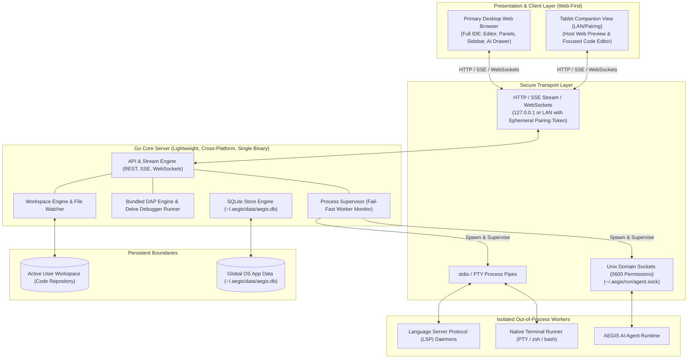

# AegisCode System Architecture

> **Objective**: Lightweight, Web-Based IDE with a Local Cross-Platform Go Backend and Remote Tablet Companion.  
> **Core Architecture**: Hybrid Layered Core with Out-of-Process Worker Supervision.  
> **Core Principle**: Do Not Over-Engineer.

---

## 1. High-Level Architectural Vision

AegisCode is engineered as a modern, lightweight, web-first IDE designed for local developer workflows with remote extension capabilities. It rejects heavy multi-gigabyte runtimes and enterprise microservice sprawl in favor of a lean, high-performance architecture:

### Core Architecture Pillars
1. **Web-Based & Remote-Ready**: The frontend runs natively in modern web standards. Developers can use the desktop browser for full IDE operations and connect a tablet over the local network as a secondary companion host (live preview or dedicated focus editor).
2. **Cross-Platform & Single Standalone Binary (`embed.FS`)**: Compiled into a single zero-dependency standalone native binary (~7.5 MB) for macOS, Linux, and Windows, embedding the production React 19 frontend via Go `embed.FS` (`server/internal/web`). The backend runtime is stateless and immutable; dynamic states are isolated exclusively inside SQLite in the OS App Data directory.
3. **Bundled Backend Debugging**: Debug Adapter Protocol (DAP) and native debugger runners (such as Delve) are bundled directly into the backend supervision engine.
4. **Resilient Isolation**: Heavy or crash-prone tasks (LSP engines, PTY terminal shells, agent reasoning) run as supervised external worker processes so crashes never terminate the core server or freeze editor UI buffers.
5. **Zero-Footprint On-Demand Viewers (Universal PWA Code Splitting)**: To prevent application bundle bloat beyond 50MB+ and protect client memory, every specialized non-code viewer and external parser (including `@tldraw/tldraw` for Wireframe Studio `.canvas`/`.design`, PDF.js for `.pdf`, spreadsheet engines for `.csv`/`.xls`, media viewers for `.svg`/`.png`/`.jpg`, and rich Markdown preview for `.md`) is strictly partitioned into asynchronous dynamic chunks loaded via `React.lazy()` and dynamic `import()`. During standard code editing, all specialized viewer runtimes consume 0 MB RAM, remain unparsed, and never inflate initial load times.

---

## 2. Directory Hierarchy & Folder Responsibilities

The codebase adheres strictly to folder-level boundaries. Each directory owns a distinct architectural responsibility:

### Root Level
- [`/`](../../): Root workspace housing configuration manifests (`package.json`, `tsconfig.json`, `vite.config.ts`), agent guidelines, and primary documentation indexes.
- [`src/`](../../src): Complete frontend source code written in React 19, TypeScript, and Tailwind CSS v4.
- [`server/`](../../server): Go Core Server implementation (planned & structured for single-binary cross-platform delivery).
- [`docs/`](../../docs): Official English project documentation, design references, specifications, and ADRs.
- [`.agents/`](../../.agents): Agent skill library, persona definitions, and autonomous workflow specifications.
- [`dist/`](../../dist): Optimized static production bundle produced by Vite for deployment and embedding.
- [`public/`](../../public): Static web assets served verbatim (favicons, manifest metadata).

---

### Frontend Hierarchy (`src/`)

- [`src/components/layout/`](../../src/components/layout): Houses layout orchestrators and composite view panels. Every subfolder owns its respective UI view and co-located stylesheets:
  - `header/`: Window management, quick launcher triggers, layout toggles.
  - `activity-rail/`: Primary navigation rail switching sidebar activity modes.
  - `sidebar/`: Multi-view sidebar containing Explorer, Source Control Git, Search & Replace, and Run & Debug.
  - `editor/`: Multi-pane text editor workbench, window groups, breadcrumbs, buffer manager, minimap, diff editor, and specialized lazy-loaded viewers (`ImageViewer`, `MarkdownViewer`, `PdfViewer`, `CsvViewer`).
  - `bottom-panel/`: Tabbed lower drawer hosting Multi-session Terminal, Problems diagnostics, Output logs, and Debug Console REPL.
  - `chat/`: AEGIS AI Agent drawer hosting session history, streaming chat, and context triggers.
  - `status-bar/`: Interactive footer displaying line positions, language, git branches, performance guard, and diagnostic summaries.
  - `settings/`: Modal overlay for IDE settings and configurable keybindings.
  - `command-palette/`: Global command palette launcher (Ctrl/Cmd + K) backed by Go-First in-memory Quick Open.
- [`src/components/codegraph/`](../../src/components/codegraph): VantageCraft CodeGraph 6-View Studio (`CodeGraphShell.tsx`, `EntrypointsView`, `StepsView`, `ArchitectureMapView`, `FlowTrailsView`, `ScreensEventsView`, `FileCodeDrawer`). Loaded strictly on-demand.
- [`src/components/ui/`](../../src/components/ui): Atomic, domain-agnostic UI primitives (icons, icon buttons, badges, toasts, modal backdrops). No business logic is placed here.
- [`src/store/`](../../src/store): Unified modular Zustand state store (`useWorkbenchStore`) split into 9 domain slices (`createWorkspaceSlice`, `createEditorSlice`, `createChatSlice`, `createGitSlice`, `createDebugSlice`, `createTerminalSlice`, `createLayoutSlice`, `createSettingsSlice`, `codegraphSlice`).
- [`src/context/`](../../src/context): Shared React Contexts and lifecycle managers (`WorkbenchLifecycle.ts`, `WorkbenchEventHub.ts`) governing buffer persistence, worker brokering, and SSE events.
- [`src/services/`](../../src/services): API client services (`storeApi.ts`, `codegraphApi.ts`, `WorkbenchEventHub.ts`).
- [`src/data/`](../../src/data): Initial mocks, constant registries, AI model definitions, and autocomplete catalogs.
- [`src/styles/`](../../src/styles): Tailwind CSS v4 design token definitions (`tokens.css`), global resets (`base.css`), reusable utility components (`ui.css`), and master frame layout shells (`shell.css`).
- [`src/utils/`](../../src/utils): Client-side utilities including syntax tokenizers, path normalization, and git diff parsers.

---

### Backend Hierarchy (`server/`)

The Go Core Server adheres to a pragmatic, flat package-by-feature layout avoiding deep DDD or hexagonal abstractions:

- `server/cmd/server/`: Executable entry point (`main.go`), CLI flag parsing, configuration bootstrap, and graceful shutdown signal traps.
- `server/internal/api/`: REST routing handlers, unified SSE multiplexer (`/api/v1/events`), WebSocket bidirectional event pipes, and workspace endpoints.
- `server/internal/events/`: Unified Go `EventHub` SSE Multiplexer broadcasting events across topics (`workspace`, `logs`, `workers`, `debug`, `lsp`, `terminal`).
- `server/internal/config/`: Immutable configuration parser reading environment variables and defaults into read-only struct instances.
- `server/internal/dap/`: Bundled Debug Adapter Protocol runner, managing debug sessions, breakpoints, and Delve daemon proxies.
- `server/internal/git/`: Native Go Git subsystem with pure CLI/porcelain execution, DAG commit graph builder, conflict detection, checkout, and branch operations.
- `server/internal/codegraph/`: Native reverse proxy routing queries to VantageCraft CodeGraph engine (`/api/codegraph/ui/*`).
- `server/internal/store/`: Embedded SQLite storage client managing user profiles, session logs, and IDE preferences in `~/.aegis/data/aegis.db`.
- `server/internal/supervisor/`: Process supervisor managing child workers (LSP, PTY, Agent) with fail-fast crash detection and auto-restart policies.
- `server/internal/terminal/`: Native pseudoterminal (PTY) session manager handling cross-platform shell allocation, resizing, and streaming.
- `server/internal/web/`: Embedded production web assets (`embed.FS`) and Single Page Application (SPA) fallback handler serving production React assets.
- `server/internal/workspace/`: Project workspace indexing, file system CRUD actions, safe path validation, windowed CSV query engine, and recursive file watchers.

---

### Documentation Hierarchy (`docs/`)

- [`docs/README.md`](../../docs/README.md): Master documentation index and navigation directory.
- [`docs/internal/architecture.md`](../../docs/internal/architecture.md): This file — system blueprint and folder-level ownership guide.
- [`docs/internal/frontend.md`](../../docs/internal/frontend.md): Active UI layout reference and Zustand store architecture.
- [`docs/internal/roadmap.md`](../../docs/internal/roadmap.md): Milestone progression tracking Phases 1 through 9.
- [`docs/internal/feature-backend.md`](../../docs/internal/feature-backend.md): Backend technical blueprint, core features, and critical REST/SSE/WS endpoints.
- [`docs/internal/report.md`](../../docs/internal/report.md): Feature assessment guidelines, scorecard metrics, and pre-implementation gate checklist.
- [`docs/internal/installation.md`](../../docs/internal/installation.md): Installation prerequisites, build instructions, and developer setup.
- [`docs/developers/local-rest-and-sse-api.md`](../../docs/developers/local-rest-and-sse-api.md): Developer API reference for REST endpoints and Unified EventHub SSE streams.
- [`docs/adr/`](../../docs/adr): Architectural Decision Records (ADR 0001 through ADR 0016).
- [`docs/rfc-append-only-chat-graph-ledger.md`](../../docs/rfc-append-only-chat-graph-ledger.md): Feature RFC for Append-Only Event Ledger and Graph Storage for AI Conversations.

---

## 3. Communication & Data Flow Contracts

1. **Client to Core Server**:
   - Primary communication occurs over HTTP loopback (`127.0.0.1`) or local LAN with an ephemeral Bearer pairing token generated on server startup.
   - Unified Streaming: Real-time telemetry, logs, file watcher events, worker status, and DAP debug output flow through a single multiplexed SSE connection via the Go `EventHub` (`GET /api/v1/events`), eliminating HTTP/1.1 socket exhaustion (ADR 0016).
2. **Core Server to Workers**:
   - LSP compilers and terminal PTY processes communicate over standard input/output (`stdio`) JSON-RPC.
   - High-throughput local agent tools interact via restricted Unix Domain Sockets (`~/.aegis/run/agent.sock`, mode `0600`).
3. **Tablet Companion Flow**:
   - The desktop initiates a pairing session displaying a tokenized URL or local QR code.
   - The tablet browser connects to the Go server on the local network.
   - The tablet interface renders in **Companion Mode**: enabling switching between running host web previews and a lightweight, focused code editor buffer with two-way file synchronization.

---

## 4. Deprecated & Legacy Architecture (Historical Archive)

> **Notice**: The architectures, patterns, and files listed below have been deprecated or permanently purged from AegisCode v2. They are documented here solely for historical auditability and backward traceability.

### A. Deprecated Frontend Core Facades & Context Wrappers
- **Monolithic Context Facades**: Monolithic files in `src/context/` (`editorCore.ts`, `settingsCore.ts`, `workspaceCore.ts`) and legacy hooks (`useChatCore`, `useGitCore`, `useLayoutCore`, `useTerminalCore`) were deprecated and purged in Wave 4, directly superseded by modular Zustand slices in `src/store/slices/`.
- **Legacy Cytoscape Flat Graph Viewer**: The legacy flat Cytoscape viewer (`GraphViewer.tsx`) querying recursive CTE endpoints (`/api/v1/codegraph/neighborhood`) has been removed and superseded by VantageCraft 6-View Studio (`CodeGraphShell.tsx`).

### B. Deprecated Independent SSE Endpoints
- **Standalone Fragmented SSE Streams**: Opening multiple concurrent SSE streams (`/api/v1/events/workspace`, `/api/v1/events/logs`, `/api/v1/events/workers`, `/api/v1/events/debug`, `/api/v1/events/lsp`) led to HTTP/1.1 browser connection pool exhaustion (max 6 sockets). Superseded by Unified Go `EventHub` Multiplexer (`GET /api/v1/events`, ADR 0016).

### C. Deprecated Custom Go AST CodeGraph Extractors
- **In-Memory Go AST Parsing Engine**: Initial custom Go AST extractors in `server/internal/codegraph/analyzer.go` and `indexer.go` were deprecated and replaced by native VantageCraft CodeGraph CLI integration (`ADR-0014`, `ADR-0015`), using native binary reverse proxying at `/api/codegraph/ui/*`.

### D. Purged Backend Endpoints
- **Dead Route Purge (Wave 5 / MP-5.1)**:
  - `/api/v1/auth/handshake`: Purged legacy handshake stub.
  - `/api/v1/pairing/info`: Purged unreferenced pairing stub.
  - `/api/v1/mcp/rpc`: Purged duplicate alias of `/api/v1/mcp`.
  - `/api/v1/mcp/events`: Purged dead SSE stream for MCP.
  - `/api/v1/codegraph/init`: Purged dead index initialization endpoint.
  - `/api/codegraph/entrypoints`: Purged unversioned duplicate route, retaining `/api/v1/codegraph/entrypoints`.

