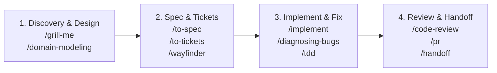

# Engineering Skills & Agent Workflow Guide

This document serves as the standard operational guide for leveraging **Engineering Skills** (Matt Pocock Skills) integrated within the **AegisCodev2** repository.

---

## 1. Architecture & Workflow Philosophy

AegisCodev2 adopts an iterative, feedback-driven cycle governed by a **local-first** approach:
1. **Challenge & Discuss (*Grilling*)**: Interrogate design assumptions before writing any code.
2. **Specification & Vertical Slices (*Spec & Tracer Bullets*)**: Convert agreements into formal specifications and self-contained tickets.
3. **Local Tracking (*Local Markdown Tracker*)**: Store all specifications and tickets directly within the `.scratch/` directory at the repository root.
4. **Disciplined Execution (*Test-Driven & Tight Feedback Loops*)**: Implement tickets one by one with tight feedback loops and automated verification (`rtk npm run build` & `rtk npm run format`).

---

## 2. Local Tracker Conventions (`.scratch/`)

As defined in [`docs/agents/issue-tracker.md`](file:///Users/aditwicaksono/Documents/Project-AI/AegisCodev2/docs/agents/issue-tracker.md), project tasks are structured as follows:

```text
.scratch/
└── <feature-slug>/
    ├── spec.md                   # Full feature specification document
    ├── map.md                    # (Optional) Coordination map for large initiatives (/wayfinder)
    └── issues/                   # Task ticket directory (one file per ticket)
        ├── 01-setup-core.md
        ├── 02-worker-supervision.md
        └── 03-ui-shell-panel.md
```

### Standard Ticket Format (`01-<slug>.md`)
Every ticket file within `.scratch/<feature-slug>/issues/` must declare metadata at the top:

```markdown
# 01 - Core Server Worker Supervision

Status: ready-for-agent
Blocked by: none
Type: task

## Context & Objectives
Implement crash isolation for background workers using supervisor goroutines.

## Acceptance Criteria
- [ ] Crashed workers automatically restart with exponential backoff
- [ ] Core Server does not panic if a worker exits abruptly
- [ ] Supervisor unit tests pass

## Comments
```

### Triage Status Vocabulary
Per [`docs/agents/triage-labels.md`](file:///Users/aditwicaksono/Documents/Project-AI/AegisCodev2/docs/agents/triage-labels.md):
- **`needs-triage`**: New issues, proposals, or unreviewed ideas.
- **`needs-info`**: Awaiting additional context or reproduction steps.
- **`ready-for-agent`**: Fully specified and ready for autonomous agent execution.
- **`ready-for-human`**: Requires human intervention (e.g., hardware credentials, access tokens).
- **`wontfix`**: Explicitly out of scope or rejected.

---

## 3. Skills Catalog & Slash Commands

Skills are organized into four primary quadrants:



### A. Discovery, Interviewing & Architectural Design
* **`/ask-matt`**: Router guide when determining which skill to apply for the current workflow phase.
* **`/grill-me`**: In-depth interview by the agent to test trade-offs, challenge assumptions, and refine feature ideas.
* **`/grill-with-docs`**: Similar to `/grill-me`, but automatically logs new vocabulary to [`GLOSSARY.md`](file:///Users/aditwicaksono/Documents/Project-AI/AegisCodev2/GLOSSARY.md) and drafts decisions into [`docs/adr/`](file:///Users/aditwicaksono/Documents/Project-AI/AegisCodev2/docs/adr).
* **`/domain-modeling`**: Refine domain entities, maintain official ubiquitous language, and document architecture decision records (ADRs).
* **`/codebase-design`**: Architect deep module interfaces (simple surfaces with robust internal capabilities) that are fully testable.
* **`/improve-codebase-architecture`**: Scan codebase for shallow abstractions, generate visual reports, and guide structural refactoring.
* **`/prototype`**: Build rapid throwaway prototypes to test technical feasibility before committing permanent changes.
* **`/research`**: Conduct primary-source technical research and document findings in markdown within the repository.

### B. Specification & Ticket Management
* **`/to-spec`**: Transform discussion conclusions into structured specs at `.scratch/<feature>/spec.md` without repeating questions.
* **`/to-tickets`**: Break down `spec.md` into numbered vertical slice tickets (*tracer bullets*) under `.scratch/<feature>/issues/`, declaring explicit `Blocked by: ...` dependencies.
* **`/wayfinder`**: Navigate and coordinate multi-session project roadmaps using coordination maps (`map.md`) and ticket claims.
* **`/triage`**: Review reported issues, categorize them (`bug` vs `enhancement`), verify impact, and apply triage labels.

### C. Implementation, Testing & Debugging
* **`/implement`** / **`/implement-spec`**: Ingest tickets or specifications from `.scratch/` and execute them directly against the codebase.
* **`/diagnosing-bugs`**: Methodical debugging protocol for elusive bugs or performance regressions. Builds reproducible feedback loops (failing tests, trace replays, bisections) prior to code modification.
* **`/tdd`**: Test-Driven Development (*Red-Green-Refactor*) cycle to guarantee functionality and regression prevention.

### D. Review, Documentation & Collaboration
* **`/code-review`**: Automated dual-axis code review (repository standards adherence and spec alignment) using parallel sub-agents.
* **`/pr`**: Generate concise, high-context pull request summaries detailing scope and impact.
* **`/handoff`**: Compile clean session handoff summaries ensuring seamless resumption across agent sessions.
* **`/retro`**: Conduct retrospective analysis on completed coding sessions to identify workflow improvements.
* **`/teach`**: Interactively explain concepts, architectural decisions, and workspace modules.
* **`/wizard`**: Construct interactive bash walkthrough scripts for manual procedures (e.g., cloud deployments, secret rotation).
* **`/writing-for-agents`**: Author guidelines and skill manifests optimized for autonomous agent execution.

---

## 4. Practical Playbook: Daily Workflows

### Scenario 1: Adding a New Feature from Scratch
1. **Brainstorm & Challenge**:
   ```text
   /grill-with-docs We want to introduce a WebSocket endpoint to stream worker logs to the UI Shell.
   ```
2. **Generate Specification**:
   ```text
   /to-spec
   ```
   *(Produces `.scratch/worker-log-streaming/spec.md`)*
3. **Break Down into Isolated Tickets**:
   ```text
   /to-tickets
   ```
   *(Produces `.scratch/worker-log-streaming/issues/01-websocket-hub.md`, `02-core-streamer.md`, etc.)*
4. **Implement Ticket**:
   ```text
   /implement .scratch/worker-log-streaming/issues/01-websocket-hub.md
   ```
5. **Review Code**:
   ```text
   /code-review
   ```

---

### Scenario 2: Investigating & Resolving Complex Bugs
1. **Initiate Diagnosis Session**:
   ```text
   /diagnosing-bugs Server hangs when a background worker crashes repeatedly within 5 seconds.
   ```
2. **Establish Feedback Loop**:
   Agent writes a reproducible failing test (*red signal*) before modifying server code.
3. **Implement Fix via TDD**:
   ```text
   /tdd
   ```
4. **Verify Quality Gates**:
   Run `rtk npm run build` and `rtk npm run format`.

---

## 5. Mandatory Repository Rules ([`AGENTS.md`](file:///Users/aditwicaksono/Documents/Project-AI/AegisCodev2/AGENTS.md))

Whenever an agent executes tasks across any skill:
* **Prefix Shell Commands with `rtk`**: Every shell invocation must be prefixed with `rtk` (e.g., `rtk npm run build`, `rtk git status`).
* **Verify Before Completion**:
  ```bash
  rtk npm run build    # Must pass with 0 errors
  rtk npm run format   # Format verification via oxfmt
  ```
* **Domain Consistency**: Always adhere to definitions in [`GLOSSARY.md`](file:///Users/aditwicaksono/Documents/Project-AI/AegisCodev2/GLOSSARY.md) and never violate architectural constraints in [`docs/adr/`](file:///Users/aditwicaksono/Documents/Project-AI/AegisCodev2/docs/adr).
