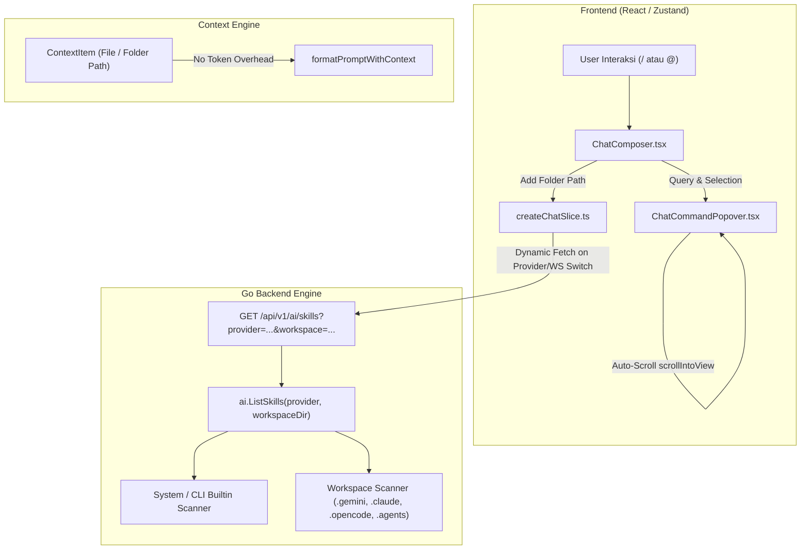

# Implementation Plan: AI Skills, Popover Auto-Scroll, Folder Context, & Token Removal

## Overview & Objectives

Berdasarkan kesepakatan desain, rencana kerja ini mencakup 4 peningkatan utama pada sistem AI Drawer AegisCode:
1. **Deteksi Skill AI Native Multi-Provider**: Memindai skill bawaan sistem dan workspace lokal secara dinamis per-provider (Antigravity, Claude, OpenCode, OpenRouter) melalui Go server.
2. **Auto-Scroll Popover Presisi**: Memastikan item terpilih pada popover `/` (skills) dan `@` (files & folders) selalu terlihat utuh mengikuti pointer keyboard (`ArrowUp` / `ArrowDown`).
3. **Konteks Folder via `@` (Path-Only)**: Memungkinkan penambahan folder ke dalam konteks percakapan dengan hanya menyertakan path direktori (`Directory: <path>`) tanpa overhead komputasi membaca seluruh isi file.
4. **Eliminasi Perhitungan Token**: Menghapus badge token dari UI dan mematikan loop kalkulasi estimasi token/budgeting untuk meringankan beban komputasi di sisi client.

---

## Arsitektur Alur Sistem



---

## Rincian Tahapan Implementasi

### Fase 1: Backend Go — Dynamic Native Skill Discovery
* **File Target**:
  - [`server/internal/ai/skills.go`](file:///Users/aditwicaksono/Documents/Project-AI/AegisCodev2/server/internal/ai/skills.go) (baru / refactor dari `antigravity.go`)
  - [`server/internal/api/api.go`](file:///Users/aditwicaksono/Documents/Project-AI/AegisCodev2/server/internal/api/api.go)
  - [`server/internal/ai/antigravity.go`](file:///Users/aditwicaksono/Documents/Project-AI/AegisCodev2/server/internal/ai/antigravity.go)
* **Langkah Kerja**:
  1. Perluas `handleAISkills` di `api.go` untuk menerima query parameter `provider` (default: `antigravity`) dan `workspace` (default: root workspace aktif).
  2. Implementasikan struktur `SkillItem`:
     ```go
     type SkillItem struct {
         Command     string `json:"command"`
         Name        string `json:"name"`
         Description string `json:"description"`
         Scope       string `json:"scope"`       // "system" | "workspace"
         Source      string `json:"source,omitempty"` // path atau label sumber
     }
     ```
  3. Implementasikan pemindai native per provider:
     - **Antigravity**:
       - Builtin: `/plan`, `/spec`, `/review`, `/debug`, `/simplify`, `/goal`, `/schedule`, `/browser`, `/grill-me`, `/boost`.
       - System: `~/.gemini/antigravity-cli/builtin/skills/` dan `~/.gemini/skills/`.
       - Workspace: `<ws>/.gemini/skills/`, `<ws>/.agents/skills/`, `<ws>/.agent/skills/`.
     - **Claude**:
       - Builtin: `/help`, `/compact`, `/clear`, `/init`, `/cost`, `/doctor`, `/review`, `/bug`, `/terminal-setup`, `/model`, `/verbose`.
       - System: `~/.claude/commands/*.md`.
       - Workspace: `<ws>/.claude/commands/*.md`, `<ws>/.claude/skills/*/SKILL.md`.
     - **OpenCode**:
       - Builtin: `/plan`, `/build`, `/test`, `/review`.
       - System: `~/.opencode/skills/`, `~/.config/opencode/skills/`.
       - Workspace: `<ws>/.opencode/skills/`, `<ws>/.opencode/commands/`.
     - **OpenRouter**:
       - Builtin: `/plan`, `/review`, `/debug`, `/explain`, `/refactor`.
       - Workspace: `<ws>/.skills/`, `<ws>/.prompts/`.
  4. Parsing frontmatter markdown (`name:`, `description:`) jika tersedia, atau ambil heading `# Title` pertama sebagai nama skill.

---

### Fase 2: Frontend Store & API Dynamic Skill Synchronization
* **File Target**:
  - [`src/utils/storeApi.ts`](file:///Users/aditwicaksono/Documents/Project-AI/AegisCodev2/src/utils/storeApi.ts)
  - [`src/store/slices/createChatSlice.ts`](file:///Users/aditwicaksono/Documents/Project-AI/AegisCodev2/src/store/slices/createChatSlice.ts)
  - [`src/types/workbench.ts`](file:///Users/aditwicaksono/Documents/Project-AI/AegisCodev2/src/types/workbench.ts)
* **Langkah Kerja**:
  1. Perbarui `fetchAISkills(provider?: string, workspace?: string): Promise<SkillCommand[]>`.
  2. Perbarui `SkillCommand` di `workbench.ts` untuk memuat properti `scope?: "workspace" | "system"` dan `source?: string`.
  3. Tambahkan `refreshAISkills(provider?: string, workspace?: string)` di `createChatSlice.ts`.
  4. Panggil refresh skill otomatis saat:
     - Inisialisasi awal aplikasi.
     - Perubahan provider via `setSessionModel`.
     - Pembukaan atau perubahan workspace root.

---

### Fase 3: Auto-Scroll Popover Pointer Tracking
* **File Target**:
  - [`src/components/layout/chat/ChatCommandPopover.tsx`](file:///Users/aditwicaksono/Documents/Project-AI/AegisCodev2/src/components/layout/chat/ChatCommandPopover.tsx)
  - [`src/components/layout/chat/ChatComposer.tsx`](file:///Users/aditwicaksono/Documents/Project-AI/AegisCodev2/src/components/layout/chat/ChatComposer.tsx)
* **Langkah Kerja**:
  1. Tambahkan `ref` array pada container daftar popover (`command-popover-list`) dan elemen item popover.
  2. Implementasikan `useEffect` pada `selectedIndex`:
     ```tsx
     useEffect(() => {
       const el = itemRefs.current[selectedIndex]
       if (el) {
         el.scrollIntoView({ block: "nearest", inline: "nearest" })
       }
     }, [selectedIndex])
     ```
  3. Sinkronkan filter item antara `ChatComposer` dan `ChatCommandPopover` agar penekanan Enter/Tab selalu mengeksekusi item yang tepat.
  4. Perbarui rendering detail item untuk menampilkan penanda asal (contoh: `Workspace · .gemini/skills/my-skill` vs `Builtin · Antigravity`).

---

### Fase 4: Folder Context Mention via `@` (Path-Only)
* **File Target**:
  - [`src/components/layout/chat/ChatComposer.tsx`](file:///Users/aditwicaksono/Documents/Project-AI/AegisCodev2/src/components/layout/chat/ChatComposer.tsx)
  - [`src/store/slices/createChatSlice.ts`](file:///Users/aditwicaksono/Documents/Project-AI/AegisCodev2/src/store/slices/createChatSlice.ts)
  - [`src/context/core/chatCore.ts`](file:///Users/aditwicaksono/Documents/Project-AI/AegisCodev2/src/context/core/chatCore.ts)
  - [`src/types/workbench.ts`](file:///Users/aditwicaksono/Documents/Project-AI/AegisCodev2/src/types/workbench.ts)
  - [`src/components/layout/chat/ChatMessageList.tsx`](file:///Users/aditwicaksono/Documents/Project-AI/AegisCodev2/src/components/layout/chat/ChatMessageList.tsx)
* **Langkah Kerja**:
  1. Izinkan `popoverItem.isFolder` pada `handleSelectToken` di `ChatComposer.tsx`.
  2. Tambahkan tipe `"folder"` pada `ContextItem.type` di `workbench.ts`.
  3. Di `createChatSlice.ts`, buat context item folder ringan:
     ```tsx
     const item: ContextItem = {
       id: `ctx-${path}-folder`,
       type: "folder",
       path,
       content: `Directory: ${path}`,
       charCount: path.length,
       mode: "reference",
     }
     ```
  4. Di `formatPromptWithContext` (`chatCore.ts`), format item folder sebagai:
     ```text
     Directory: src/components/layout/
     ```
  5. Di `ChatComposer.tsx`, render context chip folder dengan `<Icon name="folder" size={10} />` dan badge `(Dir)`.
  6. Di `ChatMessageList.tsx`, render user context pill dengan icon folder untuk item bertipe folder.

---

### Fase 5: Eliminasi Mekanisme Perhitungan & Budgeting Token
* **File Target**:
  - [`src/components/layout/chat/ChatComposer.tsx`](file:///Users/aditwicaksono/Documents/Project-AI/AegisCodev2/src/components/layout/chat/ChatComposer.tsx)
  - [`src/context/core/contextExtractorCore.ts`](file:///Users/aditwicaksono/Documents/Project-AI/AegisCodev2/src/context/core/contextExtractorCore.ts)
  - [`src/store/slices/createChatSlice.ts`](file:///Users/aditwicaksono/Documents/Project-AI/AegisCodev2/src/store/slices/createChatSlice.ts)
  - Unit test regresi frontend
* **Langkah Kerja**:
  1. Hapus elemen badge `~{item.estimatedTokens} tokens` dari context chip di `ChatComposer.tsx`.
  2. Hapus eksekusi `enforceContextTokenBudget` dari `recomputeContext` di `createChatSlice.ts` agar tidak ada looping pemotongan token yang memberatkan memori/CPU.
  3. Jadikan `estimatedTokens` opsional atau default 0 pada `ContextItem`.
  4. Pertahankan `estimateTokens` sebagai utilitas ringan backward-compatible untuk menjaga kompatibilitas suite unit test yang ada.

---

## Verifikasi & Kriteria Keberhasilan

| Komponen | Pengujian | Kriteria Lolos |
|---|---|---|
| **Backend Go** | `rtk go -C server test ./...` | Semua unit test backend lolos 100%, endpoint `/api/v1/ai/skills` mengembalikan skill sesuai provider & workspace. |
| **Frontend Build** | `rtk npm run build` | Kompilasi Vite lolos dengan 0 error dan zero type error. |
| **Code Formatting** | `rtk npm run format` | Formatting OxFmt bersih pada seluruh file yang dimodifikasi. |
| **Unit Test Frontend** | `rtk npm test` | 19 file test / 210 test lolos 100%. |
| **Keyboard Navigasi** | Manual check | Menekan panah bawah pada popover `/` dan `@` menggulir list secara presisi sehingga item aktif selalu terlihat. |
| **Mention Folder** | Manual check | Memilih folder via `@` menyematkan chip `📁 folder/ (Dir)` tanpa menghitung token. |
