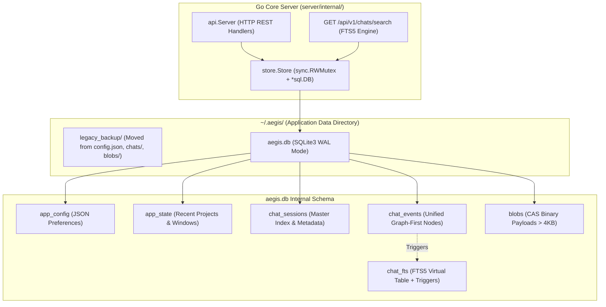

# Implementation Plan: Sub-Phase 6.13 — Embedded Pure-Go SQLite Engine & FTS5 Search

## Goal Description
Menggantikan persistensi flat-file terfragmentasi (`config.json`, `state.json`, `sessions.json`, `chats/*.jsonl`, dan `blobs/*.raw`) dengan engine database tertanam (*embedded database*) berbasis **Pure-Go SQLite** (`modernc.org/sqlite`). Menjamin transaksi ACID, konkurensi aman multi-perangkat (persiapan Tablet Companion Phase 9), integrasi *Full-Text Search* (FTS5) riwayat percakapan AI berkecepatan tinggi (< 3 ms), dan mempertahankan prinsip *Zero-CGO* (`CGO_ENABLED=0`) untuk portabilitas cross-compile macOS, Linux, dan Windows.

---

## User Review Required

> [!IMPORTANT]
> **Zero Breaking Changes**: Seluruh signature public method `Store` (`GetConfig`, `SaveConfig`, `GetState`, `SaveState`, `ListChats`, `GetChat`, `SaveChat`, `DeleteChat`, `AppendEventNode`, `GetChatNodes`, `ReconstructChat`, `SaveBlob`, `GetBlob`, dll.) dipertahankan 100% sama persis agar seluruh layer `server/internal/api/` dan frontend tidak mengalami regresi.

> [!NOTE]
> **Shadow Migration & Safe Backup**: Pada startup pertama kali, data dari berkas flat-file lama (`config.json`, `state.json`, `sessions.json`, `chats/*.jsonl`, `blobs/`) akan di-ingest ke `aegis.db` dalam satu transaksi database ACID. Setelah commit berhasil, berkas flat-file dipindahkan secara aman ke `~/.aegis/legacy_backup/` untuk menjamin zero data loss dan kemudahan rollback.

> [!TIP]
> **Pure-Go Portability**: Menggunakan driver murni `modernc.org/sqlite` tanpa CGO (`CGO_ENABLED=0`). Binary tetap portabel, mandiri, dan dapat dikompilasi tanpa GCC/Clang eksternal.

---

## Open Questions
*Tidak ada pertanyaan terbuka yang memblokir. Seluruh 5 keputusan desain arsitektur telah disepakati melalui sesi grilling:*
1. **Roadmap Slot**: Sub-Phase 6.13 di Phase 6.
2. **Schema Model**: Unified Graph-First schema pada `chat_events` untuk mendukung 100% fidelitas `GraphNode` & forking/branching.
3. **Blob Storage**: Full in-database binary BLOB storage di tabel `blobs` untuk database mandiri `aegis.db`.
4. **Shadow Migration**: Single source of truth dengan pemindahan berkas lama ke `~/.aegis/legacy_backup/`.
5. **Search API**: Endpoint canonical `GET /api/v1/chats/search?q=<query>&limit=<n>`.

---

## Proposed Changes



### Component 1: Dependencies (`server/go.mod`)

#### [MODIFY] `server/go.mod`
- Menambahkan dependensi `modernc.org/sqlite`.
- Menjalankan `go mod tidy` di direktori `server/`.

---

### Component 2: Core SQLite Engine & Schema Migration (`server/internal/store/`)

#### [NEW] `server/internal/store/db.go`
- Inisialisasi koneksi `*sql.DB` menggunakan driver `sqlite` (`modernc.org/sqlite`).
- Konfigurasi PRAGMA WAL mode:
  ```sql
  PRAGMA journal_mode = WAL;
  PRAGMA synchronous = NORMAL;
  PRAGMA foreign_keys = ON;
  PRAGMA busy_timeout = 5000;
  PRAGMA cache_size = -2000;
  ```
- DDL Schema Execution:
  1. `app_config` (id, data_json, updated_at)
  2. `app_state` (id, active_session_id, recent_projects_json, window_state_json, updated_at)
  3. `chat_sessions` (id, title, provider, model, root_node_id, active_leaf_id, node_count, created_at, updated_at, is_archived)
  4. `chat_events` (id, session_id, parent_id, type, role, text, content, reasoning, tool_name, tool_args_json, tool_output, blob_ref, preview, provider, model, meta_json, created_at)
  5. `blobs` (hash, session_id, data, size, created_at)
  6. `chat_fts` virtual table (using fts5) + insert/delete sync triggers.

#### [NEW] `server/internal/store/migrate_sqlite.go`
- Modul shadow migration non-destruktif:
  - Memeriksa apakah berkas flat-file lama ada (`config.json`, `state.json`, `sessions.json`, `chats/*.jsonl`, `chats/*.json`, `blobs/*.raw`).
  - Membuka transaksi `tx, err := db.Begin()`.
  - Mengimpor konfigurasi, status aplikasi, seluruh sesi dan graf interaksi, serta binary blob.
  - Setelah commit berhasil, memindahkan berkas flat-file ke direktori `~/.aegis/legacy_backup/`.

#### [MODIFY] `server/internal/store/store.go`
- Mengganti field struct `Store`:
  ```go
  type Store struct {
      baseDir  string
      dbPath   string
      db       *sql.DB
      mu       sync.RWMutex
  }
  ```
- Menyesuaikan `New(baseDir string)` untuk menginisialisasi SQLite `aegis.db`, menjalankan automigrasi DDL, dan menjalankan shadow migration.
- Mengimplementasikan `GetConfig()`, `SaveConfig()`, `GetState()`, `SaveState()`, `AddRecentProject()`, `RemoveRecentProject()`, `ClearRecentProjects()`, `ListChats()`, `GetChat()`, `SaveChat()`, `DeleteChat()`, `Close()`.
- Menambahkan method FTS5 search:
  ```go
  type SearchResult struct {
      SessionID    string `json:"sessionId"`
      SessionTitle string `json:"sessionTitle"`
      EventID      string `json:"eventId"`
      Snippet      string `json:"snippet"`
      Role         string `json:"role"`
      CreatedAt    int64  `json:"createdAt"`
  }

  func (s *Store) SearchChats(query string, limit int) ([]SearchResult, error)
  ```

#### [MODIFY] `server/internal/store/ledger.go`
- Mengganti operasi penulisan file `.jsonl` pada `AppendEventNode` dengan SQL insert ke tabel `chat_events` dan `chat_sessions`.
- Mengganti pembacaan baris `GetChatNodes` dengan SQL query `SELECT ... FROM chat_events WHERE session_id = ? ORDER BY created_at ASC` (dengan limit `tail` jika diminta).
- Menyesuaikan `ReconstructChat` agar merangkai riwayat percakapan dari rekaman SQL tabel `chat_events`.

#### [MODIFY] `server/internal/store/blob.go`
- Mengalihkan operasi `SaveBlob` untuk menyimpan binary payload ke tabel `blobs` di SQLite.
- Mengalihkan operasi `GetBlob` untuk membaca payload dari tabel `blobs` (dengan fallback ke filesystem jika ada blob lama).
- Mengganti `DeleteSessionBlobs` menjadi SQL delete `DELETE FROM blobs WHERE session_id = ?`.

#### [MODIFY] `server/internal/store/index.go`
- Mengalihkan sinkronisasi `sessions.json` ke tabel SQL `chat_sessions` dengan tetap mengekspos `GetSessionsIndex()`, `SaveSessionsIndex()`, `UpdateSessionDescriptor()`, dan `RemoveSessionDescriptor()` agar 100% backward-compatible.

---

### Component 3: HTTP API & FTS5 Endpoint (`server/internal/api/`)

#### [MODIFY] `server/internal/api/api.go`
- Menambahkan routing endpoint `GET /api/v1/chats/search`:
  ```go
  // In handleChats or handleChatOperations:
  if r.URL.Path == "/api/v1/chats/search" {
      s.handleChatSearch(w, r)
      return
  }
  ```
- Implementasi `handleChatSearch(w http.ResponseWriter, r *http.Request)`:
  - Membaca parameter query `q` (keyword) dan `limit` (default 30, max 100).
  - Memanggil `s.store.SearchChats(query, limit)`.
  - Mengembalikan respon JSON:
    ```json
    {
      "query": "...",
      "total": 3,
      "results": [...]
    }
    ```

---

### Component 4: Documentation & Roadmap Update (`docs/`)

#### [MODIFY] `docs/internal/roadmap.md`
- Menambahkan spesifikasi lengkap **Sub-Phase 6.13: Embedded Pure-Go SQLite Engine & FTS5 Search** pada tabel milestone dan rincian deliverable Phase 6.

#### [NEW] `docs/adr/0013-embedded-pure-go-sqlite-and-fts5-search.md`
- Dokumentasi ADR resmi untuk adopsi `modernc.org/sqlite`, CGO-free portability, WAL high concurrency, unified graph schema, dan FTS5 search.

---

## Verification Plan

### Automated Tests
1. **Go Unit & Concurrency Tests**:
   ```bash
   rtk go -C server test -v -run TestSQLite ./internal/store/...
   rtk go -C server test -v ./internal/store/...
   rtk go -C server test -v ./internal/api/...
   ```
   - Verifikasi inisialisasi database SQLite dan DDL migration.
   - Verifikasi FTS5 search query dengan snippet keyword matching.
   - Verifikasi konkurensi (30 goroutine concurrent reader + writer) tanpa `database is locked`.
   - Verifikasi shadow migration: fixture flat-file dipindahkan ke `legacy_backup/` dan data masuk utuh ke SQLite.
   - Verifikasi endpoint `GET /api/v1/chats/search` di `api_test.go`.

2. **Full Backend Test Suite**:
   ```bash
   rtk npm run test:backend
   ```
   - Memastikan seluruh 150+ unit & integration test backend tetap passing tanpa regresi.

3. **Frontend & Code Quality Gates**:
   ```bash
   rtk npm run build
   rtk npm run format
   ```

### Manual Verification
1. Boot server lokal: `npm run server`.
2. Buka AegisCode IDE di browser (`http://localhost:5173` atau `http://localhost:8080`).
3. Kirim percakapan AI di Chat Drawer, pastikan respons tersimpan di database `~/.aegis/aegis.db`.
4. Jalankan pencarian via API:
   `curl "http://localhost:8080/api/v1/chats/search?q=test"` dan verifikasi hasil JSON FTS5 terperingkat.
5. Periksa direktori `~/.aegis/legacy_backup/` untuk memastikan backup otomatis berjalan rapi.
