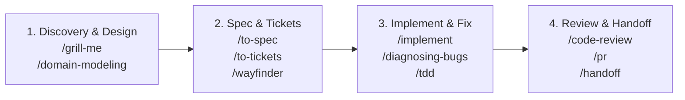

# Engineering Skills & Agent Workflow Guide

Dokumen ini adalah panduan operasional standar untuk menggunakan **Engineering Skills** (Matt Pocock Skills) yang terintegrasi di repository **AegisCodev2**.

---

## 1. Arsitektur & Filosofi Alur Kerja

AegisCodev2 mengadopsi alur kerja berulang (*feedback-driven cycle*) dengan prinsip **local-first**:
1. **Diskusi & Uji Asumsi (*Grilling*)**: Tantang rancangan sebelum menulis kode.
2. **Spesifikasi & Irisan Vertikal (*Spec & Tracer Bullets*)**: Ubah kesepakatan menjadi dokumen formal dan tiket mandiri.
3. **Pelacakan Lokal (*Local Markdown Tracker*)**: Seluruh spesifikasi dan tiket disimpan di dalam direktori `.scratch/` di root repository.
4. **Eksekusi Disiplin (*Test-Driven & Tight Feedback Loops*)**: Eksekusi tiket satu per satu dengan feedback loop yang ketat dan verifikasi otomatis (`rtk npm run build` & `rtk npm run format`).

---

## 2. Konvensi Local Tracker (`.scratch/`)

Sesuai konfigurasi di [`docs/agents/issue-tracker.md`](file:///Users/aditwicaksono/Documents/Project-AI/AegisCodev2/docs/agents/issue-tracker.md), seluruh pekerjaan proyek diorganisir sebagai berikut:

```text
.scratch/
└── <feature-slug>/
    ├── spec.md                   # Dokumen spesifikasi lengkap hasil diskusi
    ├── map.md                    # (Opsional) Peta koordinasi untuk inisiatif besar (/wayfinder)
    └── issues/                   # Direktori tiket kerja (satu file per tiket)
        ├── 01-setup-core.md
        ├── 02-worker-supervision.md
        └── 03-ui-shell-panel.md
```

### Format Standar Tiket (`01-<slug>.md`)
Setiap file tiket di dalam `.scratch/<feature-slug>/issues/` wajib mencantumkan metadata di bagian atas:

```markdown
# 01 - Core Server Worker Supervision

Status: ready-for-agent
Blocked by: none
Type: task

## Context & Objectives
Implementasi isolasi crash worker menggunakan supervisor goroutine.

## Acceptance Criteria
- [ ] Worker yang crash otomatis di-restart dengan backoff
- [ ] Core Server tidak ikut panik jika worker mati mendadak
- [ ] Unit test supervisor lolos

## Comments
```

### Kosakata Triage Status
Mengacu pada [`docs/agents/triage-labels.md`](file:///Users/aditwicaksono/Documents/Project-AI/AegisCodev2/docs/agents/triage-labels.md):
- **`needs-triage`**: Masalah, proposal, atau ide baru yang belum dievaluasi maintainer.
- **`needs-info`**: Menunggu informasi atau reproduksi lebih lanjut dari pelapor.
- **`ready-for-agent`**: Spesifikasi lengkap dan siap dieksekusi otonom oleh AI agent.
- **`ready-for-human`**: Perlu tindakan manual yang tidak bisa dilakukan agent (misal: kredensial fisik, izin akses).
- **`wontfix`**: Diputuskan untuk tidak dikerjakan / out of scope.

---

## 3. Katalog Lengkap Skills & Slash Commands

Skills terbagi ke dalam 4 kuadran utama:



### A. Perencanaan, Wawancara & Desain Arsitektur
* **`/ask-matt`**: Panduan router jika Anda bingung skill mana yang cocok digunakan pada fase kerja saat ini.
* **`/grill-me`**: Wawancara intensif oleh agent untuk menguji, menantang *trade-offs*, dan menajamkan rancangan atau ide fitur baru.
* **`/grill-with-docs`**: Serupa dengan `/grill-me`, namun secara otomatis mencatat istilah baru ke [`GLOSSARY.md`](file:///Users/aditwicaksono/Documents/Project-AI/AegisCodev2/GLOSSARY.md) dan membuat draft keputusan ke [`docs/adr/`](file:///Users/aditwicaksono/Documents/Project-AI/AegisCodev2/docs/adr).
* **`/domain-modeling`**: Mengasah model domain, memperbarui kosakata resmi, dan mendokumentasikan keputusan arsitektur (ADR).
* **`/codebase-design`**: Merancang antarmuka modul yang *deep* (antarmuka sederhana dengan kapabilitas internal yang solid) dan testable.
* **`/improve-codebase-architecture`**: Memindai arsitektur kode untuk menemukan modul yang dangkal (*shallow*), menghasilkan laporan visual HTML, lalu memandu refactoring.
* **`/prototype`**: Membuat prototipe cepat (*throwaway prototype*) untuk menguji kelayakan logika atau antarmuka sebelum ditulis secara permanen.
* **`/research`**: Meneliti topik atau dokumentasi eksternal berbasis sumber primer dan menyimpan ringkasannya sebagai markdown di repository.

### B. Spesifikasi & Manajemen Tiket
* **`/to-spec`**: Mengubah hasil percakapan/diskusi menjadi file spesifikasi terstruktur di `.scratch/<feature>/spec.md` tanpa melakukan wawancara ulang.
* **`/to-tickets`**: Memecah `spec.md` menjadi irisan vertikal tiket (*tracer bullets*) mandiri bernomor urut di `.scratch/<feature>/issues/`, lengkap dengan deklarasi dependensi `Blocked by: ...`.
* **`/wayfinder`**: Mengelola dan mengarahkan roadmap proyek skala besar (lebih dari 1 sesi agent) menggunakan sistem peta (`map.md`) dan klaim tiket.
* **`/triage`**: Mengkaji issue yang dilaporkan, menentukan kategori (`bug` vs `enhancement`), memverifikasi dampak, dan menetapkan label triage.

### C. Implementasi, Testing & Debugging
* **`/implement`** / **`/implement-spec`**: Membaca tiket atau spesifikasi yang ada di `.scratch/` dan langsung mengimplementasikannya ke dalam basis kode.
* **`/diagnosing-bugs`**: Disiplin investigasi bug sulit atau regresi performa. Membangun feedback loop (*failing test*, trace replay, atau bisection) sebelum mengubah kode sumber.
* **`/tdd`**: Siklus pengembangan berbasis pengujian (*Red-Green-Refactor*) untuk menjamin fungsionalitas dan keandalan kode baru.

### D. Review, Dokumentasi & Kolaborasi
* **`/code-review`**: Menjalankan review otomatis dua sumbu (kesesuaian standar kode repository & kesesuaian dengan tiket/spec) menggunakan sub-agent paralel.
* **`/pr`**: Membantu merumuskan deskripsi pull request yang jelas, ringkas, dan menyertakan konteks perubahan.
* **`/handoff`**: Mengompilasi ringkasan sesi kerja saat ini agar dapat dilanjutkan dengan mulus oleh sesi agent berikutnya.
* **`/retro`**: Mengadakan sesi retrospektif untuk mengevaluasi efektivitas sesi coding yang telah selesai.
* **`/teach`**: Menjelaskan konsep, teknologi, atau modul di dalam workspace ini secara interaktif.
* **`/wizard`**: Membuat skrip bash interaktif pemandu langkah manual (misal: provisioning cloud, rotasi kunci rahasia).
* **`/writing-for-agents`**: Panduan menulis instruksi atau membuat skill baru agar mudah dieksekusi secara otonom oleh AI agent.

---

## 4. Playbook Praktis: Alur Kerja Harian

### Skenario 1: Menambahkan Fitur Baru dari Nol
1. **Brainstorm & Challenge**:
   ```text
   /grill-with-docs Kita ingin menambahkan endpoint WebSocket untuk streaming log worker ke UI Shell.
   ```
2. **Buat Dokumen Spesifikasi**:
   ```text
   /to-spec
   ```
   *(Menghasilkan `.scratch/worker-log-streaming/spec.md`)*
3. **Pecah Menjadi Tiket Terisolasi**:
   ```text
   /to-tickets
   ```
   *(Menghasilkan `.scratch/worker-log-streaming/issues/01-websocket-hub.md`, `02-core-streamer.md`, dst.)*
4. **Implementasikan Tiket**:
   ```text
   /implement .scratch/worker-log-streaming/issues/01-websocket-hub.md
   ```
5. **Review Kode**:
   ```text
   /code-review
   ```

---

### Skenario 2: Menginvestigasi & Memperbaiki Bug Rumit
1. **Mulai Sesi Diagnosis**:
   ```text
   /diagnosing-bugs Server hang ketika worker crash berulang kali dalam durasi 5 detik.
   ```
2. **Kembangkan Feedback Loop**:
   Agent akan membuat pengujian yang gagal (*red signal*) terlebih dahulu sebelum menyentuh file server.
3. **Eksekusi Perbaikan (TDD)**:
   ```text
   /tdd
   ```
4. **Verifikasi Gerbang Mutu**:
   Jalankan `rtk npm run build` dan `rtk npm run format`.

---

## 5. Aturan Wajib Repository ([`AGENTS.md`](file:///Users/aditwicaksono/Documents/Project-AI/AegisCodev2/AGENTS.md))

Ketika agent mengeksekusi instruksi dari skill apa pun:
* **Prefix Shell `rtk`**: Setiap perintah terminal wajib diawali `rtk` (contoh: `rtk npm run build`, `rtk git status`).
* **Verifikasi Sebelum Selesai**:
  ```bash
  rtk npm run build    # Wajib 0 error
  rtk npm run format   # Format checking dengan oxfmt
  ```
* **Konsistensi Domain**: Selalu gunakan kosakata yang telah didefinisikan dalam [`GLOSSARY.md`](file:///Users/aditwicaksono/Documents/Project-AI/AegisCodev2/GLOSSARY.md) dan jangan melanggar aturan arsitektur di [`docs/adr/`](file:///Users/aditwicaksono/Documents/Project-AI/AegisCodev2/docs/adr).
