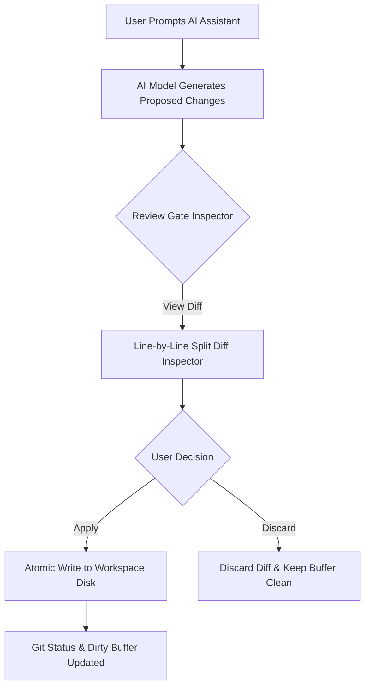

# AI Assistant Studio & Git Review Gates

AegisCode includes a built-in AI Pair-Programming Studio designed around two key values: **Transparency** and **Verification Safety**.

---

## 1. Unified AI Assistant Interface

The AI Assistant panel (accessible via the right sidebar or `Cmd + J` / `Ctrl + J`) lets you collaborate with AI models while maintaining total visibility into their reasoning and actions.

```text
+-------------------------------------------------------------+
| AI ASSISTANT                                   [ Branch 🌿 ] |
+-------------------------------------------------------------+
| User: Please refactor the store migration to use SQLite WAL |
+-------------------------------------------------------------+
| Assistant:                                                  |
| ⮟ Thought Process (1.4s)                                   |
|   Analyzing server/internal/store/migrate_sqlite.go...      |
|   Checking busy_timeout pragma and foreign_keys...          |
|                                                             |
| I have prepared the migration update. Review the diff below:|
|                                                             |
| ┏━━━━━━━━━━━━━━━━━━━━━━━━━━━━━━━━━━━━━━━━━━━━━━━━━━━━━━━━━┓ |
| ┃ 📝 server/internal/store/migrate_sqlite.go             ┃ |
| ┣━━━━━━━━━━━━━━━━━━━━━━━━━━━━━━━━━━━━━━━━━━━━━━━━━━━━━━━━━┫ |
| ┃ -   db.SetMaxOpenConns(5)                               ┃ |
| ┃ +   db.SetMaxOpenConns(25)                              ┃ |
| ┃ +   _pragma=journal_mode(WAL)                           ┃ |
| ┗━━━━━━━━━━━━━━━━━━━━━━━━━━━━━━━━━━━━━━━━━━━━━━━━━━━━━━━━━┛ |
| [ ✓ Apply Diff ]   [ ✗ Discard ]   [ 👁️ Open Split Diff ]   |
+-------------------------------------------------------------+
```

### Key Features:
* **Collapsible Thought Traces**: View the model's internal step-by-step reasoning tokens without cluttering the chat window.
* **Session Branching**: Fork any conversation at a specific prompt turn to test alternative implementation ideas without losing original chat history.
* **Full-Text Search (FTS5)**: Search past conversations and reasoning tokens instantly via the search bar at the top of the chat drawer.
* **Token Delta Streaming**: Real-time token streaming over HTTP Server-Sent Events (SSE) with low latency.

---

## 2. Git-Driven Review Gates

A major safety hazard in AI coding tools is **unsupervised disk modification**, where an agent silently overwrites working files and breaks active code.

AegisCode enforces **Git-Driven Review Gates**:



### Safety Guarantees:
1. **Zero Silent Overwrites**: When an AI proposes a `write_to_file` or `replace_file_content` action, changes are rendered as an in-memory diff preview first.
2. **Line-by-Line Split Diff View**: Click **Open Split Diff** to inspect removals in red and additions in green inside the editor before confirming.
3. **Target Path Resolution & Ghost-Tab Protection**: AegisCode sanitizes and normalizes the target path. It verifies that the path remains strictly inside the workspace boundary, preventing accidental creation of ghost files or writes outside the project root.
4. **Selective Application**:
   - **Apply Single**: Apply changes to only one specific file from a multi-file response.
   - **Apply All**: Atomically apply all proposed file patches across the workspace.
   - **Discard**: Discard the suggested change cleanly without leaving dirty buffer artifacts.

---

## 3. Supported AI Gateways

You can configure any of the following providers under **Settings -> AI Engine**:

| Provider | Gateway Type | Reasoning Traces | CodeGraph MCP Tools |
| :--- | :--- | :---: | :---: |
| **Antigravity CLI (`agy`)** | Local Subprocess Runner | Supported | Supported (In-Memory Context) |
| **Anthropic Claude** | Messages API (REST/SSE) + CLI Fallback | Supported | Supported (Native Function Schema) |
| **OpenAI / OpenRouter / DeepSeek** | Chat Completions SSE | Supported | Supported (OpenAI Function Calling) |
| **Google Gemini** | Direct REST / SSE | Supported | Supported |
| **Local Ollama / OpenCode** | Localhost Endpoint | Supported | Supported |

All providers funnel their responses through the same Review Gate pipeline, guaranteeing uniform safety across all models.

---

## 4. Model Context Protocol (MCP) in AI Drawer & Zero-Lag Execution

When an AI provider executes CodeGraph tools to explore your codebase, AegisCode formats the interactions cleanly in the AI Drawer:

```text
+-------------------------------------------------------------+
| [MCP] [Explore]  server/internal/ai/engine.go        [Open] |
| ⮟ Protocol: Model Context Protocol (codegraph)              |
|   Query: "StreamChat AntigravityEngine"                     |
|   Result: 30 symbols, 5 callers mapped (< 250 tokens)       |
+-------------------------------------------------------------+
```

### Protocol Badging & Navigation:
1. **Explicit `[MCP]` Pill Badge**: Immediately distinguishes structured MCP tool calls from local shell executions (`run_command`) and standard file operations.
2. **Instant `[Open]` Navigation (Zero-Lag)**: Clicking `[Open]` jumps directly to the target file in the main editor. AegisCode intentionally omits forced editor splitting inside chat cards, eliminating CSS Grid reflow and UI freezing during streaming.
3. **In-Memory System Context (Zero Repo Pollution)**: AegisCode dynamically wraps prompts with `<system_context>` instructions in-memory during Go core dispatch. Your workspace `AGENTS.md` remains strictly untouched and read-only.

---

## 5. Smooth Typing & Interactive Mermaid Diagram Preview

### Smooth Typewriter Pacing
Incoming LLM token streams often arrive in uneven, coarse chunks over Server-Sent Events (SSE). AegisCode buffers incoming chunks and paces rendering via an adaptive 30ms micro-batcher (~33 FPS). This provides an organic, smooth typewriter experience without UI thread freezes or lagging behind long responses.

### Mermaid Flowchart & Diagram Rendering
Any ````mermaid```` code block returned by an assistant renders directly as a visual diagram:
* **Lazy On-Demand Loading**: Mermaid runtime assets are loaded only when a diagram is encountered, keeping the initial app bundle lean.
* **Fault-Tolerant Fallback**: Invalid syntax automatically renders formatted raw code with an error status badge instead of crashing the interface.
* **Diagram / Code Toggle**: Switch between visual diagram mode and formatted raw code at any time.

### Fullscreen Pan & Zoom Preview Modal
Clicking the **Preview** button (`maximize` icon) in the diagram toolbar opens an interactive lightbox modal:
* **Pan & Zoom Canvas**: Drag to pan across large architectures, scroll wheel to zoom (20% – 500%), and double-click to reset view to 100%.
* **SVG Export & Copy**: Download the diagram directly as a clean `.svg` file or copy the raw Mermaid source.
* **Zero Workspace Overhead**: Ephemeral portal rendering means zero extra disk files, dirty tabs, or RAM leaks. Press `Esc` or click close to dismiss cleanly.


