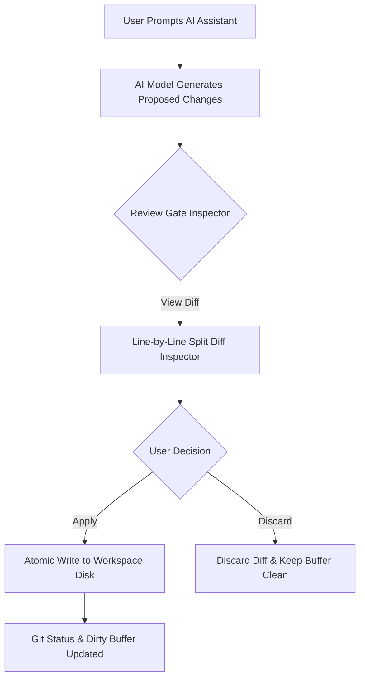

# AI Assistant Studio & Git Review Gates

AegisCode includes a built-in AI Pair-Programming Studio designed around two key values: **Transparency** and **Verification Safety**.

---

## 1. Unified AI Assistant Interface

The AI Assistant panel (accessible via the right sidebar or `Cmd + J` / `Ctrl + J`) lets you collaborate with AI models while maintaining total visibility into their reasoning and actions.

```text
+-------------------------------------------------------------+
| AI ASSISTANT                                   [ Branch 🌿 ] |
+-------------------------------------------------------------+
| User: Please refactor the store migration to use SQLite WAL |
+-------------------------------------------------------------+
| Assistant:                                                  |
| ⮟ Thought Process (1.4s)                                   |
|   Analyzing server/internal/store/migrate_sqlite.go...      |
|   Checking busy_timeout pragma and foreign_keys...          |
|                                                             |
| I have prepared the migration update. Review the diff below:|
|                                                             |
| ┏━━━━━━━━━━━━━━━━━━━━━━━━━━━━━━━━━━━━━━━━━━━━━━━━━━━━━━━━━┓ |
| ┃ 📝 server/internal/store/migrate_sqlite.go             ┃ |
| ┣━━━━━━━━━━━━━━━━━━━━━━━━━━━━━━━━━━━━━━━━━━━━━━━━━━━━━━━━━┫ |
| ┃ -   db.SetMaxOpenConns(5)                               ┃ |
| ┃ +   db.SetMaxOpenConns(25)                              ┃ |
| ┃ +   _pragma=journal_mode(WAL)                           ┃ |
| ┗━━━━━━━━━━━━━━━━━━━━━━━━━━━━━━━━━━━━━━━━━━━━━━━━━━━━━━━━━┛ |
| [ ✓ Apply Diff ]   [ ✗ Discard ]   [ 👁️ Open Split Diff ]   |
+-------------------------------------------------------------+
```

### Key Features:
* **Collapsible Thought Traces**: View the model's internal step-by-step reasoning tokens without cluttering the chat window.
* **Session Branching**: Fork any conversation at a specific prompt turn to test alternative implementation ideas without losing original chat history.
* **Full-Text Search (FTS5)**: Search past conversations and reasoning tokens instantly via the search bar at the top of the chat drawer.
* **Token Delta Streaming**: Real-time token streaming over HTTP Server-Sent Events (SSE) with low latency.

---

## 2. Git-Driven Review Gates

A major safety hazard in AI coding tools is **unsupervised disk modification**, where an agent silently overwrites working files and breaks active code.

AegisCode enforces **Git-Driven Review Gates**:



### Safety Guarantees:
1. **Zero Silent Overwrites**: When an AI proposes a `write_to_file` or `replace_file_content` action, changes are rendered as an in-memory diff preview first.
2. **Line-by-Line Split Diff View**: Click **Open Split Diff** to inspect removals in red and additions in green inside the editor before confirming.
3. **Target Path Resolution & Ghost-Tab Protection**: AegisCode sanitizes and normalizes the target path. It verifies that the path remains strictly inside the workspace boundary, preventing accidental creation of ghost files or writes outside the project root.
4. **Selective Application**:
   - **Apply Single**: Apply changes to only one specific file from a multi-file response.
   - **Apply All**: Atomically apply all proposed file patches across the workspace.
   - **Discard**: Discard the suggested change cleanly without leaving dirty buffer artifacts.

---

## 3. Supported AI Gateways

You can configure any of the following providers under **Settings -> AI Engine**:

| Provider | Gateway Type | Reasoning Traces | Tool Calling |
| :--- | :--- | :---: | :---: |
| **Google Gemini** | Direct REST / SSE | Supported | Supported |
| **Anthropic Claude** | Streaming Messages API |  Upcoming |  Upcoming |
| **OpenAI / OpenRouter / DeepSeek** | Chat Completions SSE | Supported | Supported |
| **Local Ollama** | Localhost Endpoint | Upcoming | Upcoming |
| **Antigravity CLI (`agy`)** | Local Subprocess Runner | Supported | Supported |

All providers funnel their responses through the same Review Gate pipeline, guaranteeing uniform safety across all models.
