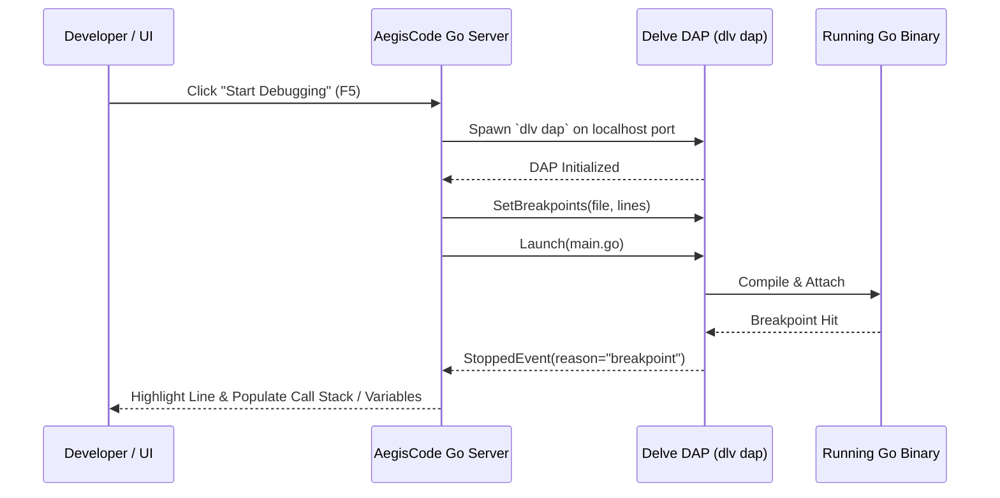

# Debugging with Bundled Delve DAP

AegisCode includes a native **Debug Adapter Protocol (DAP)** client that integrates directly with **Delve (`dlv`)**, the official debugger for the Go programming language.

---

## 1. Zero-Config Delve Architecture

Unlike traditional editors that require complex `launch.json` configuration files, AegisCode provides **Zero-Config Debugging** for Go codebases:



---

## 2. Managing Breakpoints

1. **Setting a Breakpoint**: Click in the left gutter next to any line of executable Go code. A solid red dot `🔴` appears, indicating an active breakpoint.
2. **Removing a Breakpoint**: Click the red dot again to clear it.
3. **Breakpoints Panel**: The Debug sidebar lists all registered breakpoints across your project workspace with their file paths and line numbers. Clicking any entry jumps directly to that line.

---

## 3. Launching a Debug Session

1. Open your project's `main.go` or any package test file.
2. Click the **Run & Debug** button in the Activity Bar or press `F5`.
3. AegisCode automatically starts Delve in headless DAP mode, compiles the binary with debug symbols (`-gcflags="all=-N -l"`), and attaches to the target process.

---

## 4. Floating Execution Toolbar

When execution pauses at a breakpoint, a floating control toolbar appears at the top center of the editor:

```text
+-----------------------------------------------------------+
|  ▶ Continue (F5)  |  ↷ Step Over (F10)  |  ⇲ Step In (F11) |
|  ⇱ Step Out (Shift+F11)  |  🔄 Restart  |  ⏹ Stop (Shift+F5)|
+-----------------------------------------------------------+
```

| Control | Shortcut | Action |
| :--- | :--- | :--- |
| **Continue** | `F5` | Resumes execution until the next breakpoint or program termination. |
| **Step Over** | `F10` | Executes the next line of code without stepping into subroutines. |
| **Step In** | `F11` | Steps into the function call on the current line. |
| **Step Out** | `Shift + F11` | Finishes executing the current function and pauses at the return line. |
| **Restart** | `Cmd/Ctrl + Shift + F5` | Recompiles and restarts the active debug session. |
| **Stop** | `Shift + F5` | Immediately terminates the debuggee process and shuts down Delve. |

---

## 5. Inspecting Runtime State

When execution halts, the sidebar automatically updates two primary inspection views:

### 1. Variables View
* **Locals**: Displays local variables declared in the current function scope.
* **Arguments**: Inspects all input parameters passed to the active function.
* **Type & Pointer Unwrapping**: Strings, structs, slices, maps, and pointers can be expanded interactively to inspect nested fields and heap allocations.

### 2. Call Stack
* Displays the active goroutine and the sequence of call stack frames leading to the breakpoint.
* Clicking any stack frame highlights the corresponding line in the editor and switches the variable inspection scope to that frame's context.

---

## 6. Safe Delve Teardown

AegisCode supervises Delve processes using isolated process groups. When a debug session is stopped or when AegisCode exits, all debuggee processes and Delve daemons are cleanly torn down to ensure no lingering binaries hold system ports or locks.
