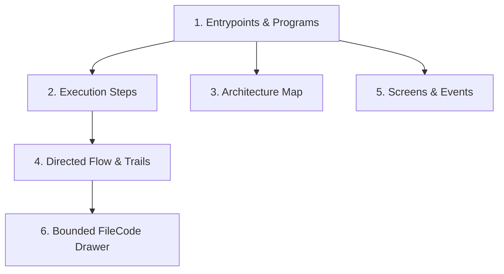

# VantageCraft CodeGraph Visual Guide

AegisCode features a high-performance **VantageCraft CodeGraph Architecture** powered by native `@colbymchenry/codegraph` daemon engine and a Zero-Freeze Web Worker layout pipeline. Instead of generic unstructured node webs, AegisCode organizes codebase exploration into **six specialized views**.

---

## 1. Opening CodeGraph

Open the CodeGraph panel by:
- Clicking the CodeGraph tab in the Editor or Activity Bar.
- Selecting **View: Open CodeGraph** from the Command Palette (`Cmd + Shift + P` / `Ctrl + Shift + P`).
- Clicking the MCP status indicator pill in the Status Bar.

*(Note: CodeGraph Studio opens independently in its own view, preserving editor layout and eliminating chat drawer split lag).*

---

## 2. The 6 VantageCraft Views

### 1. Entrypoints & Program Explorer
- **Landing View**: Grouped catalog of HTTP Routes & APIs, UI Screens, Main Binaries, Hub Symbols, and Test Suites.
- Displays HTTP methods (`GET`, `POST`, `PUT`, `DELETE`), framework annotations (Gin, Express, Next.js, etc.), and dependent counts.
- Clicking any entrypoint opens its **Execution Steps View**.

### 2. Execution Steps View
- **Spine Tree**: Sequential execution flow starting from a chosen anchor function or route.
- **Tier Classification**: Color-coded tiers (`Handler/Controller` $\rightarrow$ `Service/Logic` $\rightarrow$ `Repository/Store` $\rightarrow$ `External/IO/DB`).
- **Branch Guards (`when`)**: Displays boolean guard pills (`if`, `switch`, `try/catch`) required to enter a call branch.
- **Side Effects Badges**: Labeled pills for database operations (`DB Read`, `DB Write`), network calls, and event emissions.
- **Synthesized Hops**: Dashed connectors highlighting dynamic runtime bridges.

### 3. Architecture Map View
- **Macro Module Graph**: Compound directory and package visualization.
- **Zero-Freeze Offloading**: Layouts (Dagre/ELK) are calculated inside a Web Worker off the main thread.
- **Proportional Weight**: Edge thickness scales with the number of cross-module calls and declared imports.
- **Toggles**: Quickly isolate or hide test suites and tool-generated files.

### 4. Directed Flow & Trails View
- **3-Column Focused Blast Radius**: Upstream Callers (Left) $\rightarrow$ Focused Symbol (Center) $\rightarrow$ Downstream Callees (Right).
- **Source Window Cards**: Displays 7-line code snippets centered around the connecting call site.
- **Dynamic Boundary Detection**: Flags runtime dispatch boundaries and unresolved dynamic callbacks.

### 5. Screens & Events View
- **UI Screen Transitions**: Interactive state machine mapping frontend pages/screens to routes and backend handlers.
- **Triggers & Events**: Inspects user gestures (`onClick`, `onPress`) and their downstream API dispatch targets.

### 6. Bounded FileCode & Symbol Drawer
- **Fast Bounded Inspection**: Inspects function line ranges, file outlines, and intra-file call arcs without loading multi-megabyte source files into the graph canvas.
- **Jump to Editor**: Opens the file in `CMEditor.tsx` at the exact line and column.

---

## 3. Freshness & Synchronization

- **Fast Git Sync**: The top bar includes a **Sync** button for incremental index synchronization of modified files via Git diff.
- **Re-index**: Triggers a clean 4-phase re-index across the entire workspace repository.
