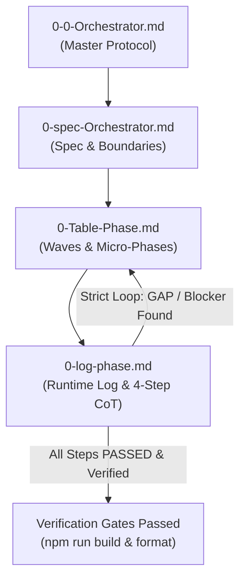

# MANDATORY ORCHESTRATOR PROTOCOL

1. IF `/skill` activate, use workflow skill agents.
2. IF NOT `/skill` activate, use `#WORKFLOW` below.

---

## 1. Core Documentation & References

Before starting any task, agents MUST consult:
- [`@AGENTS.md`](../AGENTS.md) : Core operating constraints, RTK requirements, and zero-error gates.
- [`@docs/internal/architecture.md`](../docs/internal/architecture.md) : System boundaries and package structure.
- [`@task/0-Architecture-context.md`](0-Architecture-context.md) : Zustand vs Buffer vs REST API boundaries.

---

## 2. Orchestration File Ecosystem & Interconnected Loop

The orchestration workflow is governed by four interconnected files under `task/`:

| File | Primary Role & Responsibility | Read / Write Trigger |
| :--- | :--- | :--- |
| **`task/0-0-Orchestrator.md`** | **Master Workflow & Protocol**: Governs rules of engagement, phase transitions, and gatekeeper policies. | Read on task start; updated only when workflow rules evolve. |
| **`task/0-spec-Orchestrator.md`** | **Architecture Contract & Spec**: Defines boundaries, data structures, invariants, and scope limits. | Drafted during Phase Analyze; referenced during Execution. |
| **`task/0-Table-Phase.md`** | **Wave & Micro-Phase Planner**: Deconstructs task into sequential Waves and atomic Micro-Phases with dependency mapping. | Prepared before Execution; updated when new GAP steps are injected. |
| **`task/0-log-phase.md`** | **Dynamic Feedback Hub & CoT**: Single source of truth for runtime state transitions, blocker logs, and 4-step CoT reasoning. | Written continuously during Execution & Validation; drives the loop. |

---

# WORKFLOW

## PHASE 0: INTAKE & CLARIFICATION
1. Read and translate user prompt/input to English to understand intent and technical constraints.
2. **Context Clarity Gate**:
   - IF clear, proceed immediately to Phase Analyze.
   - IF NOT clear, ask immediately using structured questions (e.g. via `/grill-me` or direct clarification):  
     `"What do you mean by your statement? Are you referring to A or B? The context provided is not clear enough."`

---

## PHASE ANALYZE: HYPOTHESIS & CODEGRAPH EXPLORATION
1. Formulate baseline assumptions regarding:
   - Target functions, endpoints, or selectors.
   - Target boundaries (Zustand DOM vs Buffer Stream vs REST API).
   - Root causes of bugs, race conditions, or optimization bottlenecks.
2. Formulate hypotheses and map dependencies using **CodeGraph** (`codegraph explore` / MCP tool, never use grep):
   - Where is the function or bug located?
   - Why does it occur?
   - Which files or store slices depend on it?
   - what component at front end properly?
3. Draw conclusions and record specifications:
   - Validate findings against codebase realities.
   - Write or update specifications in **`task/0-spec-Orchestrator.md`**.

[HOLD] THE NEXT PHASE: ASK user to REVIEW SUMMARY PLAN

---

## PHASE EXECUTION: WAVE PLANNING & ATOMIC EXECUTION
1. Outline Waves and atomic Micro-Phases in **`task/0-Table-Phase.md`**:
   - Determine execution topology:
     - **Linear**: For tasks with strong cross-file interdependencies.
     - **Parallel**: For isolated files or independent layers.
   - Define explicit prerequisites, target files, and rapid verification criteria.
2. Initialize runtime tracking in **`task/0-log-phase.md`**:
   - Register initial log entries for planned Micro-Phases with status `PENDING`.
3. Execute changes cleanly and modularly:
   - Follow strict file isolation.
   - Respect semantic Tailwind tokens and existing UI primitives.
   - Update status in **`task/0-log-phase.md`** (`IN_PROGRESS` ➔ `PASSED` / `BLOCKED`).

---

## PHASE VALIDATION & STRICT GATEKEEPER LOOP
1. Run smoke tests and mandatory verification gates using RTK:
   - `rtk npm run build` (Must pass with 0 errors)
   - `rtk npm run format` (Code formatting with oxfmt)
   - Relevant backend tests (`rtk go test ./...`)
2. **GAP Analysis & Feedback Loop**:
   - IF all verification passes:
     - Mark Micro-Phase and Wave as `PASSED` in both `task/0-log-phase.md` and `task/0-Table-Phase.md`.
     - Advance to the next Wave.
   - IF any GAP, bug, or regression is detected:
     1. **Log CoT**: Immediately document the issue in `task/0-log-phase.md` using the **4-Step CoT Template** (Trigger ➔ Root Cause ➔ Remediation ➔ Verification).
     2. **Mark Blocker**: Set status to `BLOCKED` in `task/0-log-phase.md`.
     3. **Inject Step**: Inject a remediation sub-step (e.g., `MP-x.y-FIX`) into `task/0-Table-Phase.md`.
     4. **Execute Remediation**: Apply the fix and re-run verification gates.
     5. **Strict Gatekeeper Enforcement**: The next Wave is strictly locked until the GAP is fully resolved and verified `PASSED`.