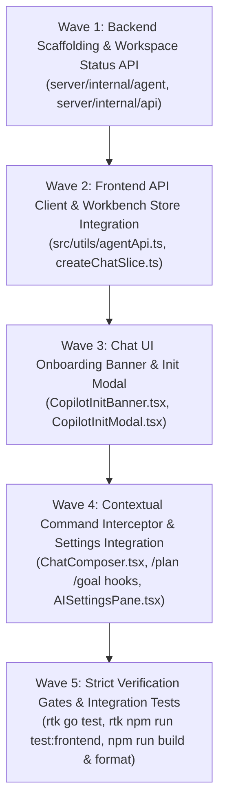

# Table Phase: Aegis Copilot Workspace Initialization (Combo 1 & 3)

> **Dokumen Rencana Wave & Micro-Phase**  
> Dibuat oleh Kanna sesuai `#WORKFLOW` pada `task/0-0-Orchestrator.md`.  
> Status Global: `COMPLETED`  
> Referensi Spesifikasi: [`task/0-spec-Orchestrator.md`](0-spec-Orchestrator.md)

---

## 1. Execution Topology & Waves Overview

Alur pengerjaan dibagi menjadi 4 Wave terstruktur dari backend domain hingga antarmuka chat dan interseptor perintah:

---

## 2. Detailed Micro-Phases

| Phase ID | Wave | Name / Description | Target File(s) | Topology | Dependencies | Verification Gate | Status |
| :--- | :--- | :--- | :--- | :--- | :--- | :--- | :--- |
| **MP-W1-BE-STATUS** | 1 | **Workspace Status Detection Engine**: Buat method `GetWorkspaceCopilotStatus(rootPath string)` di `server/internal/agent/workspace_init.go` untuk mendeteksi apakah `.aegis/`, `.aegis/tasks/`, dan `AGENTS.md` ada di workspace. Ekspos endpoint `GET /api/v1/agent/workspace-status`. | `server/internal/agent/workspace_init.go`, `server/internal/api/agent_handlers.go`, `server/internal/api/api.go` | Linear | None | `rtk go test ./...` | `PASSED` |
| **MP-W1-BE-INIT** | 1 | **Workspace Initialization Service**: Buat `InitWorkspace(rootPath string, opts InitOptions)` yang membuat `.aegis/`, `.aegis/tasks/`, `.aegis/config.json`, dan `AGENTS.md` dengan template preset. Tambahkan support penambahan idempotent ke `.gitignore`. Ekspos `POST /api/v1/agent/init-workspace`. | `server/internal/agent/workspace_init.go`, `server/internal/agent/agent_test.go`, `server/internal/api/agent_handlers.go` | Linear | MP-W1-BE-STATUS | `rtk go test ./...` | `PASSED` |
| **MP-W2-FE-API** | 2 | **Frontend Agent API & Type Contracts**: Tambahkan interface `WorkspaceCopilotStatus`, `InitWorkspaceOptions` dan fungsi `fetchWorkspaceCopilotStatus()`, `initWorkspaceCopilot()` di `src/utils/agentApi.ts`. | `src/utils/agentApi.ts` | Linear | Wave 1 | `rtk npm run build` | `PASSED` |
| **MP-W2-FE-STORE** | 2 | **Chat Slice Copilot State**: Tambahkan `isCopilotInitialized`, `copilotStatus`, `isCopilotInitModalOpen`, `checkCopilotStatus`, `openCopilotInitModal`, dan `closeCopilotInitModal` ke `createChatSlice.ts`. Hubungkan dengan EventHub topic `"copilot"`. | `src/store/slices/createChatSlice.ts`, `src/store/types.ts` | Linear | MP-W2-FE-API | `rtk npm run build` | `PASSED` |
| **MP-W3-UI-BANNER** | 3 | **Chat Onboarding Banner (Option 1)**: Buat komponen `CopilotInitBanner.tsx` yang tampil di bagian atas Chat drawer jika `isCopilotInitialized === false`. Tampilkan icon Aegis, status ringkas, dan tombol "Set Up Copilot". Perbarui `ChatWaveStepper.tsx` agar ramah saat workspace uninitialized. | `src/components/layout/chat/CopilotInitBanner.tsx`, `src/components/layout/chat/ChatDrawer.tsx`, `src/components/layout/chat/ChatWaveStepper.tsx` | Linear | Wave 2 | `rtk npm run build` | `PASSED` |
| **MP-W3-UI-MODAL** | 3 | **Copilot Init Modal**: Buat `CopilotInitModal.tsx` yang memungkinkan pengguna memilih Persona preset (Kanna, Senior Architect, Minimalist), opsi auto `.gitignore`, dan konfirmasi inisialisasi dengan Tailwind v4 semantic tokens. | `src/components/layout/chat/CopilotInitModal.tsx`, `src/components/layout/chat/index.ts` | Linear | MP-W3-UI-BANNER | `rtk npm run build` | `PASSED` |
| **MP-W4-INTERCEPT** | 4 | **Contextual Slash-Command Interceptor (Option 3)**: Tambahkan pengecekan di `ChatComposer.tsx` saat user mengirim perintah perencanaan / autonomous (`/plan`, `/goal`): jika `isCopilotInitialized === false`, tahan pesan dan buka `CopilotInitModal` dengan konteks aksi. Setelah diinisialisasi, lanjutkan pengiriman otomatis. | `src/components/layout/chat/ChatComposer.tsx`, `src/components/layout/command-palette/CommandPalette.tsx` | Linear | Wave 3 | `rtk npm run build` | `PASSED` |
| **MP-W4-SETTINGS** | 4 | **Settings Copilot Workspace Integration**: Tambahkan opsi `Auto-initialize .aegis on workspace open` di sub-tab Runtime & Guardrails / Copilot pada SettingsView. | `src/components/layout/settings/AISettingsPane.tsx`, `src/store/slices/createSettingsSlice.ts` | Linear | MP-W4-INTERCEPT | `rtk npm run build` | `PASSED` |
| **MP-W5-GATES** | 5 | **Strict Verification Gates & Unit Tests**: Tulis unit tests untuk fungsi inisialisasi dan status di backend & frontend. Jalankan `rtk go test ./...`, `rtk npm run test:frontend`, `rtk npm run build` (0 error), dan `rtk npm run format`. | Full Workspace | Linear | All Waves | `rtk go test ./... && rtk npm run test:frontend && rtk npm run build && rtk npm run format` | `PASSED` |