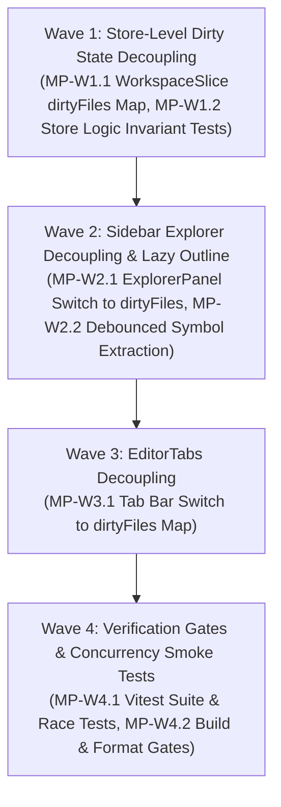

# Table Phase: Dirty File State Synchronization & Buffer Optimization

> **Dokumen Rencana Wave & Micro-Phase (Phase 4)**  
> Dibuat oleh Shun sesuai `#WORKFLOW` pada `task/0-0-Orchestrator.md`.  
> Status Global: `COMPLETED & VERIFIED`  
> Referensi Spesifikasi: [`task/0-spec-Orchestrator.md`](0-spec-Orchestrator.md)

---

## 1. Execution Topology & Waves Overview

---

## 2. Detailed Micro-Phases

| Phase ID | Wave | Name / Description | Target File(s) | Topology | Dependencies | Verification Gate | Status |
| :--- | :--- | :--- | :--- | :--- | :--- | :--- | :--- | :--- |
| **MP-W1.1-STORE-DIRTY-MAP** | 1 | **WorkspaceSlice `dirtyFiles` Decoupling**: Tambahkan `dirtyFiles: Record<string, boolean>` ke `WorkspaceSlice`. Di `updateBufferContentLogic`, perbarui referensi `dirtyFiles` HANYA jika boolean `isDirty` berubah status (`false ➔ true` atau sebaliknya). Sinkronkan di `markBufferSavedLogic`, `syncBufferWithDiskLogic`, dan `revertBufferContentLogic`. | `src/store/types.ts` `src/store/slices/createWorkspaceSlice.ts` | Linear | None | `rtk npm run test:frontend` | `PASSED` |
| **MP-W1.2-INVARIANT-TESTS** | 1 | **Store Invariant & Reference Stability Tests**: Buat/perbarui unit test untuk memverifikasi bahwa keystroke berturut-turut pada file yang sudah dirty TIDAK mengubah referensi objek `dirtyFiles`, dan bahwa `OPT-BUF-01` in-flight save tetap 100% aman. | `test/frontend/core/bufferLifecycleIntegrity.test.ts` | Linear | MP-W1.1-STORE-DIRTY-MAP | `rtk npm run test:frontend` | `PASSED` |
| **MP-W2.1-EXPLORER-DECOUPLING** | 2 | **Sidebar Explorer Switch to `dirtyFiles`**: Di `ExplorerPanel.tsx`, hapus subscription ke seluruh objek `fileBuffers`. Gunakan `dirtyFiles` untuk `buildExplorerGitDecorations` dan penanda folder dirty. | `src/components/layout/sidebar/ExplorerPanel.tsx` | Linear | Wave 1 | `rtk npm run test:frontend` | `PASSED` |
| **MP-W2.2-OUTLINE-DEBOUNCE** | 2 | **Debounced & Lazy Outline Parsing**: Di `ExplorerPanel.tsx`, debounce pemanggilan `extractSymbols` (250ms) dan pastikan tidak dipanggil jika akordeon Outline sedang tertutup (`!outlineOpen`). | `src/components/layout/sidebar/ExplorerPanel.tsx` | Linear | MP-W2.1-EXPLORER-DECOUPLING | `rtk npm run test:frontend` | `PASSED` |
| **MP-W3.1-TABS-DECOUPLING** | 3 | **EditorTabs Switch to `dirtyFiles`**: Di `EditorTabs.tsx`, gantikan pengecekan `fileBuffers` untuk dirty indicator dengan `dirtyFiles[tab]`. Pastikan tab bar tidak re-render saat mengetik di file yang sudah dirty. | `src/components/layout/editor/EditorTabs.tsx` | Linear | Wave 2 | `rtk npm run test:frontend` | `PASSED` |
| **MP-W4.1-GATES-AND-REGRESSIONS** | 4 | **Mandatory Gates & Concurrency Smoke Tests**: Jalankan seluruh test suite Vitest (318+ tests), build check dengan Rolldown, dan format check dengan oxfmt. Verifikasi sinkronisasi dirty state Text Editor ↔ Sidebar ↔ Drawer AI berjalan mulus tanpa race condition. | Full Repository | Linear | All Waves | `npm run build && npm run test:frontend && npm run format` | `PASSED` |