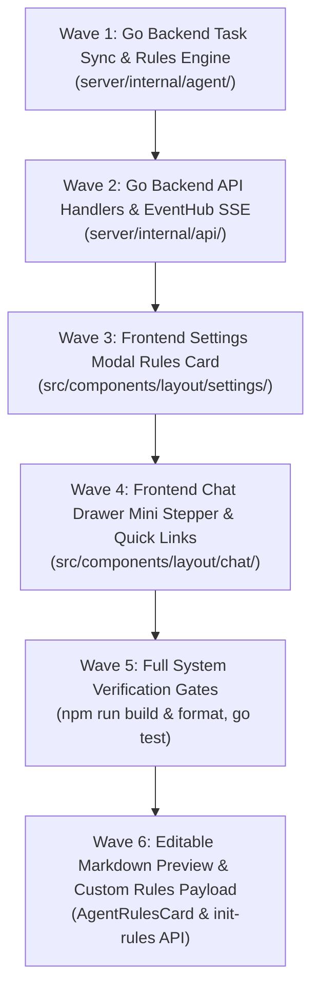

# Table Phase: Aegis Copilot Autonomous Orchestrator

> **Dokumen Rencana Wave & Micro-Phase**  
> Dibuat oleh Kanna sesuai `#WORKFLOW` pada `task/0-0-Orchestrator.md`.  
> Status Global: `COMPLETED`  
> Referensi Spesifikasi: [`task/0-spec-Orchestrator.md`](0-spec-Orchestrator.md)

---

## 1. Execution Topology & Waves Overview

Alur pengerjaan dibagi menjadi 6 Wave terstruktur dengan pemisahan lapisan (*Layered Separation*) yang ketat:

---

## 2. Detailed Micro-Phases

| Phase ID | Wave | Name / Description | Target File(s) | Topology | Dependencies | Verification Gate | Status |
| :--- | :--- | :--- | :--- | :--- | :--- | :--- | :--- |
| **MP-W1-SYNC** | 1 | **Workspace Task Scaffolding & Sync Engine**: Implementasi thread-safe file I/O untuk `.aegis/tasks/<task-slug>/` (`0-spec.md`, `0-plan.md`, `0-log.md`), lazy auto-scaffolding, dan template initialization. | `server/internal/agent/task_sync.go` | Linear | None | `rtk go test ./server/internal/agent/...` | `PASSED` |
| **MP-W1-RULE** | 1 | **Workspace Rules Ingestion & Presets**: Ingest `AGENTS.md` dari workspace root, fallback ke default in-memory rules, dan preset generator (Kanna, Senior Architect, Minimalist). | `server/internal/agent/rules.go` | Linear | MP-W1-SYNC | `rtk go test ./server/internal/agent/...` | `PASSED` |
| **MP-W1-TEST** | 1 | **Unit Tests for Agent Backend**: Test suite untuk memvalidasi thread-safe task sync, lazy creation, dan rules ingestion. | `server/internal/agent/agent_test.go` | Linear | MP-W1-RULE | `rtk go test -v ./server/internal/agent/...` | `PASSED` |
| **MP-W2-API** | 2 | **REST Endpoints for Copilot Rules & Tasks**: Handler `POST /api/v1/agent/init-rules`, `GET /api/v1/agent/rules-status`, dan `GET /api/v1/agent/tasks`. | `server/internal/api/agent_handlers.go`, `server/internal/api/api.go` | Linear | Wave 1 | `rtk go test ./server/internal/api/...` | `PASSED` |
| **MP-W2-SSE** | 2 | **EventHub SSE Bridge for Copilot**: Broadcast real-time status gelombang task ke topic `copilot` via EventHub multiplexer. | `server/internal/api/events_hub.go`, `server/internal/api/agent_handlers.go` | Linear | MP-W2-API | `rtk go test ./server/internal/api/...` | `PASSED` |
| **MP-W3-CARD** | 3 | **Interactive Rules Card Component**: Komponen kartu aturan di Settings Modal AI category, menampilkan status deteksi (`circle` vs `check`), template preview box, dan tombol `<Icon name="copy" />` serta 1-click `<Icon name="plus" />`. Zero raw emojis. | `src/components/layout/settings/AgentRulesCard.tsx`, `src/components/layout/settings/SettingsModal.tsx` | Linear | Wave 2 | `rtk npm run build` | `PASSED` |
| **MP-W3-API** | 3 | **Client Store & API Integration**: Fungsi client API `initAgentRules()` dan integrasi ke `openFileInGroup('AGENTS.md')` saat file terbuat. | `src/utils/agentApi.ts`, `src/components/layout/settings/SettingsModal.tsx` | Linear | MP-W3-CARD | `rtk npm run build && rtk npm run format` | `PASSED` |
| **MP-W4-LINKS** | 4 | **Drawer Header Quick Links**: Tombol cepat `[Icon:file Spec]` dan `[Icon:list Plan]` pada `ChatHeader.tsx` yang membuka file `.aegis/tasks/...` langsung ke active editor tab. | `src/components/layout/chat/ChatHeader.tsx`, `src/components/layout/chat/ChatDrawer.tsx` | Linear | Wave 3 | `rtk npm run build` | `PASSED` |
| **MP-W4-STEP** | 4 | **Mini Wave Stepper in Drawer**: Baris status tipis (~32px) di bawah header drawer chat menampilkan progress Wave secara real-time via SSE event. | `src/components/layout/chat/ChatWaveStepper.tsx`, `src/components/layout/chat/ChatDrawer.tsx` | Linear | MP-W4-LINKS | `rtk npm run build && rtk npm run format` | `PASSED` |
| **MP-W5-VER** | 5 | **Strict System Verification & Gates**: Full compile frontend, oxfmt format check, dan backend Go test suite. | Workspace | Linear | All Waves | `rtk npm run build`, `rtk npm run format`, `rtk go test ./...` | `PASSED` |
| **MP-W6-BE** | 6 | **Backend Custom Content Support**: Update `InitWorkspaceRulesWithContent` dan `InitRulesRequest` untuk menerima string content kustom secara thread-safe. | `server/internal/agent/rules.go`, `server/internal/api/agent_handlers.go` | Linear | Wave 5 | `rtk go test ./server/internal/...` | `PASSED` |
| **MP-W6-FE** | 6 | **Frontend Editable Textarea & Reset Action**: Ganti `<pre>` menjadi controlled `<textarea>`, sinkronisasi perubahan preset, tombol reset ke default, dan pengiriman payload content kustom ke API. | `src/components/layout/settings/AgentRulesCard.tsx`, `src/utils/agentApi.ts` | Linear | MP-W6-BE | `rtk npm run build && rtk npm run format` | `PASSED` |
| **MP-W6-GATE** | 6 | **Wave 6 Verification Gates**: Verifikasi build frontend, format check oxfmt, dan backend unit test suite. | Workspace | Linear | MP-W6-FE | `rtk npm run build`, `rtk npm run format`, `rtk go test ./...` | `PASSED` |