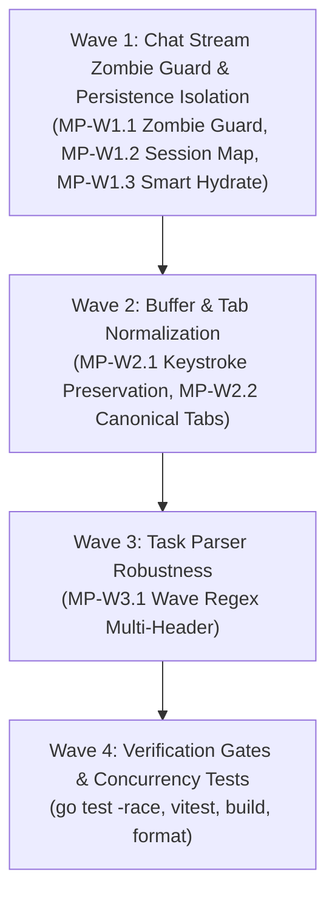

# Table Phase: Aegis Copilot Deep Concurrency & Buffer Race Remediation

> **Dokumen Rencana Wave & Micro-Phase (Phase 2)**  
> Dibuat oleh Kanna sesuai `#WORKFLOW` pada `task/0-0-Orchestrator.md`.  
> Status Global: `PASSED & VERIFIED`  
> Referensi Spesifikasi: [`task/0-spec-Orchestrator.md`](0-spec-Orchestrator.md)

---

## 1. Execution Topology & Waves Overview

Alur eksekusi dibagi menjadi 4 Wave terstruktur dengan prinsip fail-fast dan dependensi linier:

---

## 2. Detailed Micro-Phases

| Phase ID | Wave | Name / Description | Target File(s) | Topology | Dependencies | Verification Gate | Status |
| :--- | :--- | :--- | :--- | :--- | :--- | :--- | :--- |
| **MP-W1.1-ZOMBIE-GUARD** | 1 | **Stream Token Identity Guard**: Pada `createChatSlice.ts`, periksa identitas controller sebelum mengatur `isGenerating: false` dan `chatAbortController = null`. Mencegah callback abort dari sesi lama mematikan status streaming sesi baru atau menghilangkan tombol Stop. | `src/store/slices/createChatSlice.ts` | Linear | None | `rtk npm run test:frontend` | `PASSED` |
| **MP-W1.2-SESSION-MAP** | 1 | **Per-Session Debounce Map**: Ganti variabel timer tunggal pada `debouncedSaveBackendSession` dengan `Map<string, Timeout>` per-session ID, agar pergantian sesi cepat tidak saling membatalkan jadwal simpan ke backend. | `src/store/slices/createChatSlice.ts` | Linear | MP-W1.1-ZOMBIE-GUARD | `rtk npm run test:frontend` | `PASSED` |
| **MP-W1.3-SMART-HYDRATE** | 1 | **Lossless Startup Hydration Merge**: Pada `fetchBackendChatSummaries` startup hydration di `createChatSlice.ts`, bandingkan jumlah pesan lokal dengan backend. Jangan pernah menimpa sesi lokal jika pengguna sudah mengirim pesan baru saat hydration berjalan. | `src/store/slices/createChatSlice.ts` | Linear | MP-W1.2-SESSION-MAP | `rtk npm run test:frontend` | `PASSED` |
| **MP-W2.1-BUFFER-SAVE** | 2 | **Mid-Flight Keystroke Preservation**: Di `applyCodeWithReview` (`createWorkspaceSlice.ts`), preservasi isi buffer terkini yang masuk selama jeda network `await saveWorkspaceFile`, dan hitung `isDirty` dinamis alih-alih hard overwrite `isDirty: false`. | `src/store/slices/createWorkspaceSlice.ts` | Linear | Wave 1 | `rtk npm run test:frontend` | `PASSED` |
| **MP-W2.2-CANONICAL-TAB** | 2 | **Canonical Workspace Path di `openFileInGroup`**: Di `createEditorSlice.ts`, pastikan path berkas dinormalisasi menggunakan `normalizeWorkspacePath` sebelum dimasukkan ke `group.tabs`, mencegah tab duplikat dengan key absolut vs relatif. | `src/store/slices/createEditorSlice.ts` | Linear | MP-W2.1-BUFFER-SAVE | `rtk npm run test:frontend` | `PASSED` |
| **MP-W3.1-WAVE-REGEX** | 3 | **Multi-Level Wave Header Support**: Di `task_sync.go` (`ExtractWaveStatus`), perluas regex wave header menjadi `(?i)^#{2,4}\s*Wave\s*(\d+)[:\s]*(.*)` agar kompatibel dengan ragam output LLM (`## Wave`, `### Wave`, `#### Wave`). | `server/internal/agent/task_sync.go`, `server/internal/agent/agent_test.go` | Linear | Wave 2 | `rtk go test ./...` | `PASSED` |
| **MP-W4.1-GATES** | 4 | **Strict Verification Gates & Zero Regression**: Jalankan `rtk go test -race ./...` (race detector), `rtk npm run test:frontend` (Vitest), `rtk npm run build` (Rolldown 0 errors), dan `rtk npm run format` (oxfmt). | Full Repository | Linear | All Waves | All Gates Passed | `PASSED` |