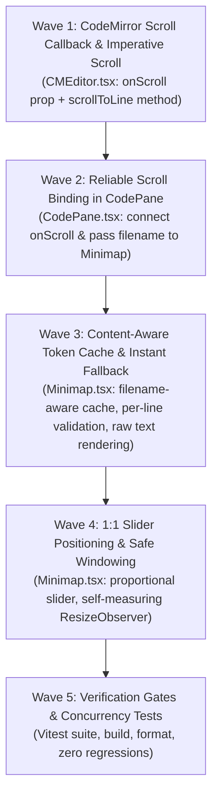

# Table Phase: Minimap Synchronization, Windowing & Rendering Accuracy

> **Dokumen Rencana Wave & Micro-Phase (Phase 6)**  
> Dibuat oleh Shun sesuai `#WORKFLOW` pada `task/0-0-Orchestrator.md`.  
> Status Global: `COMPLETED & VERIFIED`  
> Referensi Spesifikasi: [`task/0-spec-Orchestrator.md`](0-spec-Orchestrator.md)

---

## 1. Execution Topology & Waves Overview

---

## 2. Detailed Micro-Phases

| Phase ID | Wave | Name / Description | Target File(s) | Topology | Dependencies | Verification Gate | Status |
| :--- | :--- | :--- | :--- | :--- | :--- | :--- | :--- |
| **MP-M1.1-CM-SCROLL-CALLBACK** | 1 | **CodeMirror Scroll Callback & Native `scrollToLine`**: Tambahkan prop `onScroll` pada `CMEditorProps` dan implementasikan listener scroll pada `view.scrollDOM`. Ekspos `scrollToLine` pada `CMEditorHandle` menggunakan `EditorView.scrollIntoView(line.from, { y: 'center' })`. | `src/components/layout/editor/CMEditor.tsx` | Linear | None | `rtk npm run test:frontend` | `PASSED` |
| **MP-M2.1-CODEPANE-SCROLLER-BINDING** | 2 | **Reliable Scroll Binding & Prop Wiring in `CodePane`**: Hubungkan prop `onScroll` dari `CMEditor` ke state `scrollInfo` di `CodePane.tsx`. Berikan delegasi `handleScrollToLine` ke `editorRef.current.scrollToLine`. Kirim prop `filename` ke `<Minimap />`. | `src/components/layout/editor/CodePane.tsx` | Linear | MP-M1.1 | `rtk npm run test:frontend` | `PASSED` |
| **MP-M3.1-MINIMAP-CACHE-AND-FALLBACK** | 3 | **File & Content Aware Token Cache with Instant Text Fallback**: Di `Minimap.tsx`, terima prop `filename`. Bersihkan cache saat `filename` berubah. Validasi cache per-baris terhadap `lineText`. Jika token belum siap dari worker, render `lineText` langsung dengan micro-font style, bukan skeleton bar kosong. | `src/components/layout/editor/Minimap.tsx` | Linear | MP-M2.1 | `rtk npm run test:frontend` | `PASSED` |
| **MP-M4.1-MINIMAP-SLIDER-AND-WINDOWING** | 4 | **1:1 Slider Positioning & Self-Measuring Container**: Perbaiki perhitungan `sliderHeightPx` dan `sliderTopPx` agar merefleksikan rasio viewport sesungguhnya dan selalu sejajar dengan baris yang ditampilkan. Pasang `ResizeObserver` pada `containerRef` minimap agar tidak kolaps saat clientHeight luar terlambat. | `src/components/layout/editor/Minimap.tsx` | Linear | MP-M3.1 | `rtk npm run test:frontend` | `PASSED` |
| **MP-M5.1-GATES-AND-REGRESSIONS** | 5 | **Mandatory Verification Gates & Regression Validation**: Jalankan seluruh gate verifikasi (`npm run build`, `npm run format`, `npm run test:frontend`, dan Go backend tests) untuk memastikan minimap responsif, akurat, dan tidak ada regresi. | Full Repository | Linear | All Waves | `npm run build && npm run test:frontend && npm run format` | `PASSED` |