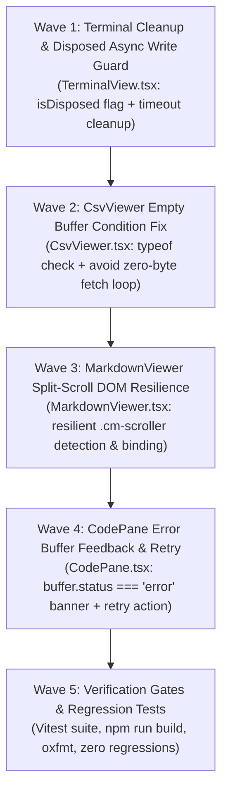

# Table Phase: Residual Edge Cases Remediation (Phase 7)

> **Dokumen Rencana Wave & Micro-Phase (Phase 7)**  
> Dibuat oleh Shun sesuai `#WORKFLOW` pada `task/0-0-Orchestrator.md`.  
> Status Global: `PENDING USER REVIEW (HOLD)`  
> Referensi Spesifikasi: [`task/0-spec-Orchestrator.md`](0-spec-Orchestrator.md)

---

## 1. Execution Topology & Waves Overview

---

## 2. Detailed Micro-Phases

| Phase ID | Wave | Name / Description | Target File(s) | Topology | Dependencies | Verification Gate | Status |
| :--- | :--- | :--- | :--- | :--- | :--- | :--- | :--- |
| **MP-7.1-TERMINAL-DISPOSE-GUARD** | 1 | **Terminal Cleanup & Disposed Write Guard**: Tambahkan flag `isDisposed = false` di `TerminalView.tsx`. Simpan `setTimeout(syncSize, 100)` ke variabel dan batalkan pada cleanup. Guard handler `sse.onmessage` / `term.write` agar tidak menulis pada terminal yang di-dispose. | `src/components/layout/bottom-panel/TerminalView.tsx` | Linear | None | `rtk npx vitest run test/frontend/bottom-panel/` | `COMPLETED` |
| **MP-7.2-CSV-EMPTY-BUFFER-GUARD** | 2 | **CsvViewer Empty Buffer Condition Fix**: Ganti `if (buffer?.content)` dengan `if (typeof buffer?.content === "string")` di `CsvViewer.tsx`. Hindari fetch loop pada file CSV kosong (0 bytes). | `src/components/layout/editor/viewers/CsvViewer.tsx` | Linear | None | `rtk npx vitest run test/frontend/viewers/` | `COMPLETED` |
| **MP-7.3-MARKDOWN-SCROLL-RESILIENCE** | 3 | **Markdown Split-Scroll DOM Resilience**: Perbaiki pengikatan listener `.cm-scroller` di `MarkdownViewer.tsx` agar menggunakan deteksi bertahap/resilient saat CodeMirror belum siap pada initial mount. | `src/components/layout/editor/viewers/MarkdownViewer.tsx` | Linear | None | `rtk npx vitest run test/frontend/viewers/` | `COMPLETED` |
| **MP-7.4-CODEPANE-ERROR-FEEDBACK** | 4 | **CodePane Error Buffer Visual Banner & Retry**: Tambahkan penanganan kondisi `buffer.status === "error"` di `CodePane.tsx` dengan banner peringatan dan tombol "Retry Fetch". | `src/components/layout/editor/CodePane.tsx` | Linear | None | `rtk npx vitest run test/frontend/editor/` | `COMPLETED` |
| **MP-7.5-VERIFICATION-GATES** | 5 | **Mandatory Verification Gates & Regression Validation**: Jalankan `npm run build`, `npm run format`, dan semua vitest suites (325 tests) untuk memastikan zero-regression. Termasuk perbaikan `ReferenceError: fileBuffers is not defined` di `ExplorerPanel.tsx`. | Full Repository | Linear | Waves 1-4 | `npm run build && npm run format && npx vitest run` | `COMPLETED` |

---

## 3. Phase 8: Minimap Canvas Silhouette & Viewport Synchronization

| Phase ID | Wave | Name / Description | Target File(s) | Topology | Dependencies | Verification Gate | Status |
| :--- | :--- | :--- | :--- | :--- | :--- | :--- | :--- |
| **MP-8.1-CANVAS-TEXT-ENGINE** | 1 | **Canvas Real Monospace Text Engine**: Gambar karakter teks kode asli (`ctx.fillText`) dengan font monospaced mini dan pewarnaan token syntax (`keywords`, `functions`, `strings`, `types`, `comments`) pada DPR Retina tinggi. | `src/components/layout/editor/Minimap.tsx` | Linear | None | `rtk npx vitest run test/frontend/core/workbenchCore.test.ts` | `COMPLETED` |
| **MP-8.2-VIEWPORT-SLIDER-SYNC** | 2 | **Viewport Slider Geometry & Direct Navigation**: Sinkronisasikan slider box proporsional dengan viewport CodeMirror. Hilangkan dual-scroll jarring effect dan dukung click/drag jump linear. | `src/components/layout/editor/Minimap.tsx` | Linear | MP-8.1 | `rtk npx vitest run test/frontend/core/` | `COMPLETED` |
| **MP-8.3-MINIMAP-CSS-CLEANUP** | 3 | **Minimap CSS Styling Refinement**: Sesuaikan `editor.css` untuk kanvas minimap, hilangkan artefak teks DOM berlebih, dan terapkan semantic color tokens (`bg-canvas`, `border-line`, `accent`). | `src/components/layout/editor/editor.css` | Linear | MP-8.2 | `rtk npm run build` | `COMPLETED` |
| **MP-8.4-REGRESSION-GATES** | 4 | **Mandatory Verification Gates**: Validasi seluruh test suite (327 tests), `npm run build` (0 error), dan `npm run format` (oxfmt). | Full Repository | Linear | Waves 1-3 | `npm run build && npm run format && npx vitest run` | `COMPLETED` |