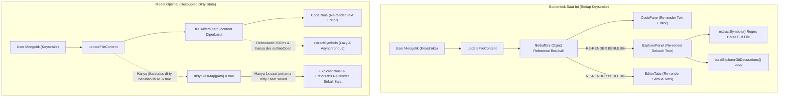

# Architecture Specification & Contract: Dirty File State Synchronization & Buffer Optimization

> **Document Type**: Architecture & Engineering Specification (Phase 4)  
> **Status**: DRAFT (Awaiting Sensei Review)  
> **Author**: Shun (AI Assistant Interface) for Adit-sensei  
> **Target Subsystems**: `src/store/slices/createWorkspaceSlice.ts`, `src/components/layout/sidebar/ExplorerPanel.tsx`, `src/components/layout/editor/EditorTabs.tsx`, `src/components/layout/editor/CodePane.tsx`, `src/App.tsx`  
> **Core Principle**: Decouple dirty-state tracking from buffer text content, eliminate keystroke re-render cascades in Sidebar & EditorTabs, guarantee async zero-loss buffer safety across Text Editor, Sidebar, and Drawer.

---

## 1. Problem Statement & Performance Diagnostics

### 1.1 The Keystroke Cascade
Saat user mengetik di `CodePane.tsx` (CodeMirror 6):
1. Event `updateFileContent(filename, content)` memodifikasi `fileBuffers[path]` di Zustand store.
2. Karena `fileBuffers` adalah objek `{ [path]: FileBuffer }`, setiap keystroke menghasilkan referensi objek `fileBuffers` baru.
3. Dua surface kritis men-subscribe seluruh objek `fileBuffers`:
   - **Sidebar (`ExplorerPanel.tsx`)**: Re-render di **setiap karakter yang diketik**! Memanggil `buildExplorerGitDecorations` dan synchronous regex `extractSymbols(code)` di main thread.
   - **Editor Tabs (`EditorTabs.tsx`)**: Re-render seluruh tab bar di setiap karakter yang diketik, meskipun tab tersebut sudah berstatus dirty sejak karakter pertama.

---

## 2. Invariants & Technical Contracts

### 2.1 Invariant 1: In-Flight Save Race Protection (`OPT-BUF-01`)
- **Contract**: Jika user terus mengetik saat operasi async `saveWorkspaceFile` sedang berlangsung di background, `markBufferSavedLogic` membandingkan `currentBuf.content !== savedContent`.
- Jika ada karakter baru yang diketik selama network I/O, `isDirty` **harus tetap `true`** dan konten ketikan terbaru tidak boleh tertimpa atau hilang.

### 2.2 Invariant 2: AI Code Apply Mutex & Diff Review
- **Contract**: Ketika Drawer AI meng-apply kode ke buffer melalui `applyCodeWithReview`:
  - Jika file sedang dirty, dialog konfirmasi wajib muncul sebelum menimpa.
  - Jika user mengetik bersamaan dengan operasi save AI, ketikan user dipertahankan (`curBuf.content !== existingBuf?.content ? curBuf.content : code`).
  - Setelah apply berhasil, diff view otomatis terbuka untuk review Git.

### 2.3 Invariant 3: Single Source of Truth for File Dirty State
- **Contract**: Boolean `isDirty` tetap bersumber dari `content !== savedContent`.
- Store menyediakan state terdedikasi atau selector memoized: `dirtyFiles: Record<string, boolean>` (atau `dirtyFilesSet`). Objek ini **HANYA** berubah referensi ketika ada file yang status dirty-nya berubah (`false ➔ true` atau `true ➔ false`), **BUKAN** saat konten teks bertambah/berkurang di dalam file yang sudah dirty.

### 2.4 Invariant 4: Outline Symbol Extraction Decoupling
- **Contract**: `extractSymbols(code)` tidak boleh dipanggil secara sinkron di setiap render `ExplorerPanel`.
- Ekstraksi harus di-debounce (250–300ms) dan di-bypass jika akordeon Outline sedang tertutup (`!outlineOpen`).

---

## 3. Architecture Blueprint & Modifications

### 3.1 Store Layer (`src/store/slices/createWorkspaceSlice.ts` & `types.ts`)
- Tambahkan `dirtyFiles: Record<string, boolean>` pada `WorkspaceSlice`.
- Pada `updateBufferContentLogic`:
  - Hitung status `isDirty = content !== savedContent`.
  - Jika status boolean `isDirty` untuk file tersebut berubah dibanding sebelumnya, perbarui `dirtyFiles: { ...state.dirtyFiles, [filename]: isDirty }`.
  - Jika status boolean tidak berubah (misal sudah dirty dan masih dirty), pertahankan referensi objek `state.dirtyFiles` tetap utuh!
- Pada `markBufferSavedLogic`, `syncBufferWithDiskLogic`, dan `revertBufferContentLogic`:
  - Sinkronkan `dirtyFiles[filename] = false`.

### 3.2 Sidebar Layer (`src/components/layout/sidebar/ExplorerPanel.tsx`)
- Gantikan subscription `fileBuffers: s.fileBuffers` dengan:
  `dirtyFiles: s.dirtyFiles`
- `buildExplorerGitDecorations` menerima `dirtyFiles` untuk menghitung `dirtyFoldersSet`.
- Debounce pembacaan simbol outline: gunakan local state debounced untuk active code atau listen event debounced, sehingga `extractSymbols` tidak memblokir render tree.

### 3.3 Editor Tabs Layer (`src/components/layout/editor/EditorTabs.tsx`)
- Hapus ketergantungan `fileBuffers: s.fileBuffers`.
- Subscribe `dirtyFiles: s.dirtyFiles`.
- Gunakan selector terarah untuk conflict markers hanya jika file mengalami perubahan atau conflict state.
- Tab bar tidak akan pernah re-render ulang selama user mengetik pada tab yang sudah dirty.

### 3.4 Drawer Layer (`src/App.tsx` & `src/components/layout/chat/ChatDrawer.tsx`)
- `BrowserAiSyncEffect` di `src/App.tsx` tetap mempertahankan pola primitif `Boolean(s.dirtyFiles[activeFile])` dengan debounce 150ms.
- `extractEditorContext` saat submit chat tetap membaca `get().fileBuffers[activeTab]` live in-memory untuk memastikan prompt AI memuat kode terbaru.

---

## 4. Verification Gates
1. `rtk npm run test:frontend`: Seluruh 30 test suite (318+ tests) wajib `PASSED`.
2. Unit test baru untuk memverifikasi referensi `dirtyFiles` tidak berubah saat mengetik di file yang sudah dirty.
3. `rtk npm run build`: Rolldown build sukses dengan 0 errors.
4. `rtk npm run format`: Format check dengan oxfmt 0 errors.
