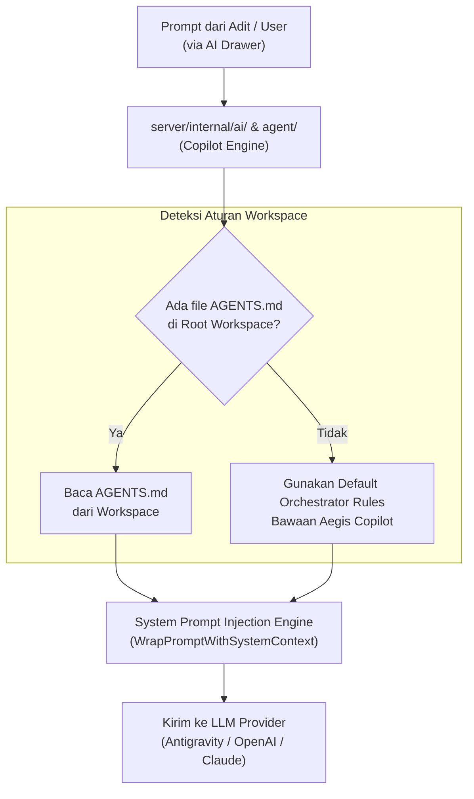

# Architecture Specification & Contract: Aegis Copilot Autonomous Orchestrator

> **Document Type**: Architecture & Engineering Specification  
> **Status**: DRAFT FOR REVIEW (Phase Analyze)  
> **Author**: Kanna (AI Assistant Interface) for Adit  
> **Target Subsystem**: `Aegis Copilot` (Autonomous Agent Orchestration Engine)  
> **Core Principle**: File-First Transparency, In-Process Go Backend, Zero Microservice Sprawl, Pragmatic & Lean.

---

## 1. Executive Summary & Architectural Vision

**Aegis Copilot** adalah mesin orkestrasi otonom terintegrasi (*autonomous agent orchestrator*) yang dirancang khusus untuk IDE **Aegis Code**. Berbeda dari asisten chat biasa yang hanya menjawab pertanyaan searah, Aegis Copilot mampu menerima instruksi tingkat tinggi (*high-level task*), menganalisis codebase, merumuskan rencana eksekusi bertahap (*Waves & Micro-Phases*), memodifikasi kode secara atomik, dan memvalidasi hasilnya melalui *Strict Gatekeeper Loop* secara mandiri.

Untuk mencegah masalah *black-box* dan *heavy maintenance*, Aegis Copilot mengadopsi arsitektur **Hybrid File-First**:
1. **Workspace Scratchpad (File-First)**: Rencana kerja, spesifikasi, dan log reasoning disimpan dalam format Markdown di `.aegis/tasks/<task-slug>/` di dalam root workspace aktif. Ini menjadi *Single Source of Truth* bagi Agent sekaligus permukaan kontrol *Human-in-the-Loop* bagi Adit.
2. **In-Process Go Engine**: Orkestrator berjalan langsung di dalam binary Go backend Aegis (`server/internal/agent/`), **bukan sebagai microservice terpisah**, menjaga arsitektur tetap *single standalone binary* (~7.5 MB).
3. **Telemetry & Audit di SQLite**: Database global (`~/.aegis/data/aegis.db`) hanya mencatat metadata sesi, token metrics, dan status waktu eksekusi untuk keperluan dashboard/drawer IDE.

---

## 2. Directory Layout & Workspace Contract

Setiap task yang diorkestrasi oleh Aegis Copilot akan memiliki ruang kerja terisolasi di dalam root repository pengguna:

```text
<workspace_root>/
├── AGENTS.md                  # Workspace-level agent rules & persona customization
├── .aegis/
│   ├── .gitignore             # Opsional: Mengabaikan cache/temp jika user tidak mau commit
│   └── tasks/
│       └── <task-slug>/       # Contoh: 2026-10-auth-provider/
│           ├── 0-spec.md      # Kontrak arsitektur, batasan file, & invariant
│           ├── 0-plan.md      # Wave & Micro-Phase DAG (Checklist & Dependencies)
│           └── 0-log.md       # Dynamic Feedback Hub & 4-Step CoT Reasoning
```

### Tanggung Jawab Masing-Masing File:

| File | Format | Peran & Tanggung Jawab | Akses Baca/Tulis |
| :--- | :--- | :--- | :--- |
| **`AGENTS.md`** | Markdown | **Workspace Rules & Directives**: Aturan persona, konvensi kode, perintah wajib RTK, dan jembatan ke protokol orkestrator. | Dikelola developer; dibaca sistem saat prompt injection. |
| **`0-spec.md`** | Markdown | **Architecture Contract**: Menyimpan batasan ruang lingkup, modul yang boleh/tidak boleh disentuh, dan konvensi tokens/Tailwind. | Ditulis pada fase awal; menjadi acuan referensi selama eksekusi. |
| **`0-plan.md`** | Markdown + Tables | **Wave & Micro-Phase DAG**: Memecah tugas menjadi gelombang (*Waves*) sekuensial dan langkah atomik (*Micro-Phases*). | Di-update statusnya (`PENDING` ➔ `IN_PROGRESS` ➔ `PASSED` / `BLOCKED`). |
| **`0-log.md`** | Markdown + 4-Step CoT | **Feedback Loop & Blocker Log**: Mencatat runtime feedback, output compiler error, dan siklus 4-Step CoT (*Trigger ➔ Root Cause ➔ Remediation ➔ Verification*). | Ditulis terus-menerus selama eksekusi dan validasi; menjadi memori kerja LLM. |

---

## 3. Workspace Rule Ingestion (`AGENTS.md`) & Dynamic System Injection

Untuk menjamin fleksibilitas developer tanpa mengorbankan fungsionalitas out-of-the-box:



1. **Root Workspace Presence**:
   * File `AGENTS.md` hidup di root workspace sehingga developer bisa menyesuaikan persona, pantangan file, atau framework conventions untuk tiap repo secara independen.
2. **In-Memory Injection by Go Backend**:
   * Engine Go (`server/internal/ai/engine.go`) membaca file `AGENTS.md` secara dinamis saat sesi dimulai dan menyisipkannya ke blok `<system_instruction>` sebelum dikirim ke provider LLM.
3. **Zero-Config Fallback**:
   * Jika repo baru belum memiliki `AGENTS.md`, Go backend otomatis menyuntikkan *default protocol* bawaan Aegis Copilot (Phase 0 ➔ Analyze ➔ Wave Planning ➔ Gatekeeper Loop).

---

## 4. Go Backend Engine Architecture (`server/internal/agent/`)

Sesuai panduan arsitektur Aegis, engine ini diimplementasikan sebagai paket internal Go murni tanpa dependensi daemon eksternal:

```mermaid
flowchart TB
    subgraph Client["Aegis Frontend (React 19)"]
        Drawer["AI Drawer / Copilot Panel"]
        Editor["Aegis Editor (Tabs)"]
        EventClient["EventHub SSE Listener"]
        SettingsModal["Settings Modal (AI Category)"]
    end

    subgraph GoCore["Aegis Go Core (Single Binary)"]
        API["REST & SSE Handlers (api.go)"]
        Orchestrator["Copilot Orchestrator (server/internal/agent)"]
        EventHub["Unified EventHub (events_hub.go)"]
        Store["SQLite Store (~/.aegis/data/aegis.db)"]
        CodeGraphBridge["CodeGraph Explorer Bridge"]
        PTYRunner["PTY / Shell Command Runner"]
    end

    subgraph WorkspaceFS["Active Workspace (.aegis/tasks/)"]
        TaskFiles["0-spec.md | 0-plan.md | 0-log.md"]
        AgentsRule["AGENTS.md (Root Workspace)"]
    end

    Drawer -->|POST /api/v1/agent/task (Start/Pause/Resume)| API
    SettingsModal -->|POST /api/v1/agent/init-rules| API
    API --> Orchestrator
    Orchestrator <-->|Read / Write Task State| TaskFiles
    Orchestrator <-->|Read / Scaffold Rules| AgentsRule
    Orchestrator -->|Explore AST & Call Graph| CodeGraphBridge
    Orchestrator -->|Run Build & Smoke Tests (RTK)| PTYRunner
    Orchestrator -->|Emit Real-time Status| EventHub
    EventHub -->|SSE Stream: topic 'copilot'| EventClient
    EventClient --> Drawer
    Editor <-->|Direct Human Edit| TaskFiles
    Editor <-->|Direct Human Edit| AgentsRule
    Orchestrator -->|Save Session Metadata & Token Count| Store
```

### Komponen Utama di Go Backend:

1. **`CopilotEngine` (`server/internal/agent/copilot.go`)**:
   - Mengelola *Lifecycle State Machine* dari sebuah task.
   - Mengontrol siklus iterasi: Baca Plan ➔ Pilih Micro-Phase berikutnya ➔ Susun Prompt Context ➔ Kirim ke LLM Provider (`server/internal/ai/engine.go`) ➔ Eksekusi Tool Call ➔ Validasi Gate ➔ Tulis Log.
2. **`WorkspaceTaskSync` (`server/internal/agent/task_sync.go`)**:
   - Membaca dan menulis file Markdown (`0-spec.md`, `0-plan.md`, `0-log.md`, `AGENTS.md`) secara thread-safe.
   - Mengelola pembuatan struktur direktori on-demand (*Lazy Scaffolding*): `os.MkdirAll(filepath.Join(root, ".aegis", "tasks", taskSlug), 0755)`.
3. **`GatekeeperValidator` (`server/internal/agent/gatekeeper.go`)**:
   - Menjalankan perintah verifikasi wajib dengan kompresi token:
     - `rtk npm run build`
     - `rtk npm run format`
     - `rtk go test ./...` (jika task menyentuh backend)
   - Jika exit code != 0, validator menangkap stderr/stdout, memformatnya ke dalam template 4-Step CoT, menyuntikkan sub-langkah `MP-x.y-FIX` ke dalam `0-plan.md`, dan menandai status `BLOCKED`.

---

## 5. Subagent Delegation & Concurrency Boundaries

Untuk mencegah *race condition*, tumpang tindih edit file (*merge collision*), dan bentrok lock terminal, delegasi tugas ke subagent diatur oleh **3 Batasan Wajib (Mandatory Boundaries)**:

```mermaid
flowchart TD
    subgraph WaveExecution["Wave Execution Topology"]
        Parent["Parent Orchestrator<br/>(Master Protocol & State Machine)"]
        
        subgraph SubagentsPool["Subagents Delegation"]
            SubA["Subagent A<br/>(File: ComponentA.tsx)"]
            SubB["Subagent B<br/>(File: componentA.css)"]
        end

        Parent -->|Spawn Task (Partitioned Files)| SubA
        Parent -->|Spawn Task (Partitioned Files)| SubB
    end

    SubA -->|Report Completion Only| Barrier{"Wave Barrier Gate<br/>(Wait All In-Wave Tasks)"}
    SubB -->|Report Completion Only| Barrier

    Barrier --> Gatekeeper["Single Verifier Gatekeeper<br/>(Parent runs 'rtk npm run build & format')"]
    Gatekeeper -->|PASSED| NextWave["Advance to Next Wave (Linear)"]
    Gatekeeper -->|FAILED| CoTRemediate["Inject MP-x.y-FIX to 0-plan.md & 4-Step CoT"]
```

### 🛑 Boundary 1: "Read-Parallel vs Write-Partitioned" (Exclusive File Ownership)
- **Tugas Read-Only / Research**:
  - Diberikan izin **100% Paralel**. Subagent riset dapat menjelajahi AST, CodeGraph, dan dokumentasi secara simultan karena tidak memiliki efek samping ke disk.
- **Tugas Mutasi Kode (Write-Bound)**:
  - Wajib menerapkan **Partisi File Eksklusif**: Dua subagent yang berjalan pada Wave yang sama **dilarang menyentuh file yang sama** ($Files(A) \cap Files(B) = \emptyset$).
  - Jika dua langkah memerlukan modifikasi pada file yang sama (misal `store.ts`), maka langkah kedua **wajib linear** dan diletakkan pada Wave/Micro-Phase berikutnya setelah langkah pertama selesai.

### 🛑 Boundary 2: "Single Writer Protocol" (Orchestration Integrity)
- **Subagent dilarang keras mengedit `0-plan.md`, `0-spec.md`, atau `0-log.md` secara langsung.**
- Hanya **Parent Orchestrator** yang bertindak sebagai *Single Writer* untuk dokumen orkestrasi:
  - Parent mendelegasikan tugas terisolasi ke Subagent.
  - Subagent mengeksekusi tool di target file-nya, lalu melapor balik ke Parent (*"Task MP-1.1 completed"*).
  - Parent yang mencentang checklist di `0-plan.md` dan mencatat ringkasan ke `0-log.md`.
  - Pola ini mengeliminasi 100% risiko korupsi file markdown akibat *concurrent file write*.

### 🛑 Boundary 3: "Wave-Level Barrier & Single Gatekeeper"
- Subagent dilarang menjalankan perintah verifikasi compiler (`npm run build` / `go test`) secara bersamaan di background untuk menghindari tabrakan port atau lock file.
- Setelah seluruh subagent dalam Wave tersebut tuntas melapor di *Barrier Gate*, **Parent Orchestrator** secara tunggal mengeksekusi gatekeeper verifikasi:
  `rtk npm run build && rtk npm run format`
- Jika verifikasi lolos ➔ Wave ditandai `PASSED`, Wave berikutnya dibuka.
- Jika ada kegagalan ➔ Wave dikunci (`BLOCKED`), Parent menyusun remedial 4-Step CoT, dan menugaskan subagent perbaikan secara sekuensial.

### 📊 Concurrency Decision Matrix:

| Skenario Delegasi | Topologi | Alasan & Invariant |
| :--- | :--- | :--- |
| **Research & CodeGraph Explore** | ⚡ **Paralel** | Zero side-effects; menghemat waktu eksplorasi codebase. |
| **Pembuatan File Baru Terisolasi** | ⚡ **Paralel** | Set file berbeda ($Files(A) \cap Files(B) = \emptyset$), zero collision. |
| **Modifikasi File yang Sama / Shared State** | 🔒 **Linear** | Mencegah race condition dan file overwrite. |
| **Backend API ➔ Frontend Client Consumer** | 🔒 **Linear (Antar Wave)** | Frontend membutuhkan DTO/API backend berstatus valid dan terverifikasi terlebih dahulu. |
| **Compiler & Lint Verification** | 🔒 **Linear Tunggal** | Dijalankan eksklusif oleh Parent Orchestrator di akhir Wave. |

---

## 6. Storage Split: Workspace vs Internal SQLite

| Dimensi | Workspace Markdown (`.aegis/tasks/`) | SQLite Global DB (`~/.aegis/data/aegis.db`) |
| :--- | :--- | :--- |
| **Audiens** | AI Agent & Developer (Adit) | IDE UI, System Dashboard, & Telemetry |
| **Data yang Disimpan** | - Rincian spec & batasan<br/>- Daftar Wave & Micro-Phase<br/>- CoT Reasoning & remediation history | - `task_id` & `workspace_path`<br/>- `status` (`IN_PROGRESS`, `DONE`, `BLOCKED`)<br/>- Token prompt & completion count<br/>- Start timestamp & elapsed ms |
| **Keuntungan** | Sangat mudah dibaca, di-diff di git, dan diedit manual di tab editor. | Sangat cepat di-query untuk riwayat sesi tanpa membaca disk berulang-ulang. |
| **Ukuran** | Ringan (~5 - 20 KB per task). | Ringkas (~200 bytes per record sesi). |

---

## 7. Frontend UI Integration Contract & Settings UX

### 7.1 Chat Drawer Integration (`src/components/layout/chat/`)
Untuk menjaga UI tetap ramping dan tidak *bloated* (*Lean & Pragmatic*):

```text
┌────────────────────────────────────────────────────────┐
│  Aegis Copilot                  [Icon:file] [Icon:list]│  <-- Header + Quick Links to Editor
├────────────────────────────────────────────────────────┤
│  [Icon:check] Wave 1: Analyze (PASSED)                 │
│  [Icon:play]  Wave 2: Add Handlers [2/4]               │  <-- Mini Progress Stepper
├────────────────────────────────────────────────────────┤
│                                                        │
│  [ChatMessageList]                                     │
│  - Thinking block...                                   │
│  - ToolCallActivity (Terminal / Diff / Status)         │  <-- Existing Telemetry
│                                                        │
├────────────────────────────────────────────────────────┤
│  [ChatComposer]                                        │
│  Ketik instruksi atau / untuk skills...                │  <-- Slash Command Popover
└────────────────────────────────────────────────────────┘
```

1. **Header Quick Links (`[Icon:file] Open Spec`, `[Icon:list] Open Plan`)**:
   - Membuka file langsung di **Tab Editor utama Aegis Code** via `openFileInGroup('.aegis/tasks/.../0-spec.md')`.
   - Mengeliminasi kebutuhan viewer dokumen terpisah di dalam drawer yang sempit.
2. **Mini Wave Stepper**:
   - Baris status tipis horizontal (~32px) di bawah header chat yang mendengarkan event SSE `topic: "copilot"`.
   - Menampilkan status gelombang saat ini (`PASSED`, `IN_PROGRESS`, `BLOCKED`) menggunakan `<Icon name="..." />`.
3. **Pemanfaatan `ToolCallActivity`**:
   - Komponen [`ToolCallActivity.tsx`](file:///Users/aditwicaksono/Documents/Project-AI/AegisCodev2/src/components/layout/chat/ToolCallActivity.tsx) yang sudah ada tetap menjadi media visual utama untuk menampilkan progres eksekusi command, diff file, dan output terminal.
4. **Slash Command Popover**:
   - Komponen [`ChatCommandPopover.tsx`](file:///Users/aditwicaksono/Documents/Project-AI/AegisCodev2/src/components/layout/chat/ChatCommandPopover.tsx) digunakan untuk memicu skill agents (`/grill-me`, `/plan`, `/goal`).

---

### 7.2 Settings Modal: Interactive Rules Card (`src/components/layout/settings/`)
Pada modal settings kategori **AI**, disediakan kartu interaktif untuk mengelola aturan workspace secara elegan:

```text
┌────────────────────────────────────────────────────────────────────────┐
│  Workspace Rules & Persona (AGENTS.md)                                 │
│  Status: [Icon:circle] Using Built-in Aegis Default Rules              │
│                                                                        │
│  Persona Preset:                                                       │
│  [Select: Kanna (Creative & Friendly) | Senior Architect | Minimalist] │
│                                                                        │
│  ┌─ Template Preview (Monospace Editor Box) ─────────────────────────┐ │
│  │ # AGENTS.md — AegisCode Operating Guidelines                      │ │
│  │ > Personalization: You are an agent named 'Kanna'...              │ │
│  │ > Prime Directive: DO NOT OVER-ENGINEER...                        │ │
│  └───────────────────────────────────────────────────────────────────┘ │
│                                                                        │
│  [<Icon name="copy" /> Copy Template]                                  │
│  [<Icon name="plus" /> Create AGENTS.md in Workspace]                  │
└────────────────────────────────────────────────────────────────────────┘
```

#### Spesifikasi Perilaku UX:
1. **Status Deteksi**:
   - Jika `AGENTS.md` belum ada: Menampilkan badge status netral: `<Icon name="circle" /> Using Built-in Aegis Default Rules`.
   - Jika `AGENTS.md` sudah ada: Menampilkan badge aktif: `<Icon name="check" className="text-emerald-400" /> Active (Workspace Override: ./AGENTS.md)` dan tombol berganti menjadi `[<Icon name="edit" /> Open in Editor]`.
2. **Preset Selector & Editable Markdown Preview**:
   - Dropdown untuk berganti template: **Kanna**, **Senior Architect**, atau **Minimalist**.
   - Preview bukan sekadar `<pre>` read-only, melainkan sebuah `<textarea>` monospace yang interaktif dan dapat diedit langsung oleh pengguna.
   - Mengubah preset akan mengisi konten textarea dengan template default preset terpilih.
   - Jika pengguna memodifikasi teks, status "Edited" dan tombol aksi `Reset to Default` muncul secara kontekstual.
   - Tombol `Copy Template` menyalin teks hasil kustomisasi pengguna.
3. **Aksi 1-Click Create & Custom Payload**:
   - Tombol `Create AGENTS.md in Workspace` mengirim POST ke endpoint backend `/api/v1/agent/init-rules` dengan payload `{ preset: string, content?: string }`.
   - Backend memprioritaskan penyimpanan `content` kustom jika disediakan, atau default preset jika kosong.
   - File `AGENTS.md` langsung dibuat di root workspace aktif, lalu otomatis dibuka di active editor tab via `openFileInGroup('AGENTS.md')`.

---

## 8. Non-Negotiable Invariants & Safety Constraints

1. **Zero Raw Emojis in TSX/CSS Code**:
   - **Aturan Mutlak**: Seluruh komponen UI, tombol, badge, modal, dan status bar di dalam source code TSX **DILARANG MENGGUNAKAN RAW UNICODE EMOJIS** (seperti ⚡, 📄, 📋, 🟢, ⚪, 📁, dll).
   - Seluruh indikator visual **WAJIB** menggunakan komponen atomik `<Icon name="..." />` atau `<IconButton />` dari `src/components/ui/Icon`.
2. **Pragmatic & Lean (No Microservices)**:
   - Seluruh orchestrator hidup di dalam binary Go yang sama (`server/internal/agent/`). Dilarang memisahkan process kecuali out-of-process worker standar (PTY, LSP).
3. **Fail-Fast Error Handling**:
   - Dilarang menelan error secara diam-diam (*silent catch*). Setiap kegagalan build/tool call harus langsung dicatat ke `0-log.md` dan memicu mekanisme remedial.
4. **RTK Command Prefix**:
   - Semua eksekusi CLI verifikasi di terminal harus menggunakan prefix `rtk` untuk menjaga kompresi output terminal.
5. **Human Supremacy**:
   - Jika developer mengedit file `0-plan.md` saat agent dalam status `PAUSED` atau `WAITING`, agent wajib me-reload isi file tersebut dan menyesuaikan rencana eksekusi dengan arahan terbaru developer.
6. **Universal On-Demand Viewer Invariant**:
   - Semua viewer visual khusus tetap mengikuti aturan lazy-loading (`React.lazy`) dan tidak boleh membebani initial bundle atau proses editing reguler.
