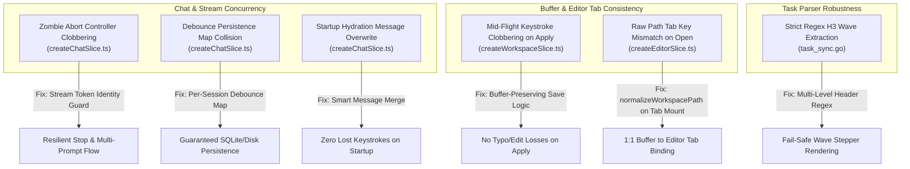

# Architecture Specification & Contract: Aegis Copilot Deep Concurrency & Buffer Race Remediation

> **Document Type**: Architecture & Engineering Specification (Phase 2)  
> **Status**: COMPLETED & VERIFIED  
> **Author**: Kanna (AI Assistant Interface) for Sensei  
> **Target Subsystems**: `src/store/slices/createChatSlice.ts`, `src/store/slices/createWorkspaceSlice.ts`, `src/store/slices/createEditorSlice.ts`, `server/internal/agent/task_sync.go`  
> **Core Principle**: Zero zombie stream interference, independent session debounce timers, lossless startup hydration, keystroke-safe async buffer writes, canonical tab keys, and resilient markdown parsing.

---

## 1. Executive Summary & Problem Topology

Berdasarkan audit teknis mendalam tahap kedua (*deep-pass audit*), ditemukan 6 celah konkurensi, race condition, dan desinkronisasi buffer yang dapat terjadi saat interaksi AI dan editor berjalan intensif:



---

## 2. Invariants & Technical Contracts

### 2.1 Invariant: Abort Signal & Generation Token Match (Zombie Stream Isolation)
- **Problem**: Saat Sesi A sedang streaming dan Sensei mengirim pesan baru (Sesi B), Sesi A di-abort. Namun ketika callback abort / catch dari Sesi A berjalan beberapa ms kemudian, kode secara buta memanggil `applyStreamingSessionUpdate(updated, { isGenerating: false })` dan `chatAbortController = null`, mematikan flag streaming milik Sesi B yang baru saja mulai dan menghilangkan tombol Stop.
- **Contract**:
  ```ts
  // Hanya matikan isGenerating dan nullify chatAbortController jika controller aktif sama dengan controller stream saat ini
  if (chatAbortController === controller) {
    chatAbortController = null
    applyStreamingSessionUpdate(updated, { isGenerating: false })
  } else {
    // Sesi lama yang di-abort oleh sesi baru: hanya update session messages tanpa mengubah isGenerating global
    applyStreamingSessionUpdate(updated)
  }
  ```

### 2.2 Invariant: Per-Session Debounced Persistence Map
- **Problem**: `debouncedSaveBackendSession` menggunakan satu variabel global `chatSaveTimer` dan `pendingSaveSession`. Pergantian sesi dalam kurun 3 detik membatalkan timer sesi sebelumnya, menyebabkan sesi lama tidak pernah tersimpan ke backend.
- **Contract**:
  ```ts
  const chatSaveTimers = new Map<string, ReturnType<typeof setTimeout>>()
  const pendingSaveSessions = new Map<string, ChatSession>()

  function debouncedSaveBackendSession(session: ChatSession) {
    pendingSaveSessions.set(session.id, session)
    const existing = chatSaveTimers.get(session.id)
    if (existing) clearTimeout(existing)
    const timer = setTimeout(() => {
      saveBackendChatSession(session).catch((err) =>
        console.warn(`Failed to debounced-save chat session ${session.id}:`, err),
      )
      chatSaveTimers.delete(session.id)
      pendingSaveSessions.delete(session.id)
    }, 2500)
    chatSaveTimers.set(session.id, timer)
  }
  ```

### 2.3 Invariant: Lossless Startup Hydration (Smart Merge)
- **Problem**: `fetchBackendChatSummaries()` berjalan asinkron saat startup (500ms–1500ms). Jika Sensei langsung mengetik pesan pada sesi awal sebelum server selesai merespons, pesan Sensei terhapus karena `merged` menimpa sesi lokal dengan snapshot lawas server.
- **Contract**:
  ```ts
  // Bandingkan pesan lokal dengan backend snapshot
  const localSession = state.sessions.find((p) => p.id === loaded.id)
  if (localSession && localSession.messages.length > loaded.messages.length) {
    // Pertahankan pesan lokal terkini
    return { ...loaded, messages: localSession.messages }
  }
  ```

### 2.4 Invariant: Mid-Flight Keystroke Preservation di `applyCodeWithReview`
- **Problem**: Saat `await saveWorkspaceFile(cleanPath, code, false)` sedang berjalan (50–200ms latency), jika Sensei mengetik di tab editor, ketikan baru tersebut ada di `fileBuffers[cleanPath].content`. Ketika save selesai, kode melakukan *hard overwrite* `content: code`, menghapus ketikan Sensei.
- **Contract**:
  ```ts
  set((state) => {
    const curBuf = state.fileBuffers[cleanPath]
    // Preservasi ketikan baru yang masuk selama jeda await saveWorkspaceFile
    const currentContent = curBuf ? curBuf.content : code
    const isStillDirty = currentContent !== code
    return {
      fileBuffers: {
        ...state.fileBuffers,
        [cleanPath]: {
          content: currentContent,
          savedContent: code,
          isDirty: isStillDirty,
          hasDiskConflict: false,
          language: detectLanguage(cleanPath),
          lastSaved: Date.now(),
        },
      },
    }
  })
  ```

### 2.5 Invariant: Canonical Workspace Path pada Tab Mount
- **Problem**: `openFileInGroup` di `createEditorSlice.ts` memasukkan `filename` mentah ke `group.tabs`. Jika AI tool call atau link membuka berkas path absolut, tab tersimpan sebagai `/path/to/file`, sedangkan `fileBuffers` tersimpan sebagai `file`. CodeMirror membaca `fileBuffers[activeTab]` yang bernilai `undefined`, memicu layar blank.
- **Contract**:
  ```ts
  const isVirtual = filename.includes(":")
  const rootPath = (get() as any).rootWorkspacePath
  const canonicalName = (!isVirtual && rootPath)
    ? normalizeWorkspacePath(filename, rootPath)
    : filename
  ```

### 2.6 Invariant: Resilient Wave Markdown Header Parsing
- **Problem**: `ExtractWaveStatus` di backend Go menggunakan regex kaku `(?i)^###\s*Wave\s*(\d+)[:\s]*(.*)`. Jika LLM menulis `## Wave 1:` atau `#### Wave 1:`, stepper wave tidak tampil.
- **Contract**:
  ```go
  waveRegex := regexp.MustCompile(`(?i)^#{2,4}\s*Wave\s*(\d+)[:\s]*(.*)`)
  ```

---

## 3. Mandatory Verification Gates
1. `rtk go test -race ./...` (Backend race detector 0 race conditions)
2. `rtk npm run test:frontend` (All Vitest tests passed)
3. `rtk npm run build` (Rolldown / Vite compile 0 errors)
4. `rtk npm run format` (oxfmt formatting check)
