# Relational PR Optimization Map: AegisCodev2 Architecture Hardening

> **Document Type**: Relational Implementation Map & PR Phasing Guide  
> **Reference Audit**: [`@task/Table-Phase-Optimized.md`](Table-Phase-Optimized.md)  
> **Source Task**: [`@task/task-issues-optimize.md`](task-issues-optimize.md)  
> **Architecture Reference**: [`@task/Architecture-context.md`](Architecture-context.md), [`@docs/adr/0016-http1-socket-starvation-prevention-and-canonical-workspace-buffer-lifecycle.md`](../docs/adr/0016-http1-socket-starvation-prevention-and-canonical-workspace-buffer-lifecycle.md)  
> **Status**: Ready for Validation & Orchestration  

---

## 1. Executive Summary & Phasing Strategy (Wave 5: Architecture Hardening)

Following the completion of Wave 1 through Wave 4 (Core Contracts, CM6 Languages, Workbench UI, and Dead Code Purge), this **Wave 5 Optimization Phase** resolves 31 verified architectural issues across three interconnected boundaries:
1. **Boundary 1: Backend API Endpoints** (17 items: 6 BUG, 6 ISSUE, 5 OPTIMIZE)
2. **Boundary 2: Zustand Store Boundaries & DOM Performance** (9 items: 0 BUG, 5 ISSUE, 4 OPTIMIZE)
3. **Boundary 3: Buffer Lifecycle & Concurrency Race Guards** (5 items: 4 BUG, 1 ISSUE, 0 OPTIMIZE)

The execution is partitioned into three parallel/sequential Micro-Phases designed to preserve zero-downtime, zero-regression guarantees.

---

## 2. Micro-Phase Relational Implementation Map

| Micro-Phase | Target Boundary | Focus & PR Scope | Primary Files | IDs Covered | Complexity & Risk |
| :--- | :--- | :--- | :--- | :--- | :--- |
| **MP-5.1** | **Backend API Hardening** | Purge dead routes, consolidate redundant SSE streams to unified EventHub, resolve ServeMux duplicate paths, and fix Git service nil-pointer panic. | `server/internal/api/api.go` `server/internal/git/git.go` `src/components/layout/bottom-panel/BottomPanel.tsx` `src/components/layout/bottom-panel/TerminalView.tsx` | `OPT-API-01` s/d `OPT-API-17` | **Low-Medium** (Requires Go test suite sync) |
| **MP-5.2** | **Zustand Store Normalization** | Single Source of Truth for theme, settings, and linter; eliminate 60Hz cursor/selection DOM render loops in CodePane; streamline tab selectors. | `src/store/slices/createLayoutSlice.ts` `src/store/slices/createSettingsSlice.ts` `src/store/slices/createEditorSlice.ts` `src/store/slices/createWorkspaceSlice.ts` `src/components/layout/editor/CMEditor.tsx` `src/components/layout/editor/CodePane.tsx` | `OPT-ZUS-01` s/d `OPT-ZUS-09` | **Medium** (Requires React re-render verification) |
| **MP-5.3** | **Buffer Lifecycle Integrity** | Eliminate data loss race condition during in-flight saves, add self-save watcher echo suppression, enforce canonical path lookups on close, and guard rapid tab fetches. | `src/store/slices/createWorkspaceSlice.ts` `src/components/layout/editor/EditorTabs.tsx` `src/context/WorkbenchLifecycle.ts` `src/components/layout/editor/CodePane.tsx` | `OPT-BUF-01` s/d `OPT-BUF-05` | **High** (Direct user data integrity) |

---

## 3. Relational Dependency Matrix & Cross-Boundary Impact

The diagram below illustrates how issues across the three boundaries intersect:

```mermaid
flowchart TD
    subgraph Boundary 1: Backend API
        API12["OPT-API-12: Dedicated /events/logs"]
        API15["OPT-API-15: TerminalView relative SSE"]
        API16["OPT-API-16: Git root() nil-deref"]
        API01["OPT-API-01..05: Dead endpoints"]
    end

    subgraph Boundary 2: Zustand Store
        ZUS01["OPT-ZUS-01: Theme split in Layout/Settings"]
        ZUS02["OPT-ZUS-02: Editor options duplication"]
        ZUS03["OPT-ZUS-03: 60Hz cursor render loop in CodePane"]
        ZUS04["OPT-ZUS-04: getDerivedEditorState recalculation"]
    end

    subgraph Boundary 3: Buffer Lifecycle
        BUF01["OPT-BUF-01: In-flight save data loss race"]
        BUF02["OPT-BUF-02: Watcher echo & false disk conflict"]
        BUF03["OPT-BUF-03: Unnormalized tab path close bypass"]
        BUF05["OPT-BUF-05: Rapid tab switch async race"]
    end

    API12 -->|"Bypasses unified EventHub"| BUF02
    ZUS03 -->|"Forces CodePane full re-render"| BUF02
    BUF01 -->|"Corrupts isDirty state"| BUF03
    ZUS04 -->|"Desynchronizes activeTab on split"| BUF05
```

---

## 4. Detailed Micro-Phase Specifications

### **Micro-Phase 5.1: Backend API Hardening & Route Deprecation**
- **Objective**: Clean the Go HTTP ServeMux surface, eliminate duplicate routes, protect socket budget by moving remaining individual SSE consumers to unified `/api/v1/events`, and patch backend runtime panics.
- **Detailed Action Items**:
  1. **Purge Dead Routes**: Remove registration for `/api/v1/auth/handshake` (`OPT-API-01`), `/api/v1/pairing/info` (`OPT-API-02`), `/api/v1/mcp/rpc` duplicate alias (`OPT-API-03`), `/api/v1/mcp/events` dead SSE stream (`OPT-API-04`), and `/api/v1/codegraph/init` (`OPT-API-05`).
  2. **Consolidate CodeGraph & Duplicate Mux Entries**: Remove duplicate route `/api/codegraph/entrypoints` (`OPT-API-14`); standardize CodeGraph UI interactions exclusively on reverse proxy `/api/codegraph/ui/*` (`OPT-API-10`).
  3. **Migrate Logs SSE to Unified Hub**: In `BottomPanel.tsx`, replace direct `new EventSource('/api/v1/events/logs')` with `eventHub.subscribe('logs', ...)` to free browser TCP socket slot (`OPT-API-12`).
  4. **Fix TerminalView API_BASE**: In `TerminalView.tsx:201`, wrap SSE URL with `${API_BASE}` to prevent dev-mode proxy routing (`OPT-API-15`).
  5. **Patch Nil Pointer Panic**: In `server/internal/git/git.go:90`, guard `s.ws == nil` before calling `GetRoot()` (`OPT-API-16`).
  6. **Clean Status Codes**: In `handleWorkspaceRename` and `handleWorkspaceMove`, return HTTP 400 for bad params and 404 for missing sources instead of HTTP 500 (`OPT-API-17`).

### **Micro-Phase 5.2: Zustand Store Normalization & DOM Render Decoupling**
- **Objective**: Establish Single Source of Truth for workbench settings and eliminate high-frequency React component re-rendering.
- **Detailed Action Items**:
  1. **Theme State Unification**: Remove duplicate theme properties from `createLayoutSlice.ts`; route `theme`, `themePalette`, and toggle methods through `createSettingsSlice.ts` with localStorage synchronization (`OPT-ZUS-01`).
  2. **Editor Settings Consolidation**: Remove isolated `tabSize`, `minimapEnabled`, `minimapScale` state from `createEditorSlice.ts`; bind editor UI directly to `settings.editor` in `createSettingsSlice.ts` (`OPT-ZUS-02`).
  3. **Decouple 60Hz Cursor & Selection Updates**: In `CodePane.tsx`, do not subscribe to global `cursorPosition` and `selection` for main render. Keep transient coordinates in local state or ref; only push to Zustand on debounced idle (150ms) or blur for status bar / context chips (`OPT-ZUS-03`).
  4. **Replace Derived State Duplication**: Eliminate `getDerivedEditorState` manual assignments in `createEditorSlice.ts`. Replace `activeTab`, `tabs`, and `focusedPane` with memoized Zustand selectors (`OPT-ZUS-04`).
  5. **Linter Settings Unification**: Remove duplicate `linterSettings` in `createWorkspaceSlice.ts`; consume `settings.linter` exclusively (`OPT-ZUS-05`).
  6. **Relocate Global Utilities**: Move `toast`, `showToast`, and `runAction` from `createDebugSlice.ts` into `createLayoutSlice.ts` (`OPT-ZUS-06`).
  7. **Invert Debugger Boundary**: Relocate `breakpoints` and `activeDebugLine` to `createDebugSlice.ts` (`OPT-ZUS-07`).
  8. **Simplify Terminal Slice**: Remove `activeTerminalSession` and `terminalLines` sync fields from Zustand; derive active session via selector (`OPT-ZUS-08`).
  9. **Consolidate CodeGraph Store**: Integrate `codegraphSlice.ts` into unified `useWorkbenchStore` (`OPT-ZUS-09`).

### **Micro-Phase 5.3: Buffer Lifecycle Integrity & Concurrency Race Guards**
- **Objective**: Guarantee zero data loss, eliminate editor flashes on save, and ensure robust buffer state across rapid operations.
- **Detailed Action Items**:
  1. **Fix In-Flight Save Race Condition**: In `createWorkspaceSlice.ts` (`saveFile`), record the exact content snapshot sent to disk (`contentToSave`). In `markBufferSavedLogic`, only set `isDirty = false` if `currentBuf.content === contentToSave`. If the user typed during the network write, retain `isDirty = true` and set `savedContent = contentToSave` (`OPT-BUF-01`).
  2. **Self-Save Echo Suppression**: When saving a file, set `lastSaved: Date.now()` and an active save lock flag on the buffer. In `WorkbenchLifecycle.ts`, ignore file modification events arriving within 800ms of `lastSaved` or when content matches `savedContent`. This completely prevents editor unmounts and false disk conflicts (`OPT-BUF-02`).
  3. **Enforce Canonical Tab Paths on Close**: Standardize `EditorTabs.tsx` and `createEditorSlice.ts` (`closeTabInGroup`) to look up dirty buffers using canonical `normalizeWorkspacePath(tab)`, preventing unsaved tab closures without modal confirmation (`OPT-BUF-03`).
  4. **Complete Auto-Save State Sync**: In `autoSaveDirtyBuffers`, invoke `markBufferSavedLogic` upon successful disk write to clear `isDirty` flags before folder transition (`OPT-BUF-04`).
  5. **Per-File Async Sequence Guard**: In `fetchBufferSafely`, maintain a per-path incrementing request token. If a subsequent fetch for the same file completes earlier, discard stale network responses to eliminate out-of-order race conditions on rapid tab switching (`OPT-BUF-05`).

---

## 5. Verification & Validation Regression Checklist

| Step | Scope | Verification Command | Acceptance Gate |
| :---: | :--- | :--- | :--- |
| **V-01** | Backend API & Tests | `go test -v ./server/internal/api/...` | All API routes respond correctly, no nil panics, Go tests 100% pass. |
| **V-02** | Go Suite Overall | `go test ./...` | All 15 server packages pass with 0 failures. |
| **V-03** | Frontend Unit Tests | `npm test` (Vitest) | All 283+ test cases pass without regressions. |
| **V-04** | TypeScript Build | `npm run build` | 0 TypeScript errors, bundle build completes cleanly. |
| **V-05** | Formatting Check | `npm run format` | Code cleanly formatted via `oxfmt`. |
| **V-06** | Manual Save Race Test | Rapid typing during Ctrl+S | Newly typed text remains dirty and is not lost on reload. |
| **V-07** | Echo Suppression Test | Ctrl+S in active editor | Editor does NOT flash loading spinner or unmount CMEditor. |
