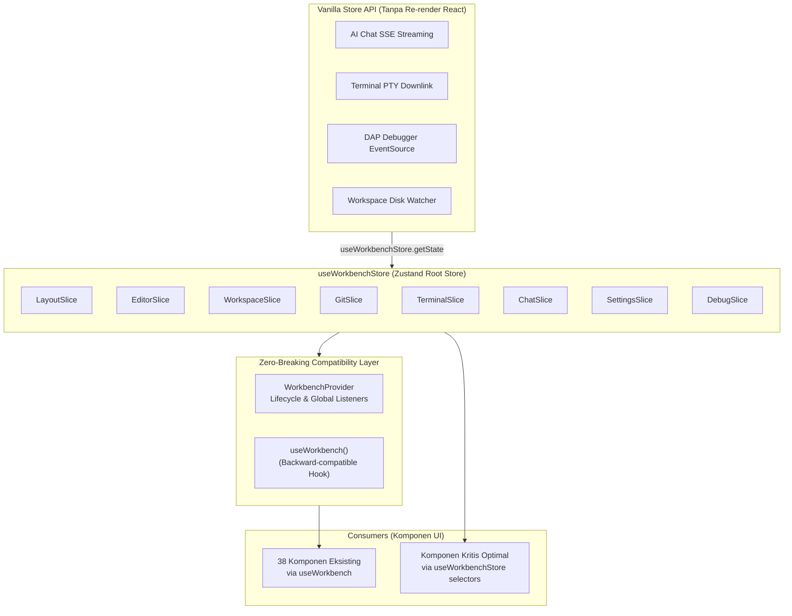

# Rencana Refaktorisasi State Management ke Zustand (Zustand Migration Plan)

> **Tujuan**: Menggantikan monolitik `workbenchFacade.ts` (1.404 baris) dan React Context raksasa dengan Zustand Modular Slices + Vanilla Store API, menstabilkan performa rendering saat streaming AI, pengetikan kursor, dan output PTY terminal, dengan prinsip **Zero-Breaking Bridge** (seluruh 38 komponen UI eksisting tetap berjalan normal sejak hari pertama).

---

## 1. Executive Summary & Analisis Kode Eksisting

### 1.1 Kondisi Saat Ini (Current Architecture Analysis)
1. **Monolitik Context Provider**: Seluruh state workbench dibungkus dalam single context `WorkbenchContext` yang diinstansiasi oleh hook monolitik `useWorkbenchFacade()` di [`src/context/core/workbenchFacade.ts`](file:///Users/aditwicaksono/Documents/Project-AI/AegisCodev2/src/context/core/workbenchFacade.ts).
2. **Re-render Cascades (Masalah Utama)**:
   - Sekitar 38 komponen UI utama (`ChatMessageList`, `StatusBar`, `CodePane`, `TerminalView`, `EditorTabs`, dll.) mengimpor `useWorkbench()`.
   - Setiap kali terjadi pembaruan state kecil (misal: koordinat kursor `cursorPosition` saat navigasi panah, chunk teks baru dari SSE streaming AI, atau output streaming PTY terminal), **seluruh komponen pemanggil `useWorkbench()` dipaksa re-render**.
3. **Koordinasi Multi-Domain & Side-Effects**:
   - `workbenchFacade.ts` tidak hanya menampung state, tetapi juga mengoordinasikan interaksi lintas domain (misal: `saveFile` memicu `refreshGit()` dan `validateSyntax()`, file dihapus memicu penutupan tab editor, dll.).
   - `workbenchFacade.ts` juga mengelola DAP Debugger (Delve/debugpy SSE stream), AI Context Extractor, dan keyboard listener global (F5, F9, F10, F11, Cmd+S, Cmd+B, Cmd+P, dsb.).
4. **Dependensi Pengujian Unit (Unit Test Coupling)**:
   - Pengujian unit di [`test/frontend/core/workbenchCore.test.ts`](file:///Users/aditwicaksono/Documents/Project-AI/AegisCodev2/test/frontend/core/workbenchCore.test.ts) (38 tests) secara langsung mengimpor fungsi logika murni (*pure transition functions*) seperti `openTabInGroupLogic`, `stageChangeLogic`, `addFileToTreeLogic`, `reorderBottomTabsLogic`, dll.
   - [`test/frontend/debug/debugWorkflow.test.ts`](file:///Users/aditwicaksono/Documents/Project-AI/AegisCodev2/test/frontend/debug/debugWorkflow.test.ts) mengimpor `getTerminalRunCommand` dari `workbenchFacade.ts`.
   - **Syarat Mutlak**: Seluruh fungsi logika murni ini tidak boleh hilang atau berubah signature-nya agar 136 unit test tetap 100% lulus.

---

## 2. Target Arsitektur Zustand



---

## 3. Rincian Pentahapan dan Sub-Fase (Phased Execution)

### Phase 1: Setup Dependensi & Pembuatan Root Store Skeleton
**Fokus**: Menyiapkan dependensi Zustand dan fondasi TypeScript modular tanpa menyentuh kode runtime yang sedang berjalan.

- **Sub-phase 1.1**: Instalasi Dependensi Zustand
  - Daftarkan dependensi `"zustand": "^5.0.0"` ke [`package.json`](file:///Users/aditwicaksono/Documents/Project-AI/AegisCodev2/package.json).
  - Jalankan `npm install` dan verifikasi instalasi.
- **Sub-phase 1.2**: Struktur Direktori Store
  - Buat direktori baru `src/store/` dan `src/store/slices/`.
- **Sub-phase 1.3**: Fondasi Tipe Gabungan (`src/store/types.ts`)
  - Buat tipe `WorkbenchStore` yang menggabungkan seluruh interface slice:
    `LayoutSlice & EditorSlice & WorkspaceSlice & GitSlice & TerminalSlice & ChatSlice & SettingsSlice & DebugSlice`.
  - Gunakan `StateCreator<WorkbenchStore, [], [], SliceType>` agar action di satu slice dapat memanggil `get()` atau `set()` untuk berinteraksi dengan slice lain secara aman (*type-safe cross-slice communication*).

---

### Phase 2: Implementasi Modular Zustand Slices & Preservasi Logika Murni
**Fokus**: Mengonversi masing-masing domain core menjadi slice Zustand mandiri, dengan tetap mempertahankan seluruh pure logic helper functions.

- **Sub-phase 2.1: `src/store/slices/createLayoutSlice.ts`**
  - Mengonversi state & actions dari [`layoutCore.ts`](file:///Users/aditwicaksono/Documents/Project-AI/AegisCodev2/src/context/core/layoutCore.ts):
    - State: `sidebarOpen`, `panelOpen`, `panelMaximized`, `activeBottomTab`, `bottomTabOrder`, `chatOpen`, `chatSessionsOpen`, `commandPaletteOpen`, `commandPaletteQuery`, `settingsModalOpen`, `settingsModalCategory`, `theme`, `sidebarWidth`, `chatDrawerWidth`, `bottomPanelHeight`.
    - Actions: `setSidebarOpen`, `toggleSidebar`, `setPanelOpen`, `togglePanel`, `setPanelMaximized`, `togglePanelMaximized`, `setActiveBottomTab`, `reorderBottomTabs`, `setChatOpen`, `toggleChat`, `setChatSessionsOpen`, `toggleChatSessions`, `setCommandPaletteOpen`, `setCommandPaletteQuery`, `openSettingsModal`, `toggleSettingsModal`, `setTheme`, `toggleTheme`, `setSidebarWidth`, `resetSidebarWidth`, `setChatDrawerWidth`, `resetChatDrawerWidth`, `setBottomPanelHeight`, `resetBottomPanelHeight`.
  - Tetap ekspor `reorderBottomTabsLogic`, `toggleThemeLogic`, `loadStoredBottomTabOrder`, `loadStoredTheme`, dsb.
- **Sub-phase 2.2: `src/store/slices/createSettingsSlice.ts`**
  - Mengonversi state & actions dari [`settingsCore.ts`](file:///Users/aditwicaksono/Documents/Project-AI/AegisCodev2/src/context/core/settingsCore.ts):
    - State: `settings` ([`AppSettings`](file:///Users/aditwicaksono/Documents/Project-AI/AegisCodev2/src/types/workbench.ts#L93)).
    - Actions: `setSettings`, `updateEditorSettings`, `updateWorkbenchSettings`, `updateFilesSettings`, `updateFeaturesSettings`, `updateCompanionSettings`, `updateLinterSettings`, `updateAgentSettings`, `resetSettings`, `setThemeMode`, `setThemePalette`, `toggleThemeMode`.
  - Tetap ekspor `DEFAULT_APP_SETTINGS`, `loadStoredSettings`, `saveStoredSettings`.
- **Sub-phase 2.3: `src/store/slices/createEditorSlice.ts`**
  - Mengonversi state & actions dari [`editorCore.ts`](file:///Users/aditwicaksono/Documents/Project-AI/AegisCodev2/src/context/core/editorCore.ts):
    - State: `splitEditor`, `splitRatio`, `group1`, `group2`, `focusedGroup`, `focusedPane`, `secondaryActiveTab`, `activeActivity`, `activeTab`, `tabs`, `minimapEnabled`, `minimapScale`, `findStateGroup1`, `findStateGroup2`, `cursorPosition`, `selection`, `currentFocusedFile`, `tabSize`, `encoding`, `breakpoints`, `activeDebugLine`.
    - Actions: `setSplitEditor`, `toggleSplitEditor`, `closeSplitEditor`, `setSplitRatio`, `setFocusedGroup`, `openFileInGroup`, `closeTabInGroup`, `setActiveTabInGroup`, `moveTabBetweenGroups`, `reorderTabsInGroup`, `setFocusedPane`, `setSecondaryActiveTab`, `openFileInPane`, `setActiveActivity`, `setActiveTab`, `closeTab`, `setMinimapEnabled`, `toggleMinimap`, `setMinimapScale`, `setFindStateGroup1`, `setFindStateGroup2`, `openFind`, `closeFind`, `toggleFind`, `setCursorPosition`, `setSelection`, `renameTabsInBothGroups`, `closeTabInBothGroups`, `resetAllGroups`, `setTabSize`, `toggleTabSize`, `setEncoding`, `setBreakpointsMap`, `toggleBreakpoint`, `clearBreakpoints`, `setActiveDebugLine`.
  - Tetap ekspor fungsi pure: `openTabInGroupLogic`, `closeTabInGroupLogic`, `setActiveTabInGroupLogic`, `moveTabBetweenGroupsLogic`, `reorderTabsInGroupLogic`, `renameTabInAllGroupsLogic`.
- **Sub-phase 2.4: `src/store/slices/createWorkspaceSlice.ts`**
  - Mengonversi state & actions dari [`workspaceCore.ts`](file:///Users/aditwicaksono/Documents/Project-AI/AegisCodev2/src/context/core/workspaceCore.ts):
    - State: `rootWorkspacePath`, `rootWorkspaceName`, `isWorkspaceLoading`, `recentProjects`, `files`, `fileBuffers`, `diagnostics`, `notifications`, `activeLanguage`, `linterSettings`.
    - Actions: `addRecentProject`, `removeRecentProject`, `clearRecentProjects`, `openFolderPicker`, `openRootFolder`, `closeRootFolder`, `refreshWorkspace`, `moveFile`, `setFiles`, `createFile`, `renameFile`, `deleteFile`, `setFileBuffers`, `updateFileContent`, `syncBufferWithDisk`, `saveFile`, `revertBufferContent`, `ensureFileBuffer`, `fetchBufferSafely`, `setDiagnostics`, `addNotification`, `clearAllNotifications`, `removeNotification`, `markAllNotificationsRead`, `markNotificationRead`, `setActiveLanguage`, `setLinterSettings`, `navigateToDiagnostic`, `autoSaveDirtyBuffers`.
  - Tetap ekspor: `addFileToTreeLogic`, `removeFileFromTreeLogic`, `renameFileInTreeLogic`, `updateBufferContentLogic`, `markBufferSavedLogic`, `revertBufferContentLogic`, `sanitizeContentOnSave`, `normalizeWorkspacePath`, `AsyncSequenceGuard`.
- **Sub-phase 2.5: `src/store/slices/createGitSlice.ts`**
  - Mengonversi state & actions dari [`gitCore.ts`](file:///Users/aditwicaksono/Documents/Project-AI/AegisCodev2/src/context/core/gitCore.ts):
    - State: `isGitRepo`, `activeBranch`, `activeRepo`, `gitRepos`, `gitChanges`, `stagedChanges`, `gitCommits`, `gitBranches`, `gitTags`, `gitProfile`, `ahead`, `behind`, `upstream`, `commitHash`, `isLoadingGit`, `gitError`, `isRepoLocked`, `isOperatingGit`, `gitDiffVersion`.
    - Actions: `setActiveBranch`, `setActiveRepo`, `setGitRepos`, `setGitChanges`, `setStagedChanges`, `setGitCommits`, `refreshGit`, `unlockRepo`, `initRepo`, `checkoutBranch`, `createBranch`, `stageChange`, `unstageChange`, `stageAllChanges`, `unstageAllChanges`, `discardChange`, `discardAllChanges`, `commitChanges`, `gitPull`, `gitPush`, `gitSync`, `createTag`, `pushTags`, `addRemote`, `fetchDiff`, `fetchTimeline`, `openGitDiff`.
  - Tetap ekspor: `stageChangeLogic`, `unstageChangeLogic`, `stageAllLogic`, `unstageAllLogic`, `commitChangesLogic`.
- **Sub-phase 2.6: `src/store/slices/createTerminalSlice.ts`**
  - Mengonversi state & actions dari [`terminalCore.ts`](file:///Users/aditwicaksono/Documents/Project-AI/AegisCodev2/src/context/core/terminalCore.ts):
    - State: `terminalSessions`, `activeTerminalSessionId`, `terminalLines`, `terminalRunning`.
    - Actions: `setActiveTerminalSessionId`, `createTerminalSession`, `restartTerminalSession`, `terminateTerminalSession`, `closeTerminalSession`, `setTerminalRunning`, `sendTerminalCommand`, `clearTerminal`.
  - Tetap ekspor: `createTerminalSessionLogic`, `closeTerminalSessionLogic`, `clearTerminalSessionLogic`, `processTerminalCommandLogic`.
- **Sub-phase 2.7: `src/store/slices/createChatSlice.ts`**
  - Mengonversi state & actions dari [`chatCore.ts`](file:///Users/aditwicaksono/Documents/Project-AI/AegisCodev2/src/context/core/chatCore.ts) & Context Extractor:
    - State: `sessions`, `activeSessionId`, `activeProvider`, `activeModel`, `chatMessages`, `isGenerating`, `skills`, `antigravityModels`, `contextItems`, `manualMentions`, `dismissedPaths`, `contextModeOverrides`.
    - Actions: `createSession`, `switchSession`, `deleteSession`, `setSessionModel`, `sendChatMessage`, `stopGenerating`, `appendChatChunk`, `dismissContextItem`, `toggleContextItemMode`, `addMentionContext`, `clearManualMentions`.
  - Tetap ekspor: `createSessionLogic`, `deleteSessionLogic`, `sendChatMessageLogic`, `setSessionModelLogic`, `generateContextualReply`, `DEFAULT_PROVIDER`, `DEFAULT_MODEL`.
- **Sub-phase 2.8: `src/store/slices/createDebugSlice.ts`**
  - Mengonversi fungsionalitas DAP Debugger dan global utilities dari `workbenchFacade.ts`:
    - State: `debugState`, `isDebugging`, `toast`, `confirmCloseFile`, `confirmRevertFile`, `serverConnected`.
    - Actions: `startDebugging`, `stepDebugging`, `terminateDebugging`, `runFileInTerminal`, `showToast`, `clearToast`, `checkServerConnection`, `resolveConfirmCloseFile`, `requestRevertFile`, `resolveConfirmRevert`, `runAction`.
  - Tetap ekspor: `getTerminalRunCommand`.

---

### Phase 3: Root Store Assembly & "Zero-Breaking Bridge"
**Fokus**: Menggabungkan seluruh slice ke `useWorkbenchStore` dan membangun bridge transparan di `WorkbenchContext.tsx` sehingga tidak ada satupun dari 38 komponen yang rusak.

- **Sub-phase 3.1: Assembly `src/store/index.ts`**
  - Buat root store Zustand `useWorkbenchStore` dengan menggabungkan 8 slice:
    ```typescript
    export const useWorkbenchStore = create<WorkbenchStore>()((set, get, store) => ({
      ...createLayoutSlice(set, get, store),
      ...createSettingsSlice(set, get, store),
      ...createEditorSlice(set, get, store),
      ...createWorkspaceSlice(set, get, store),
      ...createGitSlice(set, get, store),
      ...createTerminalSlice(set, get, store),
      ...createChatSlice(set, get, store),
      ...createDebugSlice(set, get, store),
    }))
    ```
- **Sub-phase 3.2: Re-ekspor Kompatibilitas Pure Logic**
  - Buat re-ekspor barrel atau pertahankan interface di `src/context/core/*` sehingga seluruh import di `workbenchCore.test.ts` dan test lainnya tetap resolvable 100%.
- **Sub-phase 3.3: Implementasi Bridge di `src/context/WorkbenchContext.tsx`**
  - `useWorkbench()` diarahkan untuk langsung membaca `useWorkbenchStore()`:
    ```typescript
    export function useWorkbench(): WorkbenchContextType {
      return useWorkbenchStore()
    }
    ```
  - Definisikan `WorkbenchContextType = WorkbenchStore`.
- **Sub-phase 3.4: Lifecycle & Event Listeners Manager (`WorkbenchProvider`)**
  - Pindahkan listeners non-rendering dari `workbenchFacade.ts` ke hook lifecycle `useWorkbenchLifecycle()` yang dijalankan di dalam `WorkbenchProvider`:
    1. Global keyboard shortcuts (`keydown`: F5, F9, F10, F11, Cmd+S, Cmd+B, Cmd+P, Esc, dll.).
    2. Responsive viewport resize listener (auto-collapse sidebar/chat drawer pada layar kecil).
    3. Auto-save timers (`afterDelay` dan `onFocusChange` blur listener).
    4. SSE Debug listener (`connectDebugSSE`).
    5. Server health check interval (20s polling).
- **Sub-phase 3.5: Verifikasi Gates Zero-Breaking**
  - Jalankan `rtk npm run test:frontend` -> Memastikan 136 tests tetap lulus 100%.
  - Jalankan `rtk npm run build` -> Memastikan 0 TypeScript error.

---

### Phase 4: Optimasi Komponen Kritis dengan Atomic Selectors
**Fokus**: Memutus rantai *re-render cascades* pada komponen yang paling rentan lag / freeze.

- **Sub-phase 4.1: Area Chat & AI Streaming**
  - Komponen: [`ChatMessageList.tsx`](file:///Users/aditwicaksono/Documents/Project-AI/AegisCodev2/src/components/layout/chat/ChatMessageList.tsx), [`ChatComposer.tsx`](file:///Users/aditwicaksono/Documents/Project-AI/AegisCodev2/src/components/layout/chat/ChatComposer.tsx), [`ChatHeader.tsx`](file:///Users/aditwicaksono/Documents/Project-AI/AegisCodev2/src/components/layout/chat/ChatHeader.tsx).
  - Optimasi: Ganti `useWorkbench()` menjadi atomic selector:
    - `ChatMessageList`: `const chatMessages = useWorkbenchStore(s => s.chatMessages)` dan `const isGenerating = useWorkbenchStore(s => s.isGenerating)`. Komponen ini **tidak lagi re-render** saat kursor editor bergerak!
- **Sub-phase 4.2: Area Editor & Breadcrumbs**
  - Komponen: [`CodePane.tsx`](file:///Users/aditwicaksono/Documents/Project-AI/AegisCodev2/src/components/layout/editor/CodePane.tsx), [`EditorBreadcrumbs.tsx`](file:///Users/aditwicaksono/Documents/Project-AI/AegisCodev2/src/components/layout/editor/EditorBreadcrumbs.tsx), [`EditorTabs.tsx`](file:///Users/aditwicaksono/Documents/Project-AI/AegisCodev2/src/components/layout/editor/EditorTabs.tsx).
  - Optimasi:
    - `CodePane`: Hanya subscribe ke buffer filenya sendiri `useWorkbenchStore(s => s.fileBuffers[filename])` dan breakpoints file tersebut `useWorkbenchStore(s => s.breakpoints[filename])`.
    - `EditorBreadcrumbs`: Hanya subscribe ke `s.activeTab`, `s.secondaryActiveTab`, `s.splitEditor`, `s.focusedPane`.
- **Sub-phase 4.3: Area Status Bar**
  - Komponen: [`StatusBar.tsx`](file:///Users/aditwicaksono/Documents/Project-AI/AegisCodev2/src/components/layout/status-bar/StatusBar.tsx).
  - Optimasi: Pisahkan baris kursor (`Ln X, Col Y`) ke child component `CursorIndicator` yang meng-subscribe `s.cursorPosition`. Komponen lain di StatusBar tidak re-render setiap kali kursor digerakkan.
- **Sub-phase 4.4: Area Terminal**
  - Komponen: [`TerminalView.tsx`](file:///Users/aditwicaksono/Documents/Project-AI/AegisCodev2/src/components/layout/bottom-panel/TerminalView.tsx).
  - Optimasi: Hanya subscribe ke `s.activeTerminalSessionId` dan session aktif `s.terminalSessions[activeId]`. Output terminal deras tidak memicu re-render di editor atau sidebar.
- **Sub-phase 4.5: App Root & Panes**
  - Komponen: [`App.tsx`](file:///Users/aditwicaksono/Documents/Project-AI/AegisCodev2/src/App.tsx).
  - Optimasi: Subscribe hanya ke dimensi layout (`sidebarOpen`, `panelOpen`, `chatOpen`, ukuran sash).

---

### Phase 5: Pemanfaatan Vanilla Store API untuk Background Stream
**Fokus**: Memindahkan mutasi data latar belakang langsung ke `useWorkbenchStore.getState()` tanpa melalui lifecycle React dispatch.

- **Sub-phase 5.1: AI Chat SSE Streaming Chunk**
  - Pada callback EventSource / chunk streaming AI, mutasi `chatMessages` langsung via `useWorkbenchStore.getState().appendChatChunk(chunk)`.
- **Sub-phase 5.2: Terminal PTY Downlink & File Watcher SSE**
  - Listener SSE workspace (`/api/v1/events/workspace`) langsung memanggil `useWorkbenchStore.getState().syncBufferWithDisk(...)` tanpa memicu re-render induk.
- **Sub-phase 5.3: DAP Debug Event Listener**
  - Handler event SSE debug memanggil `useWorkbenchStore.getState().setDebugState(event.state)`.

---

### Phase 6: Pembersihan Akhir & Deprecasi
**Fokus**: Menghapus technical debt kode lama secara terukur.

- **Sub-phase 6.1**: Penggantian sisa pemanggilan `useWorkbench()` di 30+ komponen sekunder dengan import langsung `useWorkbenchStore` (atau pertahankan alias tipis `useWorkbench`).
- **Sub-phase 6.2**: Pengecilan `workbenchFacade.ts` menjadi fasad re-ekspor tipis atau penghentian pemakaian jika sudah tidak ada referensi langsung.
- **Sub-phase 6.3**: Pembersihan import yang tidak terpakai, optimasi tree-shaking, dan verifikasi bundle size.

---

### Phase 7: Quality Gates & Verifikasi Regresi
**Fokus**: Memastikan seluruh sistem stabil, lulus uji coba, dan siap produksi.

- **Sub-phase 7.1**: Eksekusi Vitest Suite (`rtk npm run test:frontend`) -> 100% pass (136/136 tests).
- **Sub-phase 7.2**: Pemeriksaan Format Kode (`rtk npm run format` dengan `oxfmt`) -> 0 errors.
- **Sub-phase 7.3**: Verifikasi Build TypeScript (`rtk npm run build` via Vite) -> 0 errors.
- **Sub-phase 7.4**: Benchmarking Interaktivitas (pastikan nol re-render pada editor saat AI streaming dan nol lag pada input ketik).

---

## 4. Check & Recheck Table Checklist

Tabel berikut dirancang khusus untuk memandu eksekusi bertahap, memverifikasi setiap sub-fase, mengidentifikasi potensi risiko regresi, dan memastikan mitigasi telah diuji sebelum melangkah ke sub-fase berikutnya.

| No | Sub-Phase & Komponen Target | Kriteria Check Awal (Check) | Prosedur Verifikasi Ulang (Recheck) | Risiko & Failure Mode | Strategi Mitigasi & Pencegahan | Status |
|:---|:---|:---|:---|:---|:---|:---:|
| **1.1** | `package.json`<br/>Zustand Dependency | `zustand` versi `^5.0.0` terpasang di `dependencies`. | `rtk npm list zustand` menampilkan versi yang tepat. | Konflik versi React 19 peer dependencies. | Gunakan `--legacy-peer-deps` bila diperlukan, verifikasi kesesuaian Zustand v5 dengan React 19. | ⏳ Pending |
| **1.2** | `src/store/`<br/>Direktori & Skeleton | Folder `src/store/` dan `src/store/slices/` dibuat. | `rtk ls -la src/store/slices` menunjukkan struktur direktori yang bersih. | Salah peletakan folder di luar `src`. | Pastikan hierarki di bawah `src/store/`. | ⏳ Pending |
| **1.3** | `src/store/types.ts`<br/>Type Definitions | Interface `WorkbenchStore` menggabungkan seluruh 8 domain slice. | Jalankan `rtk npm run build` (type-check compile sukses tanpa error). | Kesalahan typing `StateCreator` saat cross-slice state access. | Definisikan interface bersama dengan pola `StateCreator<WorkbenchStore, [], [], Slice>`. | ⏳ Pending |
| **2.1** | `createLayoutSlice.ts` | State dimensi, panel, tab bottom, dan tema berhasil dimigrasikan. | Unit test `reorderBottomTabsLogic` & `toggleThemeLogic` tetap lulus. | State layout reset saat navigasi atau refresh. | Sinkronisasi `localStorage` untuk tab order & tema dipertahankan. | ⏳ Pending |
| **2.2** | `createSettingsSlice.ts` | State konfigurasi editor, linter, file, agent berhasil dipetakan. | Test `DEFAULT_APP_SETTINGS` di `settingsAndExplorer.test.ts` tetap valid. | Pengaturan default linter/agent ter-overwrite. | Pertahankan default object 1:1 dari `settingsCore.ts`. | ⏳ Pending |
| **2.3** | `createEditorSlice.ts` | Group editor, tabs, split editor, find widget, dan cursor posisi aktif. | Test `openTabInGroupLogic` dkk. di `workbenchCore.test.ts` tetap 100% pass. | Tab hilang saat split editor atau rename file. | Re-export pure functions persis dengan signature aslinya. | ⏳ Pending |
| **2.4** | `createWorkspaceSlice.ts` | Tree file, in-memory buffers, recent projects, dan notifications. | Test `addFileToTreeLogic`, `updateBufferContentLogic` tetap lulus. | In-memory buffer desinkronisasi dengan disk backend. | Pertahankan `syncBufferWithDisk` dan dirty buffer flags. | ⏳ Pending |
| **2.5** | `createGitSlice.ts` | Git staging, diff, branch checkout, commit, dan push/pull status. | Test `stageChangeLogic`, `unstageChangeLogic` di `workbenchCore.test.ts` pass. | Git diff version tidak ter-update saat save file. | Panggil mutasi increment `gitDiffVersion` pada action save/discard. | ⏳ Pending |
| **2.6** | `createTerminalSlice.ts` | Multi-session terminal PTY, line buffers, command history dispatch. | Test `createTerminalSessionLogic` & `processTerminalCommandLogic` pass. | Session ID terduplikasi atau xterm disconnect. | Gunakan generator ID timestamp yang konsisten dan dispatch custom event. | ⏳ Pending |
| **2.7** | `createChatSlice.ts` | Multi-session chat, pesan riwayat, tool calls, model picker, context item. | Test `createSessionLogic`, `sendChatMessageLogic` di `workbenchCore.test.ts` pass. | Context chip hilang saat user memilih tab lain. | Simpan `contextItems` dan `manualMentions` di dalam slice store. | ⏳ Pending |
| **2.8** | `createDebugSlice.ts` | DAP debug engine (Delve/debugpy), breakpoints sync, run command runner. | Test `getTerminalRunCommand` di `debugWorkflow.test.ts` tetap 100% lulus. | Delve tidak terdeteksi atau SSE debug event putus. | Pindahkan handler SSE debug ke lifecycle manager dengan teardown bersih. | ⏳ Pending |
| **3.1** | `src/store/index.ts`<br/>Root Store | Seluruh 8 slice dikombinasikan ke `useWorkbenchStore`. | Panggil `useWorkbenchStore.getState()` di konsol/test, semua key tersedia. | Redundant key nama atau penimpaan property slice yang sama. | Audit nama properti antar slice agar tidak ada tabrakan (namespace collisions). | ⏳ Pending |
| **3.2** | Re-ekspor Pure Functions | Seluruh pure helper functions diekspor dari path `@/context/core/*`. | Jalankan `rtk npm run test:frontend` -> 136 tests lulus tanpa missing import. | Error `Cannot find module ... or export ...`. | Verifikasi setiap nama fungsi yang diimpor di `workbenchCore.test.ts`. | ⏳ Pending |
| **3.3** | `WorkbenchContext.tsx`<br/>Zero-Breaking Bridge | `useWorkbench()` membungkus `useWorkbenchStore()` tanpa mengubah API shape. | Seluruh 38 komponen UI me-render normal tanpa ada perubahan pada file mereka. | Komponen melempar error `undefined context`. | Pastikan `useWorkbench()` me-return full store state fallback. | ⏳ Pending |
| **3.4** | Lifecycle Listeners (`WorkbenchProvider`) | Keyboard shortcuts (F5, F9, Cmd+S, Cmd+B, Cmd+P), resize, SSE terhubung. | Tekan F5, Cmd+B di antarmuka; auto-save timer berjalan saat file dirty. | Event listener duplikat pada window saat hot reload. | Gunakan cleanup function pada `useEffect` untuk `removeEventListener`. | ⏳ Pending |
| **3.5** | Initial Gate Check | Zero-breaking validation tahap bridge selesai. | `rtk npm run test:frontend` (136 pass) && `rtk npm run build` (0 error). | Ada error kompilasi TS tersembunyi. | Atasi semua error sebelum menyentuh komponen individual. | ⏳ Pending |
| **4.1** | `ChatMessageList.tsx`<br/>Selector Optimization | Menggunakan `useWorkbenchStore(s => s.chatMessages)`. | Profiler re-render saat AI streaming: hanya Chat area yang re-render. | Komponen tidak update saat ada pesan baru. | Pastikan selector mengembalikan reference state yang benar. | ⏳ Pending |
| **4.2** | `CodePane.tsx` & `EditorBreadcrumbs.tsx` | Hanya subscribe ke buffer filenya sendiri (`fileBuffers[filename]`). | Ketik di editor: CPU usage stabil, komponen lain tidak re-render. | Editor tertinggal saat ganti active tab. | Pastikan `activeTab` dan `fileBuffers` disinkronkan tepat waktu. | ⏳ Pending |
| **4.3** | `StatusBar.tsx`<br/>Cursor Separation | Koordinat kursor dipisah ke selector khusus `s.cursorPosition`. | Gerakkan kursor: hanya angka kursor yang re-render di StatusBar. | Posisi Ln/Col tidak bergerak saat panah ditekan. | Sambungkan event editor selection change ke action `setCursorPosition`. | ⏳ Pending |
| **4.4** | `TerminalView.tsx`<br/>Output Isolation | Hanya subscribe ke session terminal aktifnya sendiri. | Jalankan command dengan output deras di terminal: editor tidak lag. | Terminal tertutup sendiri saat session berganti. | Ambil session berdasarkan ID dari store bukan index statis. | ⏳ Pending |
| **5.1** | Background SSE Downlink | Mutasi AI chat chunk langsung via `useWorkbenchStore.getState()`. | Streaming token AI muncul instan dan mulus tanpa buffer drop. | Race condition saat user klik 'Stop Generating'. | AbortController ref dipertahankan dan di-reset saat stream selesai/batal. | ⏳ Pending |
| **5.2** | Workspace Disk Watcher | Event perubahan file disk memutasi store langsung via Vanilla API. | Simpan file dari luar: tree explorer dan buffer ter-update otomatis. | Konflik file terbuka yang belum disimpan (dirty buffer). | Konfirmasi dialog overwrite tetap aktif sebelum menimpa dirty buffer. | ⏳ Pending |
| **6.1** | Penggantian Sisa Komponen | Seluruh komponen yang memanggil `useWorkbench()` dialihkan ke selector bila perlu. | `rtk grep -rl "useWorkbench" src/` diaudit secara menyeluruh. | Komponen sekunder rusak karena salah destructure. | Pertahankan alias bridge sampai seluruh unit test terverifikasi stabil. | ⏳ Pending |
| **6.2** | Deprecasi `workbenchFacade.ts` | Ukuran file lama dipangkas atau dialihkan fungsinya secara aman. | Tidak ada dead-code atau file orphaned yang membingungkan. | Ada kode yang masih mengimpor file usang. | Lakukan pencarian global sebelum menghapus file apapun. | ⏳ Pending |
| **7.1** | Quality Gate: Vitest Suite | 100% tes frontend lulus. | `rtk npm run test:frontend` -> minimal 136 passed. | Regresi pada virtual workspace atau logic diff. | Debug dan perbaiki langsung jika ada assertion gagal. | ⏳ Pending |
| **7.2** | Quality Gate: Format Check | Kode rapi sesuai aturan oxfmt. | `rtk npm run format` -> 0 unformatted / 0 error. | Perbedaan whitespace atau trailing comma. | Format otomatis dengan `oxfmt`. | ⏳ Pending |
| **7.3** | Quality Gate: Production Build | Build frontend sukses tanpa error type TypeScript atau asset missing. | `rtk npm run build` -> exit code 0. | Chunk size explosion atau missing modules. | Pastikan lazy-loading viewer dan tree-shaking tetap optimal. | ⏳ Pending |

---

## 5. Rencana Verifikasi (Verification Plan)

### 5.1 Automated Testing Gates
1. **Frontend Vitest Suite**:
   ```bash
   rtk npm run test:frontend
   ```
   *Target*: 14 test files, 136+ unit tests lulus (100% pass rate).
2. **Codebase Formatting**:
   ```bash
   rtk npm run format
   ```
   *Target*: 0 format errors (oxfmt).
3. **Production Typecheck & Build**:
   ```bash
   rtk npm run build
   ```
   *Target*: Sukses kompilasi Vite dalam mode produksi, 0 error TypeScript.

### 5.2 Manual & Runtime Verification
1. **Verifikasi Zero-Breaking Bridge**:
   - Buka AegisCode di browser (`npm run dev`), pastikan Explorer, Editor, Terminal, Status Bar, Settings Modal, dan Chat Drawer terbuka dan berfungsi normal tanpa runtime exception.
2. **Verifikasi Eliminasi Re-Render Cascade**:
   - Buka DevTools React Profiler.
   - Pindahkan kursor di CodeMirror editor: Verifikasi bahwa `ChatMessageList`, `SourceControlPanel`, dan `TerminalView` **TIDAK** mengalami re-render.
   - Jalankan AI chat streaming: Verifikasi bahwa `CodePane`, `StatusBar`, dan `ActivityRail` **TIDAK** mengalami re-render terus menerus seiring bertambahnya token chat.
3. **Verifikasi Background Stream**:
   - Jalankan perintah di Terminal: Output PTY muncul secara live tanpa stuttering.
   - Buka debugger DAP (Delve / debugpy): Breakpoint tertrigger dan state debugger diperbarui secara akurat.
